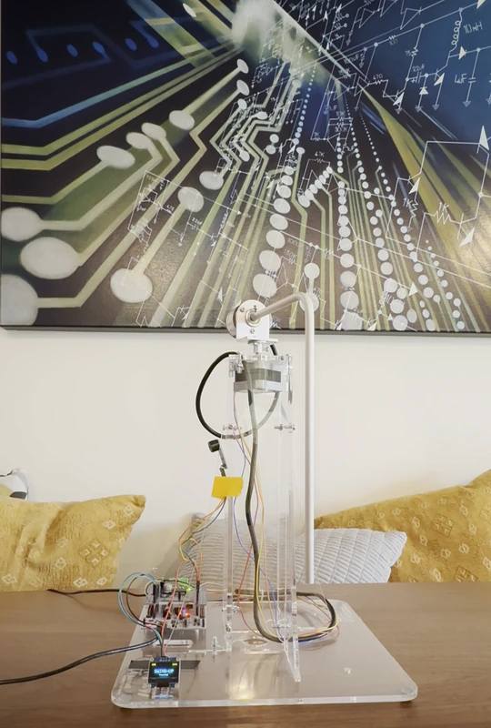
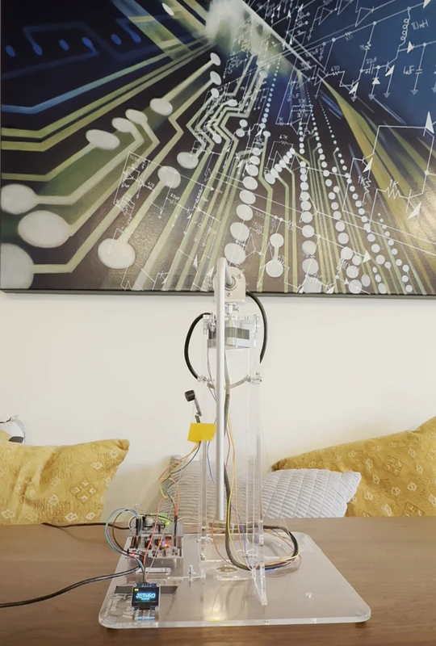
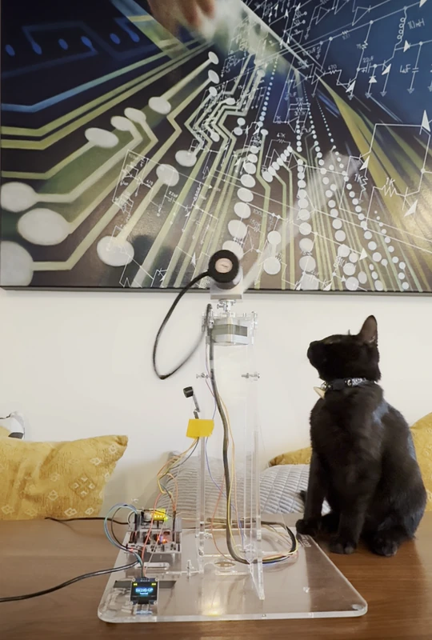
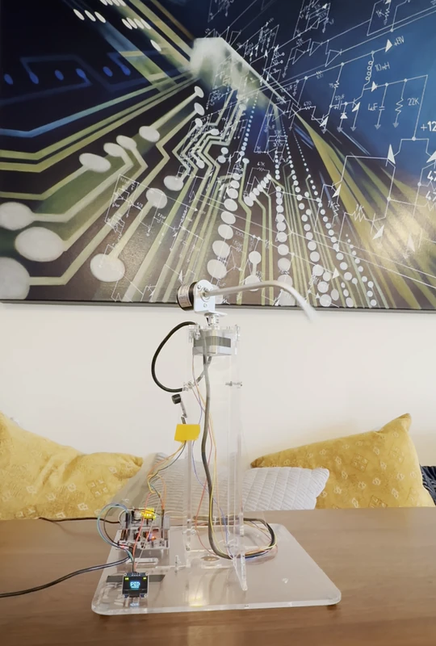
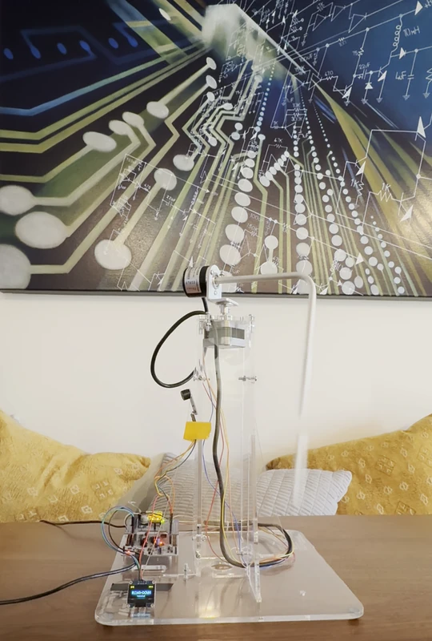
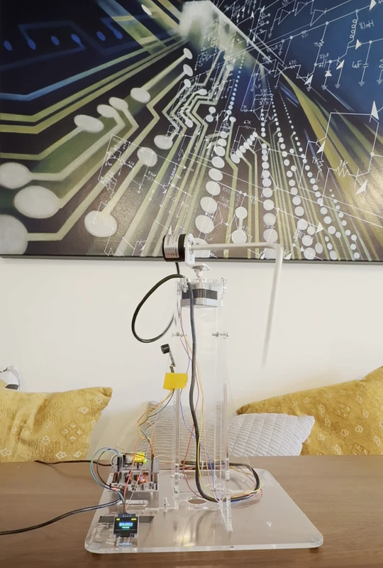

# Edukit Furuta Pendulum RL

A personal sandbox for learning sim-to-real reinforcement learning on a STEVAL-EDUKIT01 Furuta pendulum, with policies trained in NVIDIA Isaac Lab and run on its own microcontroller. Supervised, mostly, by my cat.

<table>
  <tr>
    <th width="33%">Fast Swing Up</th>
    <th width="33%">Gentle Swing Up</th>
    <th width="33%">Adversarial Swing Up</th>
  </tr>
  <tr>
    <td></td>
    <td></td>
    <td></td>
  </tr>
</table>

## Milestones

A showcase of the project's milestones. Each one is a mode in the board's final firmware, and I flip between them with the Nucleo's blue button.

<table>
  <tr>
    <th width="20%">PID<br><a href="docs/milestones/M3-hardware-bringup.md">Milestone 03</a></th>
    <th width="20%">Ring-down<br><a href="docs/milestones/M4-model-reconciliation.md">Milestone 04</a></th>
    <th width="20%">Balance<br><a href="docs/milestones/M5-balance.md">Milestone 05</a></th>
    <th width="20%">Swing-up<br><a href="docs/milestones/M6-swing-up.md">Milestone 06</a></th>
    <th width="20%">Jethro<br><a href="docs/milestones/M7-wrap-up.md">Milestone 07</a></th>
  </tr>
  <tr>
    <td></td>
    <td></td>
    <td></td>
    <td></td>
    <td></td>
  </tr>
</table>

## Documentation

Everything I wrote down along the way, from the plan and each experiment's results to the runbooks and the reasoning behind each decision.

- [Milestones](docs/milestones/README.md)
- [Experiments](docs/experiments/README.md)
- [Runbooks](docs/runbooks/README.md)
- [Design inputs](docs/design-inputs/README.md)
- [Detailed design](docs/design/README.md)
- [Bill of materials](docs/design-inputs/bom.md)
- [Decision records](docs/adrs/README.md)

## Reference documents

The Edukit Manual and the assembly guides are third-party copyrighted material and aren't committed. Fetch them with:

```bash
./scripts/fetch_reference_docs.sh
```

## Credits

The STEVAL-EDUKIT01 and its educational material are the work of STMicroelectronics and Prof. William J. Kaiser, UCLA Samueli School of Engineering. The Edukit Manual and the 14-chapter tutorial series are at <https://sites.google.com/view/ucla-st-motor-control/home>.
