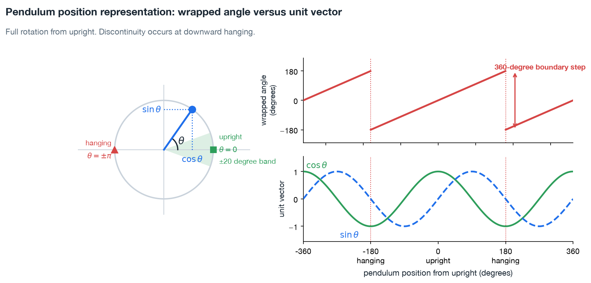
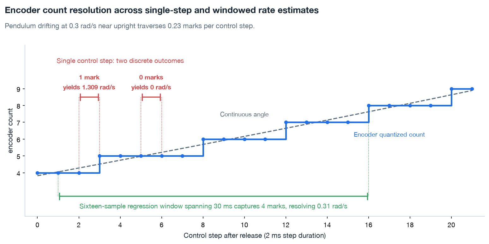

# ADR-0005: observation space

**Context:** two position sensors instrument the physical plant. An optical encoder at the pendulum pivot resolves shaft angle to 2400 counts per revolution. The stepper driver reports arm displacement as a running microstep total. No onboard sensor measures velocity.

The reinforcement learning policy trains in Python simulation and executes on microcontroller hardware. Consequently, [`board/observer.c`](../../board/observer.c) and [`src/furuta/env.py`](../../src/furuta/env.py) must produce identical observations. Discrepancies degrade sim-to-real transfer. Altering observation semantics later forces complete policy retraining, fresh artifact export, and firmware reflashing.

In the upright position, the pendulum diverges with a time constant of 136 ms, and rotor torque can arrest states satisfying $|\dot{\theta} + 7.351\theta| < 1.011\ \mathrm{rad/s}$. Velocity estimates must resolve well within the $1.011\ \mathrm{rad/s}$ boundary to distinguish recoverable from unrecoverable pendulum states. Rate estimation must also introduce minimal phase lag, preserving the narrow 136 ms stability budget.

## Options: pendulum position

| Option | Assessment |
|---|---|
| $[\cos\theta, \sin\theta]$ | Requires two network inputs across $[-1, 1]$, continuous throughout rotation. Periodic trigonometric calls `cosf` and `sinf` eliminate angle-wrapping logic in `observer.c`, matching simulation directly |
| Raw angle wrapped to $[-\pi, \pi]$ | Provides a single input with a sharp discontinuity at the wrap boundary. Placing the wrap point at downward hanging introduces an artificial step change directly across swing-up motion |
| Unwrapped angle | Maintains continuity across full revolutions. However, angle magnitude grows unbounded. Swing-up energy pumping across multiple revolutions produces input values outside training distributions |

*A single rotation from upright in trigonometric and wrapped representations. Wrapped angle steps 360 degrees at downward hanging.*

## Options: angular rate estimation

| Option | Assessment |
|---|---|
| Least-squares slope over 16 samples | Resolves 0.020 rad/s with 15 ms lag. On a uniform time grid, linear regression acts as a fixed finite-impulse-response filter. Microcontroller firmware evaluates a dot product against precomputed weights |
| Differencing two adjacent samples | A single encoder count across a single 2 ms control step equals 1.309 rad/s, exceeding the 1.011 rad/s modal stability limit. Control policies reacting to raw sample differences saturate the actuator on quantization noise |
| Longer sample windows | Velocity resolution and phase lag scale proportionally with window length. For instance, sixteen samples at a 100 Hz control rate produce 75 ms of phase lag against the 136 ms divergence time constant |
| Model-based state filter | A Kalman filter extracts velocity from encoder counts with minimal phase lag. However, state estimation demands embedding physical plant parameters inside firmware and synchronizing firmware matrices across simulation revisions |

*Near upright, the pendulum traverses 0.23 encoder marks per control step. Two-sample differencing registers zero marks or a full mark. Sample differencing therefore reports 0 or 1.309 rad/s rather than the true 0.30 rad/s velocity. A sixteen-sample window spans 30 ms and accumulates four marks, resolving 0.31 rad/s.*

## Options: rotor position

| Option | Assessment |
|---|---|
| Driver microstep count | Firmware already maintains a running step tally. The tally records commanded displacement, diverging from physical arm displacement whenever the stepper motor slips steps under heavy load |
| Absolute rotor encoder | Direct arm measurement eliminates cumulative position drift. However, the Edukit bill of materials omits a dedicated rotor encoder |

## Decision

The observation vector contains five elements: $[\cos\theta, \sin\theta, \dot{\theta}, \phi, \dot{\phi}]$. Variable $\theta$ defines pendulum angle relative to upright vertical balance where $\theta = 0$. Variable $\phi$ defines rotor angle relative to track center where $\phi = 0$.

Pendulum position enters the observation vector as a trigonometric unit vector $[\cos\theta, \sin\theta]$. Rotor position enters directly as a continuous scalar angle $\phi$, because hardware travel limits end training episodes well before the arm completes a full rotation.

The estimator derives angular velocities $\dot{\theta}$ and $\dot{\phi}$ using a 16-sample linear least-squares regression. Python simulation in [`src/furuta/estimator.py`](../../src/furuta/estimator.py) and microcontroller firmware function `slope_update` in [`board/observer.c`](../../board/observer.c) execute identical estimation routines. Setting window size to 2 reproduces two-point differencing. Therefore, the Python and C estimators share a single implementation parameterized by window depth.

The control pipeline applies no scaling or normalization to observation values. The neural network policy receives raw physical units in radians and radians per second, matching preceding definitions.

## Consequences

Five inputs cover four physical degrees of freedom. The additional redundant element provides trigonometric continuity across full 360-degree rotation and eliminates boundary wrapping logic from high-frequency control loops.

The unstable modal coordinate $\dot{\theta} + 7.351\theta$ dictates dynamic recoverability. While the observation vector omits direct modal values, inputs $\cos\theta$, $\sin\theta$, and $\dot{\theta}$ supply sufficient information for neural network layers to reconstruct the linear combination. Existing telemetry leaves unverified whether internal network layers assemble modal coordinates.

Rotor angle relies entirely on stepper driver pulse counts. No secondary sensor measures physical arm rotation. [Experiment 04](../experiments/04-model-reconciliation/writeup.md) identified stepper slip under load without establishing exact physical torque boundaries. The bench step-loss calibration ladder proposed in [ADR-0004](0004-two-actuator-paths.md) establishes physical torque limits. Prior to hardware ladder execution, cumulative drift between microstep counts and true arm displacement remains an unmeasured source of state error.

Reward functions omit the 15 ms filter group delay. At the 500 Hz control frequency, 15 ms of phase lag remains small alongside the 136 ms divergence time constant. In contrast, evaluating a 16-sample window at a 100 Hz control rate incurs 75 ms of delay. Estimator design therefore links window length directly to the target control loop rate.

[Milestone 05](../milestones/M5-balance.md) finalized the observation architecture when linear slope estimation replaced discrete differencing prior to policy export. Unit-vector pendulum encoding originated during initial prototype development. The preceding text synthesizes historical design choices directly from source code and git history.
