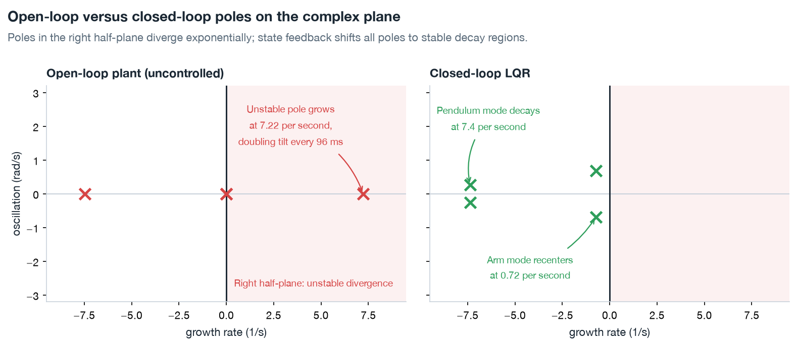
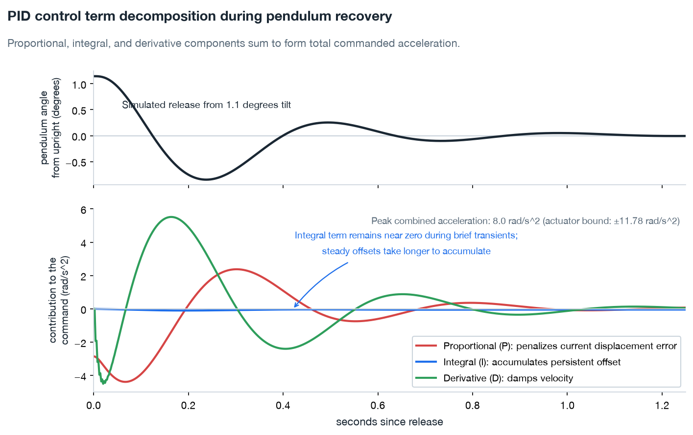
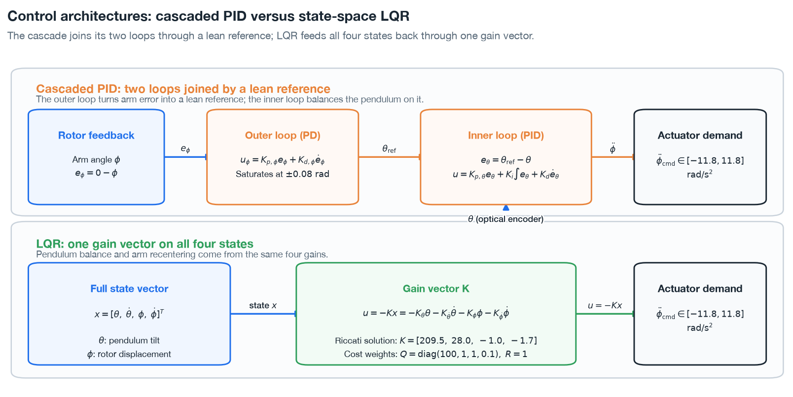
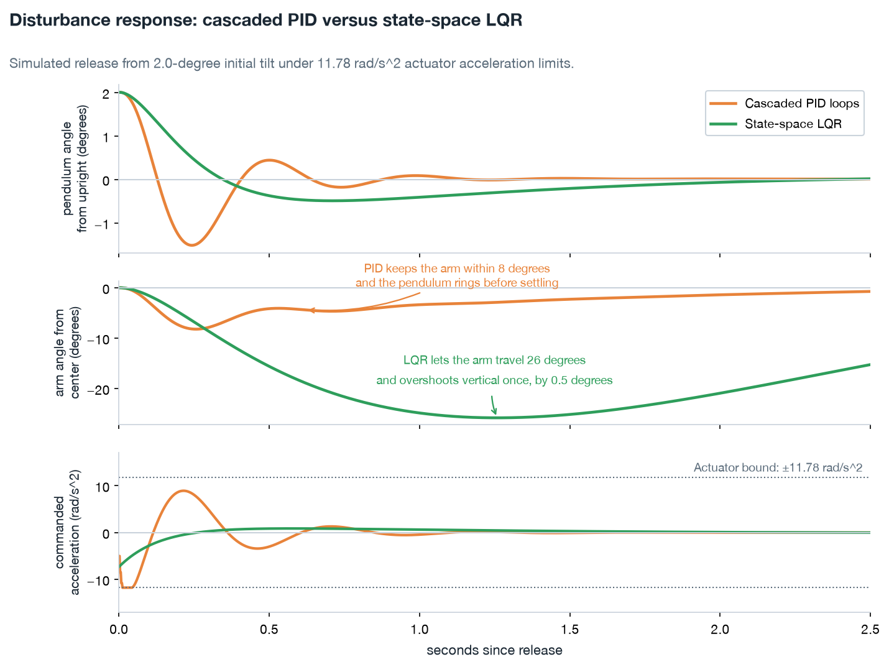

# PID and LQR on the rotary inverted pendulum

The ST STEVAL-EDUKIT01 platform implements a rotary inverted pendulum. A stepper motor turns a horizontal rotor arm, and a pendulum rod is fastened to the hub of an optical rotary encoder mounted at the end of that arm. The encoder's shaft is the pivot, so the part that lets the rod swing is the same part that measures its angle. Stabilization means holding the rod upright over that pivot while the arm turns underneath it.

The kit arrives with a working controller already on it. The supplied firmware balances the pendulum using two proportional-integral-derivative (PID) loops, and the kit manual walks through how they are tuned. The manual then derives a linear quadratic regulator (LQR) as the step beyond them, a state feedback controller that reads the whole machine at once rather than one angle per loop. Teaching that progression from PID to LQR is what the kit is built for. This document covers both, because they are the baselines any learned policy here is measured against.

## Why a control loop is required

A pendulum hanging down needs no help. Displace it and gravity pulls it back to vertical. Inverted, gravity works the other way: the further the rod leans, the harder it is pulled over, so a small lean grows into a fall.

Nothing on the machine corrects that by itself. The only thing that can hold the rod up is the arm moving underneath it, and it has to keep moving, because a correction that stops leaves the rod leaning again. A controller is what decides how to move the arm, step after step, for as long as the machine is running.

That decision needs a measurement to act on. Reading the state and feeding a command back to the motor is what closes the loop, and driving the motor without that feedback is open loop.

The loop also has a deadline. Left alone, a lean on this machine doubles every 96 milliseconds, so a controller slower than that loses ground on every correction.

Four numbers are available to decide from: the pendulum's angle from vertical $\theta$, its angular velocity $\dot{\theta}$, the arm's angle from center $\phi$, and the arm's angular velocity $\dot{\phi}$. Only $\theta$ is measured, by the encoder. $\dot{\theta}$ is estimated from the encoder's counts, and $\phi$ and $\dot{\phi}$ come from counting the steps sent to the motor.

Stability is conventionally read off the poles of those dynamics. Each pole is one mode of the machine, and its horizontal position is a growth rate. Left of the vertical axis a mode dies away, right of it a mode grows, and distance from the axis sets how fast either happens. Stabilizing the machine means closing a loop that puts every pole on the left.

*Left, the machine alone. The fall is the pole at $+7.22\text{ s}^{-1}$, its stable counterpart sits at $-7.48\text{ s}^{-1}$, and the arm adds a double pole at the origin because its angle is the double integral of the commanded acceleration. Right, under LQR, all four poles sit on the left.*

## Actuator command constraints

The motor is a NEMA-17 stepper. The firmware runs the control loop every 2 ms (500 Hz) and turns each acceleration command into a step pulse train. The interface accepts acceleration rather than torque, and nothing measures torque.

The supplied firmware drives the motor two ways. Swing-up kicks are position moves through the stepper driver's speed profile. That profile ramps at $11.78\text{ rad/s}^2$. Balance commands bypass that profile and are integrated directly into step timing. The balance path's physical limit is unmeasured, and [ADR-0004](../adrs/0004-two-actuator-paths.md) keeps $11.78\text{ rad/s}^2$ as its provisional bound. In the simulations on this page, controllers output an acceleration command $\ddot{\phi}_{\mathrm{cmd}} \in [-11.78, 11.78]\text{ rad/s}^2$ every 2 ms. The supplied balance loop itself exceeds that bound. In a steady hold its 99th-percentile command is $15\text{ rad/s}^2$. Saturation on this page is against that convention, and the motor's own limit is unknown.

## PID

PID acts on the error $e(t) = r(t) - y(t)$ between a setpoint $r$ and a measured angle $y$:

$$u(t) = K_p e(t) + K_i \int_0^t e(\tau) \, d\tau + K_d \frac{de(t)}{dt}$$

- **Proportional, $K_p e$**: pushes back in proportion to the current error. On its own it leaves an offset or rings.
- **Integral, $K_i \int e \, dt$**: accumulates the error over time and removes a steady offset, such as one from friction or a base that is not level.
- **Derivative, $K_d \frac{de}{dt}$**: acts on how fast the error is changing. It damps the motion and adds phase lead.

The figure splits a pendulum PID into its three terms, during one simulated recovery from a 1.1-degree tilt. Its error is $\theta_{\mathrm{ref}} - \theta$, where $\theta_{\mathrm{ref}}$ is a small lean set by a second loop on the arm ([Two loops for one input](#two-loops-for-one-input)).

*The derivative term is the largest through most of the recovery and peaks at $5.5\text{ rad/s}^2$. The proportional term peaks at $4.4\text{ rad/s}^2$, and the integral term stays below $0.11\text{ rad/s}^2$. The PID gains here were tuned on the linear model for this illustration. The supplied firmware uses its own.*

### Two loops for one input

The machine is underactuated. It has two angles, $\theta$ and $\phi$, and one input, $\ddot{\phi}_{\mathrm{cmd}}$. Because the pendulum can stand upright at any arm angle, a single PID loop on $\theta$ holds the pendulum upright while the arm drifts away without limit.

The supplied firmware adds a second PID, on the arm's error $e_\phi = \phi_{\mathrm{ref}} - \phi$, where $\phi_{\mathrm{ref}}$ is the arm's reference. The boot menu offers several reference signals. The builds that logged the supplied balance loop skip the menu and keep the firmware's compiled-in default. In their 5 s holds that default is a single $20^\circ$ step of the reference as balance begins. The pendulum PID and the arm PID each produce a rotor command, and the firmware sums the two into $\ddot{\phi}_{\mathrm{cmd}}$. Manual Sec. 12 designs this pair as an inner loop, the pendulum PID closed around the machine, inside an outer loop that adds the arm PID's output to the pendulum PID's command.

The figures on this page use a cascade instead, in which the arm loop sets the pendulum loop's reference rather than adding to the command:
1. **Outer loop, on the arm**: a PD on $e_\phi$, with $\phi_{\mathrm{ref}}$ at center, computes a lean reference $\theta_{\mathrm{ref}}$ for the pendulum.
2. **Inner loop, on the pendulum**: a PID on $e_\theta = \theta_{\mathrm{ref}} - \theta$ computes the commanded acceleration $\ddot{\phi}_{\mathrm{cmd}}$.

To return the arm toward center, the cascade's outer loop asks the pendulum to lean slightly toward center. The inner loop accelerates the arm to catch the leaning pendulum.

Each loop sees only its own angle error, and the lean reference $\theta_{\mathrm{ref}}$ is the only link between them.

## LQR

LQR feeds all four states back through one gain vector:

$$u = -K x, \qquad x = [\theta, \dot{\theta}, \phi, \dot{\phi}]^T$$

The gain vector $K = [K_\theta, K_{\dot{\theta}}, K_\phi, K_{\dot{\phi}}]$ comes from solving the continuous-time algebraic Riccati equation, and it minimizes an infinite-horizon quadratic cost:

$$J = \int_0^\infty \left( x(t)^T Q x(t) + R u(t)^2 \right) dt$$

The diagonal matrix $Q = \mathrm{diag}(q_\theta, q_{\dot{\theta}}, q_\phi, q_{\dot{\phi}})$ charges for state error, and the scalar $R$ charges for commanded acceleration. The weights used here:

| State variable | Weight $Q_{ii}$ | Purpose |
|---|---|---|
| Pendulum angle $\theta$ | $100$ | Charges tilt |
| Pendulum velocity $\dot{\theta}$ | $1.0$ | Damps the pendulum's swing |
| Arm angle $\phi$ | $1.0$ | Returns the arm toward center |
| Arm velocity $\dot{\phi}$ | $0.1$ | Leaves the arm free to move fast during a recovery |

Solving against the linearized model in [`figures/_control.py`](figures/_control.py) with $Q = \mathrm{diag}(100, 1, 1, 0.1)$ and $R = 1.0$ gives:

$$K = [209.5,\; 28.0,\; -1.0,\; -1.7]$$

The pendulum gains come mostly from the physics. Solving again with the tilt weight at 1 instead of 100 changes $K_\theta$ by less than 0.3 percent. Stabilizing the machine at all means pulling the unstable pole into the left half-plane, and that requirement sets the pendulum gains.

The arm gains, $-1.0$ and $-1.7$, are small and negative. With $u = -Kx$, the arm-angle term on its own pushes the arm further from center. That leans the pendulum back toward the arm's center position, and the large pendulum gains then carry the arm back under it. The cascaded PID's outer loop makes the same move.

The pendulum poles land at $-7.4\text{ s}^{-1}$, near $-7.22$, the unstable pole reflected across the imaginary axis. The arm poles land at $-0.72\text{ s}^{-1}$, ten times slower than the pendulum poles. Recentering the arm at that pace does not upset the pendulum.

### PID versus LQR

The block diagram sets the two structures side by side. The cascade links its loops only through the lean reference, and LQR maps all four states to the command through one gain vector.

*The outer loop saturates the lean reference at 0.08 rad, and the encoder's angle feeds the inner loop.*

| Feature | Cascaded PID | LQR |
|---|---|---|
| Acts on | The errors $e_\phi$ and $e_\theta$, one loop each | All four states $x$ |
| Structure | Two nested single-input single-output loops | One state feedback, $u = -K x$ |
| Model used | The same linearized model, tuned one loop at a time. Manual Sec. 12 designs the firmware's summed pair on a frequency-response model | The linearized state-space matrices $A$ and $B$ |
| Tuning | Adjusting $K_p$, $K_i$, and $K_d$ loop by loop | Choosing $Q$ and $R$, then solving the Riccati equation |
| Coupling between loops | Only through the lean reference | Chosen jointly in one solve |

## Disturbance response comparison

A simulated release from a 2.0-degree tilt runs both controllers on the same linear model under the $11.78\text{ rad/s}^2$ bound.

*Disturbance recovery under an $11.78\text{ rad/s}^2$ bound. Cascaded PID saturates the actuator and crosses vertical three times before settling. LQR crosses once, by half a degree, and never saturates. The PID gains are the same illustrative set as in the first PID figure.*

- **Overshoot and saturation**: LQR crosses vertical once and dips half a degree past it. That dip is the lean that brings the arm back. LQR's command peaks at $7.33\text{ rad/s}^2$ at release and never reaches the bound. PID overshoots vertical by $1.5^\circ$ and saturates the $11.78\text{ rad/s}^2$ bound within the first 100 milliseconds. PID's dip is the same lean-to-return move. Its outer loop asks for a lean of $2.2^\circ$ within 0.12 s, and the pendulum follows it to $1.5^\circ$ past vertical.
- **Arm travel**: LQR lets the arm travel $25.8^\circ$ to decelerate the pendulum smoothly. PID keeps the arm within $8.2^\circ$, and the pendulum crosses vertical three times before settling inside $0.1^\circ$ at 0.82 s. With $q_\phi = R = 1$, a radian of arm error costs as much as a rad/s² of command, and LQR spends arm travel to keep its command low. Raising $q_\phi$ to 10 cuts the travel to $16.6^\circ$.

## Limits of the classical controllers on this machine

1. **A narrow region of validity**: the linear model assumes $\sin\theta \approx \theta$ and $\cos\theta \approx 1$. That holds near upright and fails as the pendulum falls toward hanging. A linear controller cannot swing the pendulum up from rest. The supplied firmware swings it up with a separate routine of timed stepper pulses, triggered by the encoder's zero crossings, and hands over to the balance controller when the pendulum comes within $1.0^\circ$ of upright.
2. **Handover without a rate check**: the supplied firmware hands over on the angle alone, $|\theta| \le 1.0^\circ$, whatever the rate at arrival. The combination $\dot{\theta} + 7.351\theta$ is the unstable mode, the part of the motion that grows at the fall rate. The 7.351 is the pendulum's natural frequency with its small damping left out, and the damped pole is the 7.22 above. An $11.78\text{ rad/s}^2$ bound can arrest the mode only below 1.011 rad/s, the [recovery ceiling](rl-environment.md#where-the-limits-come-from). Bench swing-ups in [Experiment 05](../experiments/05-balance/writeup.md) arrive at a median $2.33\text{ rad/s}$, well above it. A controller held to that bound cannot catch those arrivals.
3. **An unmeasured actuator limit**: the balance path clamps commands in software at $257.4\text{ rad/s}^2$, and the stepper's physical limit on that path has not been measured ([ADR-0004](../adrs/0004-two-actuator-paths.md)). Bench telemetry from the supplied firmware's balance routine records commands of $43$ to $58\text{ rad/s}^2$ in 50 ms windows over the first 300 ms, and $15\text{ rad/s}^2$ at the 99th percentile during a steady hold. The early peaks come from the arm's PID loop starting up and the $20^\circ$ step in the arm's reference. The arm carries no encoder, and a step lost to an excessive command goes unseen.

## Role of classical baselines in reinforcement learning

- **PID is the baseline the kit ships with**: the supplied firmware's PID loops are the starting point for hardware validation.
- **LQR is the linear benchmark**: it is derived from the constants in [`config/edukit.yaml`](../../config/edukit.yaml) and solved in [`scripts/scripted_swingup.py`](../../scripts/scripted_swingup.py). In [Experiment 05](../experiments/05-balance/writeup.md), a scripted swing-up that pumps energy into the rod at $15\text{ rad/s}^2$ brought it within $20^\circ$ of upright, where control handed over, in 236 simulated episodes. Held to $11.78\text{ rad/s}^2$, a reinforcement learning policy caught 166 and LQR caught 168.
- **A learned policy covers what a linear controller cannot**: it acts over the full angular range, and one network can both swing the pendulum up and balance it.
