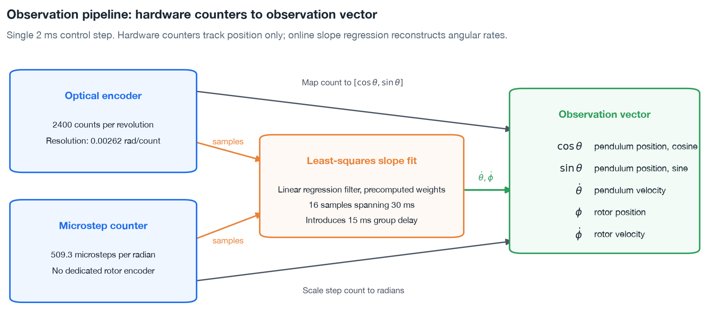
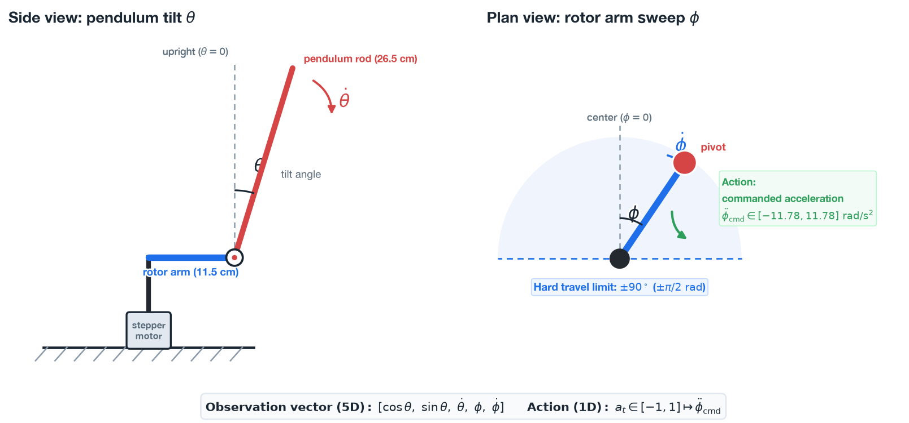

# Reinforcement learning environment

Simulation environments establish the training interface for the ST and UCLA STEVAL-EDUKIT01 rotary inverted pendulum. Isaac Lab hosts environment dynamics as a `DirectRLEnv` in [`src/furuta/env.py`](../../src/furuta/env.py), implementing task variants in [`src/furuta/tasks.py`](../../src/furuta/tasks.py). Physical constants load dynamically from [`config/edukit.yaml`](../../config/edukit.yaml).

Dynamic boundaries originate directly from the physical relationships documented in [Where the limits come from](#where-the-limits-come-from).

## Observation vector

At 500 Hz control updates, policy execution consumes five observation values providing complete state feedback for stabilization.

| Component | Dimension | Units | Sensor source | Processing and resolution |
|---|---|---|---|---|
| Pendulum position | 2 | unit vector | Optical encoder | 2400 counts per revolution, $0.00262\text{ rad}$ per count, entering the vector as $[\cos\theta, \sin\theta]$, cosine first |
| Pendulum velocity | 1 | rad/s | Encoder slope regression | Online least-squares fit across 16 past samples, spanning $30\text{ ms}$ |
| Rotor position | 1 | rad | Microstep counter | Relative displacement from center, calibrated to $509.3\text{ microsteps per radian}$ |
| Rotor velocity | 1 | rad/s | Microstep slope regression | Online least-squares fit across 16 past microstep sample increments |



*Hardware counters report positions only. Linear slope regression reconstructs angular rates from counter history buffers.*

Observation vector design incorporates specific architectural decisions detailed in [ADR-0005](../adrs/0005-observation-space.md):

- **Trigonometric unit vector for pendulum position.** Cosine and sine terms remain continuous through downward hanging, avoiding artificial 360-degree boundary steps.
- **Linear regression for angular rates.** A 16-sample least-squares slope estimator resolves 0.020 rad/s with 15 ms of phase lag, outperforming two-sample differencing quantization noise of $1.309\text{ rad/s}$. Python simulation in [`src/furuta/estimator.py`](../../src/furuta/estimator.py) and microcontroller firmware function `slope_update` in [`board/observer.c`](../../board/observer.c) execute identical calculations.
- **Driver microstep tally for rotor position.** The physical assembly lacks an absolute rotor encoder, meaning arm displacement reflects commanded step totals. Step slip under torque load introduces drift between commanded microsteps and true physical angle, highlighting an open modeling discrepancy identified in [Experiment 04](../experiments/04-model-reconciliation/writeup.md).



*Coordinate conventions defining state observations and control action.*

## Action

A single continuous action drives the system: rotor angular acceleration, normalized to $[-1, 1]$ and scaled to the nominal $11.78\text{ rad/s}^2$ limit. [ADR-0004](../adrs/0004-two-actuator-paths.md) documents why the environment commands acceleration rather than torque. The $11.78\text{ rad/s}^2$ limit represents the firmware ramp generator profile rather than a measured motor torque ceiling.

Simulation executes policy updates at 500 Hz with a 2 ms control period while stepping PhysX dynamics at 1000 Hz, applying commanded accelerations across two physics substeps. The swing-up task keeps that default in code but trains and is scored at 4 kHz, eight substeps, passed as `--physics-hz 4000`; 1 kHz on the walked target is untested. The `AccelerationCommandActuator` class integrates commanded acceleration into microstep-quantized position targets matching the command interface of the hardware stepper driver. Each substep's drive target is walked from the previous period's target to the current one, with the commanded velocity fed forward ([ADR-0006](../adrs/0006-walked-rotor-target.md)).

## Termination boundaries

Episodes end upon violating safety boundaries or upon reaching elapsed time limits.

| Safety boundary | Threshold | Design rationale |
|---|---|---|
| Pendulum position | $|\theta| > 20^\circ$ from upright | Extends beyond the 7.83-degree static arrest angle to permit dynamic recovery maneuvers while halting unrecoverable falls |
| Rotor position | $|\phi| > 90^\circ$ from center | Prevents mechanical binding and strain across the physical optical encoder wiring harness |

Training episodes enforce a 10.0-second duration limit, whereas the gate scores deterministic performance over 30.0 seconds.

## Reset distributions

A reset samples four coordinates uniformly and independently.

| State coordinate | Sampling interval | Physical span |
|---|---|---|
| Pendulum position $\theta$ | $\pm 0.035\text{ rad}$ | $\pm 2.0\text{ deg}$ about upright |
| Pendulum velocity $\dot{\theta}$ | $\pm 0.25\text{ rad/s}$ | Low-velocity initial motion |
| Rotor position $\phi$ | $\pm 0.5\text{ rad}$ | $\pm 28.6\text{ deg}$ displacement from center |
| Rotor velocity $\dot{\phi}$ | $\pm 0.5\text{ rad/s}$ | Low-velocity initial rotor rate |

At maximum displacement, the specified distribution produces an initial unstable modal coordinate of $7.351 \times 0.035 + 0.25 = 0.507\text{ rad/s}$, roughly half the 1.011 rad/s actuator recovery ceiling. Consequently, sampled states remain analytically recoverable while demanding non-trivial stabilization torque.

Balance training initializes states near upright vertical alignment to match benchmark evaluation criteria. In contrast, momentum balance tasks sample across the entire theoretical recovery envelope, exposing policies to diverse catching conditions encountered during swing-up handovers.

## Reward formulation

Step rewards sum the terms listed in the following table. Configuration weights map to `FurutaEnvCfg` attributes in [`src/furuta/env.py`](../../src/furuta/env.py), while `config/edukit.yaml` supplies physical constants. Balance tasks fix seven additional reward components at zero weight, activating components during swing-up experiments: energy, capture, pump power, swing rate, travel governor, rotor rate, and action excess.

| Term | Mathematical formulation | Scale weight | Operational rationale |
|---|---|---|---|
| Alive | $1.0$ | $+1.0$ | Constant reward per step to incentivize maintaining states within safety boundaries |
| Upright | $1 - (\theta / \theta_{\max})^2$ | $+1.0$ | Quadratic tilt penalty across the 20-degree span, flat within a $0.325^\circ$ stiction deadband |
| Termination | $-2.0$ | $-2.0$ | Penalty assessed upon breaching tilt or travel safety boundaries |
| Rotor travel | $\max(0, |\phi| - \phi_{\text{dead}})$ | $-0.05$ | Linear penalty on excursion beyond a $0.35\text{ rad}$ center deadband |
| Action | $-a^2$ | $-0.01$ | Quadratic penalty on commanded acceleration magnitude |
| Action rate | $-(\Delta a)^2$ | $-0.01$ | Quadratic penalty on step-to-step action differences to discourage high-frequency chatter |
| Pendulum rate | $-\dot{\theta}^2$ | $-0.005$ | Quadratic penalty on pendulum angular velocity to encourage still balance |

The upright balance term employs a quadratic formulation rather than cartpole cosine functions $\cos\theta$. Empirical data in [Experiment 05](../experiments/05-balance/writeup.md) eliminated trigonometric formulations based on catch robustness.

Reward deadbands prevent optimization penalties on precision unachievable on physical hardware.

- **Upright deadband**: flattens within $0.325^\circ$, matching half of the $0.65^\circ$ Coulomb friction loss per half-swing identified in [Experiment 04](../experiments/04-model-reconciliation/writeup.md). Pivot stiction holds the pendulum stationary within the deadband region, generating zero optical encoder pulses.
- **Rotor travel deadband**: provides $0.35\text{ rad}$, or 20 degrees, of unpenalized travel. The threshold originally targeted a firmware step-rate limit absent from production hardware. The margin permits minor positional drift before penalizing actuator movement, as observed during seed 2 evaluations in [Experiment 05](../experiments/05-balance/writeup.md).

The baseline action-rate penalty weight of $-0.01$ permits excessive actuator chatter on hardware, where control commands reverse 12 to 30 times per second. Parameter sweeps in [Experiment 05](../experiments/05-balance/writeup.md) revealed a weight of $-0.5$ reduces steady-state chatter tenfold without degrading catch success, whereas a weight of $-3.0$ drops catch rates to 11 percent. Production configurations retain $-0.01$ pending formal reward schedule updates.

## Task variants

Tasks defined in [`src/furuta/tasks.py`](../../src/furuta/tasks.py) adapt environment configuration parameters for specific experimental phases:

| Task identifier | Configuration differences | Operational role |
|---|---|---|
| `Furuta-Balance-Direct-v0` | Baseline balance task configured with nominal limits | Primary balance policy training |
| `Furuta-Balance-Direct-Play-v0` | Deterministic mean action with zero exploration noise | Milestone gate evaluation and disturbance testing |
| `Furuta-Balance-Momentum-Direct-v0` | Resets across the recoverable set alongside a $\pi$ travel limit | Swing-up handover catch training |
| `Furuta-SwingUp-Direct-v0` | Hanging, near-vertical and full-circle resets, cosine upright, energy and capture rewards, `tanh` on the command, $\pi$ travel limit, and omitted tilt termination | Swing-up policy training |
| `Furuta-SwingUp-Direct-Play-v0` | Hanging start, $\pi$ travel limit, and omitted tilt termination | Milestone gate evaluation, and scripted and firmware swing-up evaluation |

## Where the limits come from

Physical boundaries stem from two mechanical realities: open-loop instability at the upright equilibrium, and finite stepper acceleration authority.

Every value below is computed from the constants in `config/edukit.yaml` rather than measured directly. The geometry and inertia behind $\omega_g$ were measured on the bench; $a_{\max}$ was read from firmware source, so the three quantities derived from it carry that same status.

| Parameter | Value | Definition | Physical role |
|---|---|---|---|
| Inverted natural frequency $\omega_g$ | 7.351 rad/s | $\sqrt{m g \ell / 2 J_{\text{pivot}}}$, gravity torque per radian over pivot inertia. The measured constants give $\omega_g^2 = 54.04$ against the manual's nominal 55.85 | Sets the divergence time constant, $\tau = 136\text{ ms}$ |
| Linear unstable mode | $\dot{\theta} + 7.351\theta$ | Linearized unstable eigenvector | State combinations diverging exponentially without control torque |
| Acceleration ceiling $a_{\max}$ | 11.78 rad/s^2 | `MAX_ACCEL` read from the supplied firmware source, not a measured motor property | Bounds maximum rotor acceleration authority |
| Static arrest angle $\theta_{\text{arrest}}$ | 7.83 deg | $\arctan(r a_{\max} / g)$, from the arm radius measured 2026-08-24 and the firmware's $a_{\max}$, both in `config/edukit.yaml` | Largest tilt the motor can hold statically. Derived, never measured on the bench |
| Dynamic recovery ceiling | 1.011 rad/s | Maximum recoverable modal velocity | Analytical boundary of recoverable state trajectories |

The recoverable set establishes the theoretical boundary of control authority:

```math
|\dot{\theta} + 7.351\theta| < 1.011\ \mathrm{rad/s}
```

The recovery ceiling derives from the configured acceleration bound and the rotor moment arm. The acceleration bound corresponds to the ST L6474 driver speed ramp profile utilized during swing-up kicks. In contrast, the continuous acceleration path commanded by balance policies lacks empirical torque boundary measurements. Consequently, [ADR-0004](../adrs/0004-two-actuator-paths.md) retains $11.78\text{ rad/s}^2$ as a provisional nominal baseline. Numerical thresholds computed from the baseline represent simulation modeling conventions rather than definitive hardware limits. Inside simulation, the ceiling governs validity criteria for reset distributions and defines disturbance benchmark intensities.
