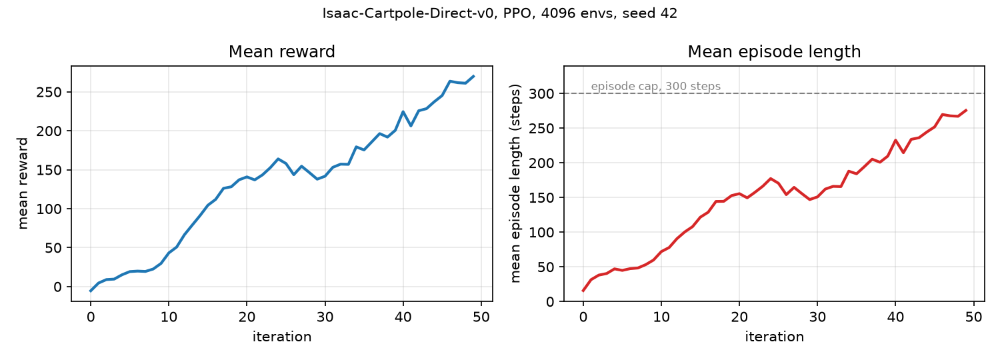
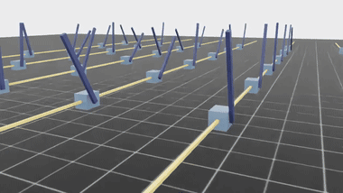
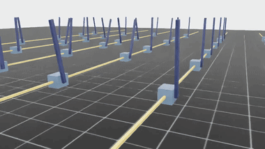

# Experiment 01: Isaac Lab bring-up

## Goal

Per [Milestone 01](../../milestones/M1-isaac-lab-bringup.md), the goal is to get Isaac Lab running on a training host and confirm the built-in cartpole simulation trains, before writing any code for the project.

## Setup

The training host was set up following [Training host setup](../../runbooks/training-host-setup.md). Commands that run there assume the working directory is the IsaacLab folder it creates. Not all of the commands run there, though. The learning-curve figure is regenerated locally, from the experiment folder, and the SSH tunnel for watching a run live is opened there too.

## The work

### Driving the training host over SSH

The original plan was to train on a home Linux server, but its GPU lacked the hardware ray-tracing cores Isaac Sim requires, ruling it out regardless of driver or memory ([ADR-0002](../../adrs/0002-training-host.md) has the full story). A Windows machine with a newer GPU was the fallback, reachable only over SSH.

The SSH connection was checked by whether the simulation, driven over it, printed `Using device: cuda:0` and claimed GPU memory.

```powershell
..\.venv\Scripts\python.exe scripts\tutorials\00_sim\create_empty.py --headless
```

Running it confirmed Isaac Sim creates a D3D12 device and runs physics on `cuda:0`.

### Training the stock cartpole end to end

The end-to-end test runs Isaac Lab's built-in Cartpole task, the closest match to the Furuta pendulum project and one that comes with a working configuration.

Training ran for 50 iterations at 4096 environments. The full configuration can be found in [config.yaml](./config.yaml).

```powershell
# command to run the stock cartpole training
..\.venv\Scripts\python.exe scripts\reinforcement_learning\rsl_rl\train.py --task=Isaac-Cartpole-Direct-v0 --headless --max_iterations 50
```

Training was watched from the local workstation via TensorBoard, following [Training host setup](../../runbooks/training-host-setup.md#watch-a-run-from-the-workstation).

| Metric | Value |
|---|---|
| Mean reward, iteration 0 | -5.40 |
| Mean reward, iteration 49 | 269.81 |
| Mean episode length, iteration 49 | 275.5 of 300 steps (92%) |
| Throughput at 4096 environments | 238,000 steps/s |
| Wall clock, 50 iterations | about 13 s |
| Seeds | 1 (preliminary) |
| Total environment steps | 3.28 M |

Reward and episode length are both still rising at iteration 49, cut off by the `--max_iterations 50` limit before either leveled off, showing the policy learned. Episode length rises with training as the cartpole balances the pole for longer.



*Mean reward (left) and mean episode length (right) per training iteration, 4096 environments, one seed. The dashed line is the 300-step episode cap.*

| Iteration 0 | Iteration 49 |
|---|---|
|  |  |

*One full 5-second episode, 36 of the 4096 environments. Left is the checkpoint at iteration 0, right at iteration 49.*

### Measuring throughput against environment count

Running many simulations at once is the primary reason to use a GPU-based simulator, so the sweep below measures how much it helps.

The sweep runs 50 iterations at 64, 512 and 4096 parallel environments, with nothing else changed between runs. Isaac Lab prints a steps-per-second figure every iteration, and the median of the last ten is the number reported.

| Environments | Throughput (steps/s) | Relative to 64 envs | Per environment (steps/s) | Iteration time |
|---|---|---|---|---|
| 64 | 3,640 | 1.0x | 56.9 | 0.27 s |
| 512 | 28,924 | 7.9x | 56.5 | 0.27 s |
| 4096 | 238,190 | 65.4x | 58.2 | 0.27 s |

Multiplying the environment count by 64 multiplied the sample rate by 65. Per-environment throughput holds at about 57 steps/s and iteration time never moves off 0.27 seconds, so the per-iteration cost does not scale with batch width.

## Takeaway

Isaac Lab runs and trains on the training host. The stack trains a stock cartpole to 92 percent of the episode cap in about 13 seconds on an RTX 5080, driven headless over SSH from a workstation with no GPU, with the trained and untrained rollouts recorded side by side.

Throughput is linear out to 4096 environments because iteration time stays at 0.27 seconds regardless of width, so at the scale this project needs the marginal cost of an environment is near zero.

## References

- [ADR-0001](../../adrs/0001-simulation-environment.md), why Isaac Lab was chosen as the simulator.
- [ADR-0002](../../adrs/0002-training-host.md), why training runs on a separate RT-core host driven over SSH.
- [Training host runbook](../../runbooks/training-host-setup.md), the install and its defect catalogue.
- [Isaac Sim system requirements](https://docs.isaacsim.omniverse.nvidia.com/latest/installation/requirements.html), the RT core rule and the stated GPU minimum.
- [Isaac Lab pip installation](https://isaac-sim.github.io/IsaacLab/main/source/setup/installation/pip_installation.html), the published procedure this experiment corrects.
