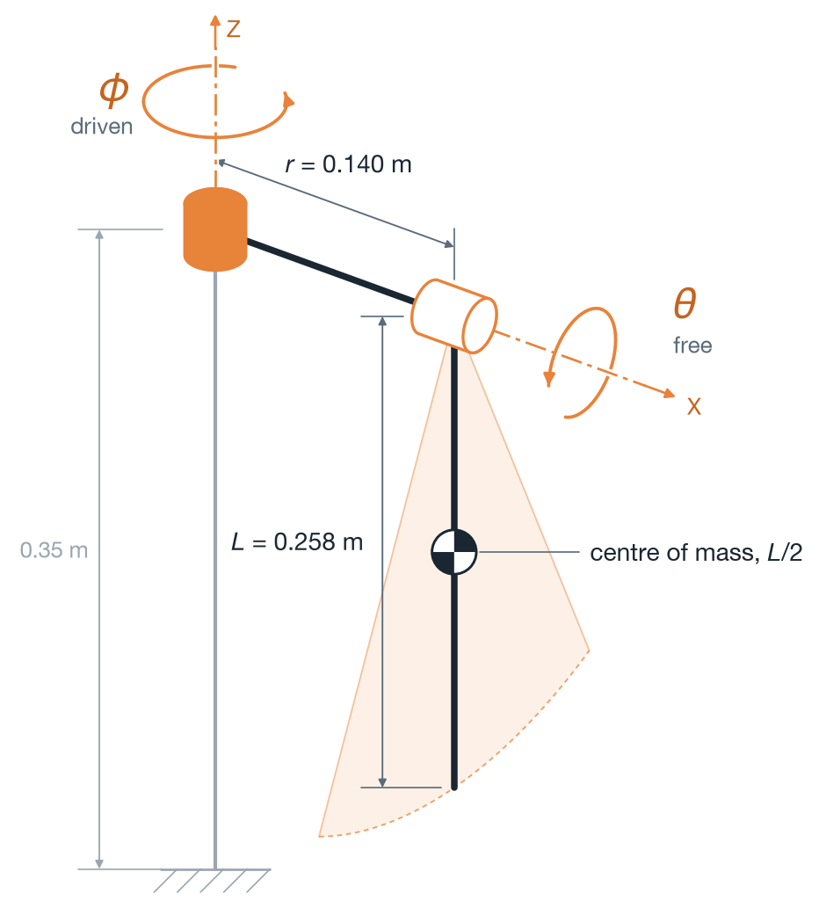
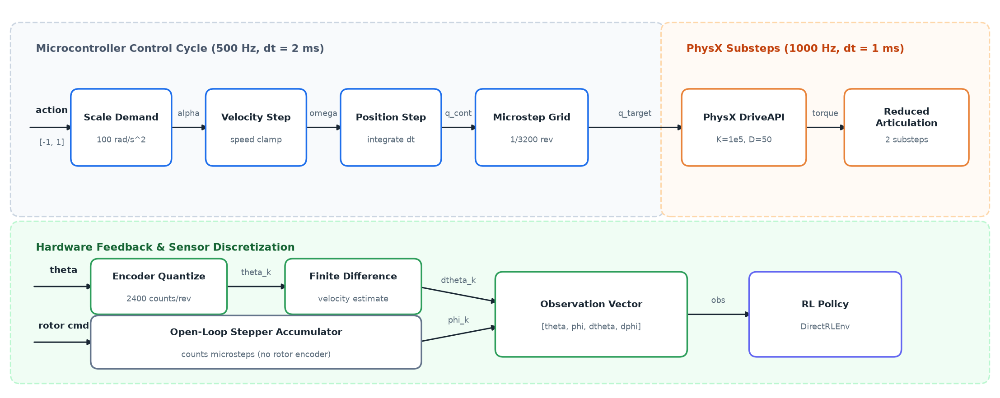
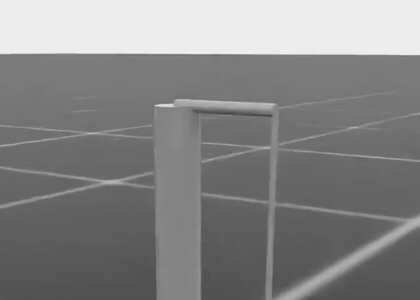
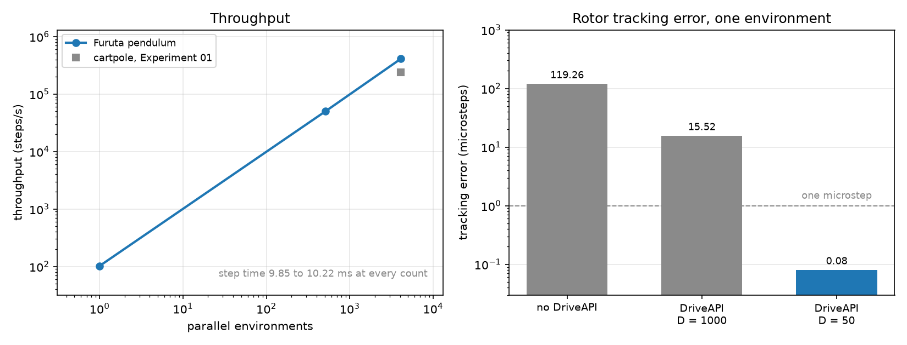

# Experiment 02: Furuta environment

## Goal

Per [Milestone 02](../../milestones/M2-furuta-model.md), the objective is building the Furuta pendulum simulation model within Isaac Lab. Preceding work in [Experiment 01](../01-cartpole-bringup/writeup.md) validated the toolchain on a cartpole. Work here replaces the cartpole continuous torque joint with the Edukit acceleration-commanded stepper actuator and measures throughput scaling across parallel environment counts.

## Setup

Training host setup followed [Training host setup](../../runbooks/training-host-setup.md), utilizing an RTX 5080 with 16 GB video memory on driver 591.86. Remote commands run from the repository clone adjacent to the IsaacLab folder. Unit tests execute locally from the repository root, while plotting scripts regenerate figures from the experiment folder.

## The work

### Building the articulation

The simulation model is an articulation, a tree of rigid bodies connected by joints that PhysX solves as a single coupled system. Generator script [`src/furuta/articulation.py`](../../../src/furuta/articulation.py) constructs the model as an asset in Universal Scene Description (USD) format. Universal Scene Description, created by Pixar and adopted as the native asset framework across NVIDIA Omniverse and Isaac Sim, provides an extensible system for defining hierarchical 3D scenes alongside physical properties and joint schemas. Generating the model programmatically as a USD asset embeds geometry, mass distributions, and drive constraints directly from configuration parameters, avoiding manual 3D modeling.

PhysX can simulate jointed assemblies in maximal or reduced coordinates. In maximal coordinates, each body has six degrees of freedom, and constraint projections pull joints together on each step. In reduced coordinates, PhysX tracks only joint angles, preventing joint separation under high accelerations. The Furuta model uses reduced coordinates.

The mechanical assembly comprises three bodies:
- Base: fixed to the world frame.
- Rotor arm: turned by the stepper motor about vertical axis `Z`.
- Pendulum: hanging from the arm tip on a passive joint about horizontal axis `X`.

The pendulum swings in a vertical plane that rotates alongside the arm.



*Modeled geometry generated from parameter specifications by [model_spec.py](./figures/model_spec.py). Arm radius `r` and pendulum length `L` enter the equations of motion. Arm height provides floor clearance without altering dynamic equations. Cylinder radius provides visualization, while inertia derives from physical equations.*

Configuration file [config.yaml](./config.yaml) pins the physical constants used across this experiment:

| Symbol | Quantity | Value | Source |
|---|---|---|---|
| `L` | pendulum length | 0.258 m | Manual Appendix D, Pendulum Dynamics, page 148 |
| `r` | arm length | 0.140 m | Manual Table 2, page 11 |
| `m` | pendulum mass | 0.050 kg | assumed nominal |
| `g` | gravity | 9.806 m/s^2 | nominal gravitational acceleration |
| `2*I_shaft/(m*L^2)` | shaft inertia, normalized | 0.0139 | Manual Appendix D, Pendulum Dynamics, page 148 |
| `Q` | quality factor of the free swing | 20 | Manual Appendix D, Pendulum Dynamics, page 150 |
| | microsteps per revolution | 3200 | Manual page 11, as 200 full steps of 16 |
| | encoder counts per revolution | 2400 | Manual Table 2, page 11 |

Source file [`src/furuta/articulation.py`](../../../src/furuta/articulation.py) writes the bodies and joints, applying schema `PhysicsArticulationRootAPI` to the root prim. The environment reads joint angles and commands targets through runtime class `Articulation`. Anchoring the base body prevents the assembly from falling under gravity.

Revolute joint definitions specify local anchor coordinates:

```python
_revolute_joint(
    ..., "/Furuta/base", "/Furuta/arm", "Z", (0.0, 0.0, ARM_HEIGHT_M), driven=True
)
_revolute_joint(..., "/Furuta/arm", "/Furuta/pendulum", "X", (r, 0.0, 0.0))
```

Inspection script [`scripts/inspect_articulation.py`](../../../scripts/inspect_articulation.py) loads the USD asset headlessly to verify parsed bodies and joints before launching training environments:

```powershell
..\.venv\Scripts\python.exe scripts\inspect_articulation.py --headless
```

### Deriving rotational inertia

Module [`src/furuta/parameters.py`](../../../src/furuta/parameters.py) converts physical constants into rigid body tensors.

A swinging pendulum balances gravity against rotational inertia. Natural frequency `omega_g` for small-amplitude hanging oscillation derives from:

```math
\omega_g^2 = \frac{m \, g \, (L/2)}{I_\mathrm{pivot}}
\qquad\text{where}\qquad
I_\mathrm{pivot} = \tfrac{1}{3} m L^2 + I_\mathrm{shaft}
```

Every term in pivot inertia carries a factor of `m`: the uniform rod term visibly, and the shaft term through normalized manual parameter `2*I_shaft/(m*L^2) = 0.0139`. Mass cancels from numerator and denominator, leaving natural frequency dependent on length and normalized shaft inertia rather than absolute mass:

```python
rod = self.pendulum_mass_kg * self.pendulum_length_m**2 / 3.0
return rod + self.shaft_inertia_kg_m2
```

The uniform rod term plus normalized shaft inertia yields `omega_g^2 = 55.847 rad^2/s^2`, matching the rounded 55.85 published in the manual.

Standard Isaac Lab `MassPropertiesCfg` specifications only configure total mass or density, leaving rotational inertia to PhysX geometric inference. For a cylinder, PhysX infers uniform rod inertia `(1/12) m L^2` about the center of mass, omitting bearing collars alongside shaft hardware. That omission increases predicted `omega_g^2` to 57.01 rad^2/s^2, injecting a 2 percent modeling error.

To capture the true dynamics, `src/furuta/articulation.py` shifts calculated pivot inertia to the center of mass at `-L/2` through the parallel-axis theorem:

```math
I_\mathrm{com} = I_\mathrm{pivot} - m \left(\frac{L}{2}\right)^2
```

The generator then authors explicit diagonal inertia tensors directly onto the USD prim:

```python
api = UsdPhysics.MassAPI.Apply(prim)
api.CreateMassAttr().Set(mass)
api.CreateCenterOfMassAttr().Set(Gf.Vec3f(0.0, 0.0, -length / 2.0))
api.CreateDiagonalInertiaAttr().Set(Gf.Vec3f(inertia_com, inertia_com, axial))
```

Transverse moments `Ixx` and `Iyy` share identical values by symmetry, while axial moment `Izz` along the narrow rod contributes negligible resistance. Pivot damping evaluates to `I_pivot * omega_g / Q` from manual quality factor `Q = 20`, applied to the pendulum joint with zero stiffness to model a passive, lightly damped bearing.

Local unit tests validate parameter calculations against manual benchmarks:

```bash
uv run --with pytest --with pyyaml --with torch --with numpy pytest tests/test_parameters.py -q
```

Running asset generation confirms that authored USD properties match the derivation:

```powershell
..\.venv\Scripts\python.exe scripts\generate_articulation.py --output assets\edukit_pendulum.usda
```

### Emulating the stepper motor drive

Environment class [`src/furuta/env.py`](../../../src/furuta/env.py) implements the DirectRLEnv workflow under registration key `Furuta-Balance-Direct-v0`. The cartpole template from [Experiment 01](../01-cartpole-bringup/writeup.md) applies joint effort directly:

```python
self.cartpole.set_joint_effort_target(self.actions, joint_ids=self._cart_dof_idx)
```

The Edukit hardware accepts no direct torque commands. Instead, firmware routine `apply_acceleration()` in Manual Appendix E, page 160, integrates acceleration commands into discrete microstep position targets. The environment replicates that firmware pipeline:

```python
self._rotor_target = self._actuator.step(actions.squeeze(-1), PARAMS.control_dt_s)
...
self.robot.set_joint_position_target(
    self._rotor_target.unsqueeze(-1), joint_ids=self._rotor_idx
)
```

The actuator integrates once per 500 Hz control step, equal to 2 ms, while physics advances across two 1000 Hz substeps with decimation factor 2.



*Actuator and observation pipeline. The upper path scales actions to acceleration limits, integrates stepping velocity, accumulates position setpoints at 500 Hz, quantizes setpoints to 1/3200 microstep increments, and applies targets to the PhysX joint drive. The lower path quantizes pendulum angles to 2400 encoder counts and forwards open-loop stepper steps into the observation vector.*

Observations reflect hardware sensing constraints:
- Pendulum angle rounds to discrete increments of the 2400-count optical encoder, differencing positions across steps to compute angular velocity.
- Rotor observations provide commanded microstep angles because the stepper runs open loop without an encoder.

The reward evaluates pendulum height, +1 upright and -1 hanging. Episodes end after 10 seconds or when the rotor exceeds pi radians of travel.

### Resolving rotor tracking error

Physical stepper motors hold commanded angles rigidly. Matching that holding stiffness required diagnosing drive tracking errors across three iterations:

| Configuration | Tracking error | Behavior |
|---|---|---|
| Initial USD export | 119.26 microsteps | Rotor remained stationary |
| Added `DriveAPI`, damping 1000 | 15.52 microsteps | Severe velocity lag |
| Corrected damping to 50 | 0.08 microsteps | Stiff position holding |

Tracking error represents the largest angular difference between commanded targets and simulated positions.

The initial failure came from omitting schema `UsdPhysics.DriveAPI` on the rotor joint. Isaac Lab implicit actuators write proportional-derivative PD targets into joint drives, so joints lacking `DriveAPI` receive no torque despite normal simulation execution. Commanded travel was 119 microsteps, meaning the rotor never moved.

Adding `DriveAPI` with damping `D = 1000 N s/rad` introduced severe velocity lag. Implicit actuators apply torque:

$$\tau = K(q_\mathrm{target} - q) - D \dot{q}$$

At rotor speeds near 3.5 rad/s, damping demanded 3500 N m of counter-torque, forcing stiffness `K = 1e5` to sit 0.035 rad behind target. Critical damping `2*sqrt(K*I)` for rotor inertia 1.1e-3 kg m^2 evaluates to roughly 21 N s/rad, making 1000 nearly fifty times overdamped. Reducing damping to 50 brought tracking error down to 0.08 microsteps.

Driven rollout verification demonstrates dynamic coupling under the corrected drive:



*Rollout over five seconds. A cosine acceleration tuned to the 0.841-second natural period, 420 control steps at 500 Hz, drives the rotor, pumping swing amplitude higher on each cycle.*

```powershell
..\.venv\Scripts\python.exe -u scripts\record_environment.py --headless --num-envs 1 --steps 2500 --period-steps 420
```

### Measuring throughput scaling

Benchmark script [`scripts/bench_environment.py`](../../../scripts/bench_environment.py) measures environment stepping throughput on the training host without policy training overhead:

| Setting | Value |
|---|---|
| Warm-up steps | 20 steps, untimed |
| Timed steps | 200 steps, or 50 at single-environment scale |
| Action | constant 0.25, requesting 25 rad/s^2 acceleration |
| Runs per environment count | 1 execution sweep |

```powershell
..\.venv\Scripts\python.exe -u scripts\bench_environment.py --headless --num-envs 4096 --steps 200
```

| Environments | Throughput in steps/s | Step duration | Rotor tracking error |
|---|---|---|---|
| 1 | 102 | 9.85 ms | 0.08 microsteps |
| 512 | 50,106 | 10.22 ms | 0.20 microsteps |
| 4096 | 409,876 | 9.99 ms | 0.20 microsteps |

One control step advances 2 ms of simulated time. Step duration measures elapsed wall clock spent computing that step. At 4096 environments, 9.99 ms of wall clock computes 8.2 seconds of simulated experience.

Scaling from 1 to 4096 environments multiplied throughput by 4018, while step duration stayed flat between 9.85 ms and 10.22 ms. Per-step cost shows negligible dependence on parallel batch width, matching the scaling behavior observed on the cartpole in [Experiment 01](../01-cartpole-bringup/writeup.md).

Cartpole training reached 238,190 steps/s in Experiment 01, measured during active PPO policy updates. The benchmark here isolates physics stepping, establishing throughput before adding policy optimization.



*Left: throughput scaling against environment count on logarithmic axes. The reference square marks the [Experiment 01](../01-cartpole-bringup/writeup.md) cartpole benchmark measured during policy training. Right: rotor tracking error across drive configurations on logarithmic scale. Values below the dashed line confirm stable commanded position tracking.*

Plotting script [`figures/plot_results.py`](./figures/plot_results.py) reads [`results.csv`](./results.csv) and [`tracking.csv`](./tracking.csv):

```bash
uv run --with matplotlib python figures/plot_results.py
```

### Verifying parametric asset generation

A verification test changed `pendulum_length_m` from 0.258 m to 0.300 m in a copy of `config/edukit.yaml` and reran asset generation without modifying source code:

```powershell
..\.venv\Scripts\python.exe scripts\generate_articulation.py --config C:\path\to\copy.yaml --output variant.usda
```

| Quantity | Predicted | Measured |
|---|---|---|
| Inertia scaling ratio | 1.35208, from `(0.300/0.258)^2` | 1.35208 |
| Natural frequency `omega_g^2` | 48.028 rad^2/s^2, from `55.847 x 0.258/0.300` | 48.029 rad^2/s^2 |
| Center of mass | -0.150 m, from `-L/2` | -0.150 m |

The output confirms that USD assets generate parametrically from configuration files rather than hardcoded geometries.

## Takeaway

The simulation environment fulfills [Milestone 02](../../milestones/M2-furuta-model.md) acceptance criteria:
- Asset generation embeds calculated rotational inertia directly into USD prims, matching manual frequency `omega_g^2 = 55.85 rad^2/s^2`.
- The rotor drive emulates microcontroller acceleration stepping, tracking commanded positions to 0.08 microsteps.
- Stepping throughput scales to 409,876 steps/s across 4096 parallel environments, with step duration flat at 10 ms.
- USD assets rebuild parametrically from configuration edits without source modifications.

## References

- [Milestone 02](../../milestones/M2-furuta-model.md): simulation environment acceptance criteria.
- [Experiment 01](../01-cartpole-bringup/writeup.md): toolchain validation and baseline cartpole throughput comparisons.
- [Training host setup](../../runbooks/training-host-setup.md): remote workstation installation and environment configuration.
- [Edukit system parameters (`config/edukit.yaml`)](../../../config/edukit.yaml): mechanical constants and parameter provenance.
- Edukit manual reference: documentation by STMicroelectronics and Professor William J. Kaiser, UCLA, accessible in `docs/reference/Edukit_Manual.pdf` via `scripts/fetch_reference_docs.sh`. Appendix D, Pendulum Dynamics page 148 for `L` and normalized shaft inertia. Table 2 page 11 for `r`, rotor gain, and encoder resolution. Appendix E page 160 for `apply_acceleration()`.
