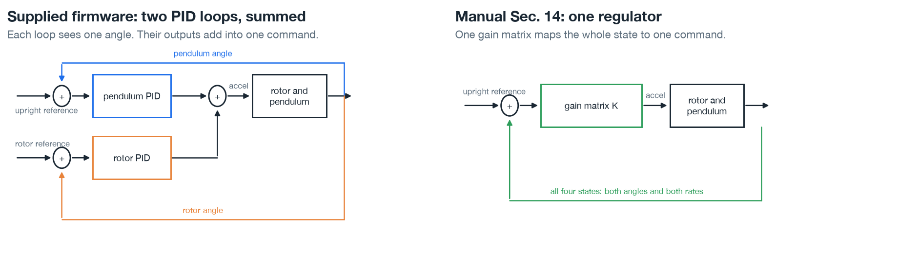
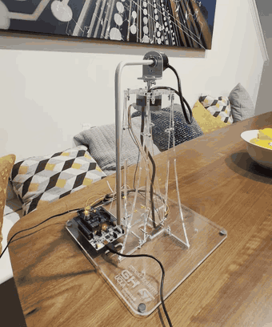
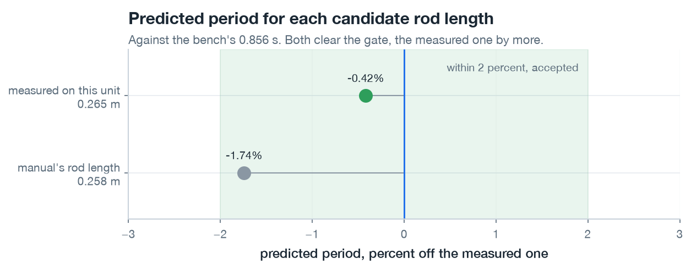
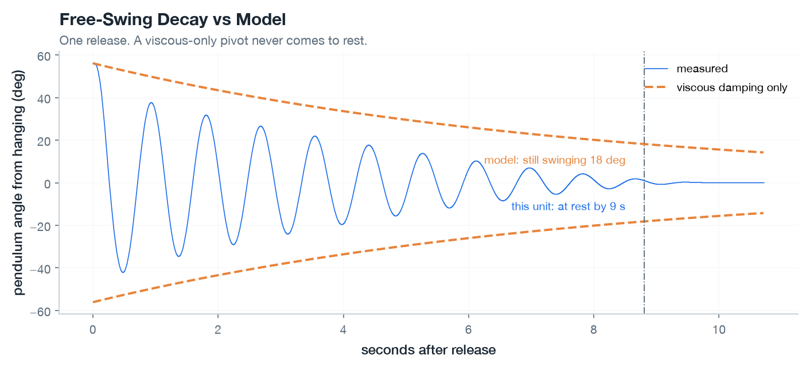
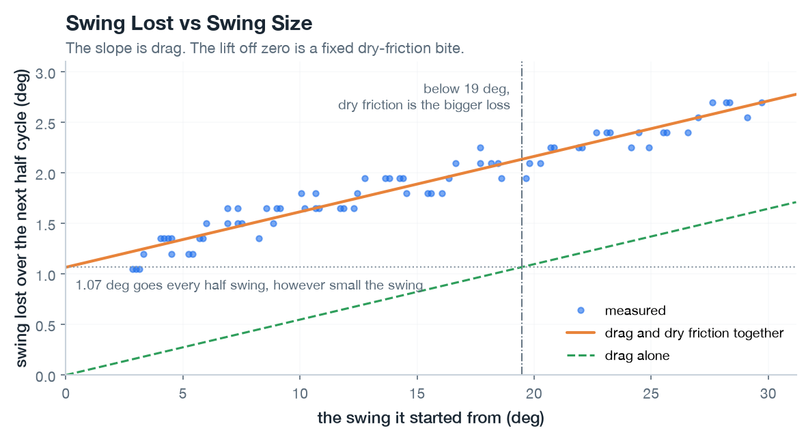
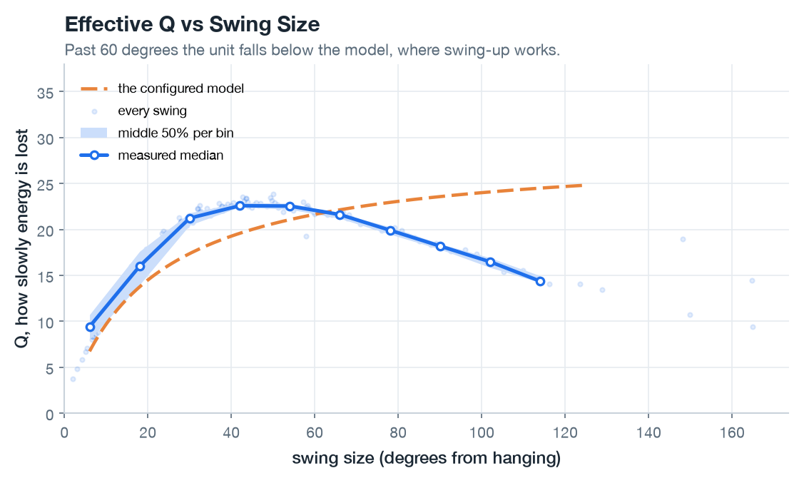
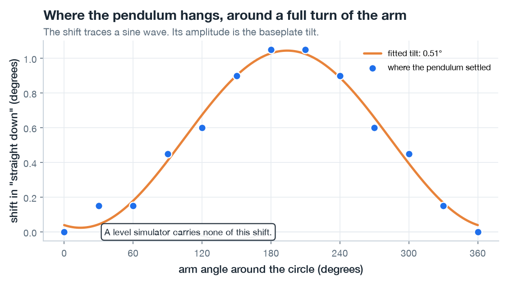
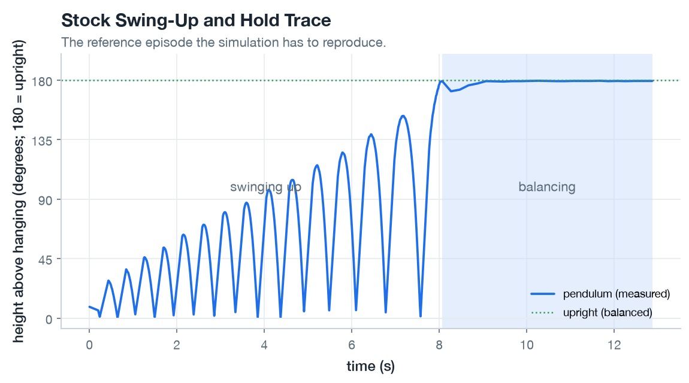

# Experiment 03: hardware bring-up and system identification

## Goal

The goal was to measure this unit and find where it differs from the manual's reference machine, as [Milestone 03](../../milestones/M3-hardware-bringup.md) defines it. [Experiment 01](../01-cartpole-bringup/writeup.md) and [Experiment 02](../02-furuta-environment/writeup.md) built the simulation from the manual's nominal constants. This experiment checks them against the unit.

## Setup

Everything ran on the workstation. Flashing, the boot modes, and the rebuild procedure are in [Running the Edukit firmware](../../runbooks/edukit-firmware.md). Flashing needs `st-flash`, from the stlink package.

## The work

### The supplied firmware

The supplied ST and UCLA image goes on the board first.

```bash
just hw-flash
```

The firmware swings the pendulum up from hanging and then holds it there with two cascaded PID loops, described in Manual Sec. 9, page 27. The inner loop is a PID on the pendulum angle. On its own it keeps the pendulum upright while the rotor drifts, because any rotor position satisfies it. The outer loop is a PID on the rotor angle, and its output becomes the inner loop's reference, so pulling the rotor back to where it should be means asking the pendulum to lean a little. The manual derives an alternative in Sec. 14, page 76, a Linear Quadratic Regulator. One gain matrix maps the whole measured state, both angles and both rates, to a single motor command, and the gains are chosen to minimize a weighted sum of state error and control effort. That's the classical baseline a learned policy has to beat.



*Each PID loop sees one angle. The regulator sees all four states at once. Drawn from the architectures in Manual Sec. 9 and Sec. 14 by [control_structures.py](./figures/control_structures.py).*

The swing-up works by energy shaping, the same trick as pushing a child on a swing: the motor can't lift the pendulum directly, so on each pass through the bottom, where the pendulum's speed peaks, it nudges the arm the way the pendulum is already going and adds a little energy. One nudge turns the arm a small amount, measured in microsteps. A microstep is the motor's smallest commandable increment, one sixteenth of a physical step. How big each nudge is comes from `stage_amp`. The firmware picks one of three values by the peak angle the last nudge reached, in the bands below.

On the first run of the firmware as supplied, the pendulum never reached the top. About twenty swing-up attempts all stalled short of it. The source had a per-nudge progress report commented out, and re-enabling it, so it prints the amplitude in use and the peak angle since the previous nudge, showed where the climb stops. The following table shows one run of 394 nudges:

| Band | Constant | Amplitude | Gain per nudge | Peak reached |
|---|---|---|---|---|
| Below 90 deg | `STAGE_0_AMP` | 200 | 8.55 deg | 85 deg |
| 90 to 150 deg | `STAGE_1_AMP` | 130 | 3.11 deg | 149.5 deg |
| Over 150 deg | `STAGE_2_AMP` | 120 | never entered | |



*The firmware as supplied, stalling short of the top.*

The top band is never reached, because the climb stalls on the boundary just below it and the last three hundred nudges gain nothing. The pendulum needs less energy per degree near the top, so cutting drive as the pendulum rises is sound on its own. But friction loss grows with the arc swept. Raising the two upper amplitudes was enough:

| Constant | Was | Now |
|---|---|---|
| `STAGE_1_AMP` | 130 | 200 |
| `STAGE_2_AMP` | 120 | 160 |

The climb now reaches the handover to balance in 17 nudges, and the balance loops hold it upright indefinitely. The rebuild procedure is in [Running the Edukit firmware](../../runbooks/edukit-firmware.md).

### Determining where the controller should run

With the supplied firmware completing a swing-up, the next question is where the controller has to live. Whether the trained policy can run on the workstation depends on how fast it can read a state and answer. The firmware echoes each character it receives, so the time from writing a byte to seeing it return is one full round trip. That is the best case. In reality the controller does other work in between, and would be slower.

[`scripts/measure_latency.py`](../../../scripts/measure_latency.py) answers each prompt in the board's boot chain, times the echo of the byte it wrote, and reports the spread.

```bash
just hw-latency
```

| | |
|---|---|
| Median round trip | 86 ms |
| 95th percentile | 99 ms |
| Budget at 500 Hz | 2 ms |
| One byte on the wire at 230400 baud | 0.043 ms |

Inference has to run on the board. The 86 ms round trip is more than forty times the 2 ms budget. One byte crosses the wire in 0.043 ms, so link speed isn't the limit. Where the 86 ms goes was not identified.

### Measuring the unit

System identification measures the real machine's lengths, masses, friction and how hard the motor can drive the pendulum. No simulation runs here. The comparison curves below come from the equations and the constants in [`config/edukit.yaml`](../../../config/edukit.yaml).

The identification battery is one firmware probe per part of the system. Each logs on the board's 500 Hz tick and streams to the workstation. Each capture starts by flashing the matching target.

#### Geometry

Rod length and rotor arm measured with calipers, and the pendulum mass weighed before assembly:

| | Measured | Manual | |
|---|---|---|---|
| Rod length | 0.265 m | 0.258 m | 2.7 percent longer than the reference unit |
| Rotor arm | 0.1145 m | 0.140 m | Different spans: the manual gives the whole arm, the pivot sits 25.5 mm inboard |
| Pendulum mass | 20.65 g | not given | Upper bound. The 17.05 g tube may include the pivot shaft, which adds no swing moment |

How hard the arm can drive the pendulum comes from `omega_r^2`, the coefficient linking rotor angle to pendulum angle in the manual's transfer function, described in Manual App. D, page 148. It grows with the arm's swept radius. The manual's full arm puts it at 0.803, and this unit's radius out to the pivot puts it at 0.635, a fifth less.

#### The suspended mode

Releasing the pendulum and logging the ring-down fixes its natural frequency. The shaft inertia is fitted to that frequency. Mode `w` holds the rotor and logs continuously while a hand lifts and releases the pendulum, several times in one capture. `furuta.freeswing` segments the capture into one decay per release.

```bash
just hw-flash bench
just hw-probe-freeswing 300
just freeswing-fit
```

Five releases between 37 and 56 degrees give 1.168 Hz, with a spread of 0.003 Hz. The manual's constants predict 1.189 Hz, 1.8 percent high. The measured rod length alone brings that to 1.174 Hz. Fitting the shaft term as well moves `2*I_shaft/(m*L^2)` from the manual's 0.0139 to 0.0181, and the model predicts 1.170 Hz.



*Only the rod length differs between the two candidates.*

The decay is the other half of that capture. A pivot damped only by drag can't come to rest, and this one does.



*One release of five.*

A pendulum bleeds energy to friction as it swings, and the "quality factor" Q is a single number for how slowly. A higher Q means it keeps swinging longer. Q combines viscous and dry friction:

- Viscous friction is drag that grows with speed, like moving through honey.
- Dry friction, also called Coulomb friction, is a fixed bite taken every swing whatever the speed, like a rusty hinge.

Plotting the loss against the amplitude each swing started from splits it into a drag term and a constant bite.



*The viscous part of the fit is a Q of 28.7.*

#### How the pendulum loses energy at each swing size

Viscous drag and dry friction leave different signatures as the swing grows, so the probe measures Q across a ladder of swing sizes to separate them. It pumps the pendulum up to a target, cuts the drive, and watches the swings shrink.

```bash
just hw-flash ident-pump
just hw-probe-pump 420
```



The orange line is the free-swing fit from the previous section. Past 60 degrees the measured Q drops below it, a large-amplitude drag the fit has no term for.

The free-swing fit holds below 60 degrees and overstates Q past it, across the amplitudes swing-up climbs through.

#### Where upright sits as the arm turns

The base isn't perfectly level, so where the pendulum hangs shifts with the arm angle, and so does where upright sits. The probe turns the arm a full circle and logs where the pendulum settles at each stop. The resting angle traces a sine wave, and its height is the tilt.

```bash
just hw-flash ident-sweep
just hw-probe-sweep 250
```



The fitted tilt is 0.51 degrees. A level simulation gives the controller more margin than the hardware has. The map also gives the unit its only absolute reference. There is no sensor on the motor shaft, so the resting angle at a known arm position is the rotor's zero.

An earlier sweep read 0.98 degrees. It ran over a half turn, because the cable to the pendulum's angle sensor winds as the arm rotates, and half a turn covers half the sine wave. That makes its amplitude the weaker of the two readings. The base may also have sat differently that day. The experiment's [config.yaml](./config.yaml) records both.

### A reference trace

The last probe runs the retuned stock controller end to end and logs the entire episode, from hanging to balanced. This is the reference the simulation must reproduce.

```bash
just hw-flash ident-trace
just hw-probe-trace 220
```



The height axis is the pendulum's angle up from hanging. Zero is the bottom and 180 is upright. The swing-up pumps it up in growing arcs over about eight seconds, then the balance loops catch it and hold it flat at the top. On-board logging during balance is sparse, five samples a second rather than five hundred. A log line takes about 1.7 ms to send, and a full-rate stream would starve the 500 Hz stabilizer. It held for 4.8 seconds before the rotor ran out of cable travel.

### Where the model stands

The simulation's pivot has only viscous damping, and its base is level. It has no term for the dry bite of 1.07 degrees per half swing, none for the extra drag past 60 degrees, and none for the 0.51 degree tilt. This experiment measures the bite and the tilt, and both are ready to add. The drag comes out as a curve, and nothing yet fits a term to it. Swing-up spends its time at those amplitudes.

The suspended mode and the friction fit come from a hand-released capture, the last measurement here a person has to perform. Mode `d` releases on its own and agrees on the frequency to 0.2 percent. But its lowest target is 57.9 degrees and its window ends before the big releases settle, leaving its own small-swing fit unusable. Low targets in `IDENT_RINGDOWN_AMPLITUDES` and a longer hold would move both constants onto the autonomous probe.

Two earlier runs pumped the pendulum over the top, where it made a full rotation and settled one revolution away in the running count. They read 2398 and 2411 counts per revolution, within half a percent of the 2400 nominal, and the assumed 6.666667 counts per degree holds. Neither run is among the committed captures.

## Takeaway

This experiment meets [Milestone 03](../../milestones/M3-hardware-bringup.md). The unit swings up and balances, and the simulation's constants now come from it rather than from the manual.

- Two amplitude constants in the supplied firmware were all it took to get a swing-up that completes and hands over to balance.
- Inference has to run on the board. At 86 ms the round trip can't close a 2 ms loop from the workstation.
- This unit isn't the one the manual describes. The rod is 2.7 percent longer, and the arm out to the pivot is 0.1145 m rather than 0.140 m. That costs a fifth of the drive the published constant implies.
- The base carries a 0.51 degree tilt.
- A full swing-up and balance episode is captured and committed, as the reference the simulation has to reproduce.

The friction is the result that matters most. A fixed 1.07 degrees goes every half cycle whatever the amplitude, and large swings lose more on top of that. The model was fitted on small swings and is wrong on the big ones swing-up climbs through. That gap is now measured across the full range.

These are one unit's numbers taken across sessions in August and September. A hardware reading is a sample, not a distribution.

## References

- [Milestone 03](../../milestones/M3-hardware-bringup.md), the exit gates this experiment has to clear.
- [Running the Edukit firmware](../../runbooks/edukit-firmware.md), flashing, the logging modes, the wire format, and the rebuild and tuning procedure.
- [Edukit assembly](../../runbooks/edukit-assembly.md), the encoder wiring this depended on.
- [Design inputs](../../design-inputs/README.md), which record the constants and their provenance.
- [Experiment 02](../02-furuta-environment/writeup.md), the simulation these measurements refit.
