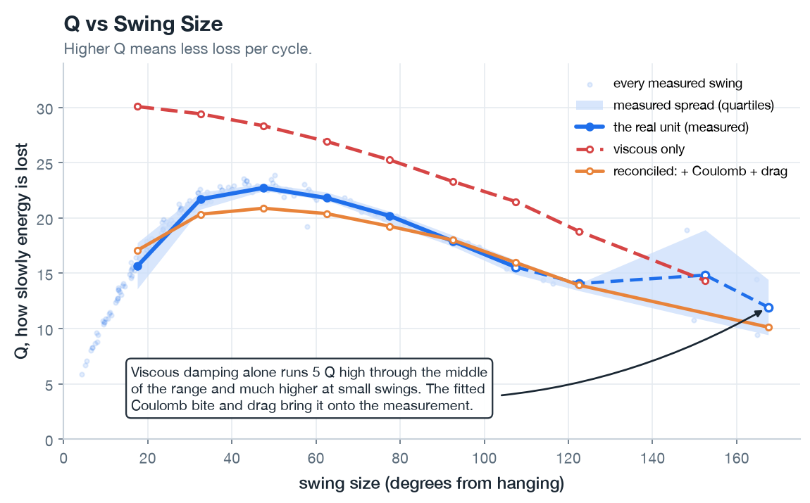
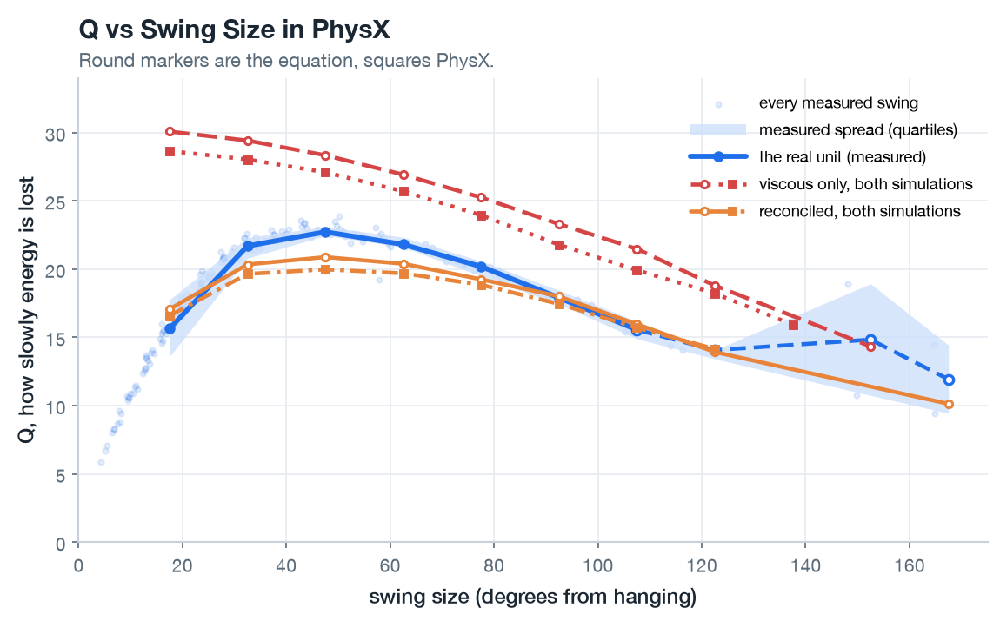
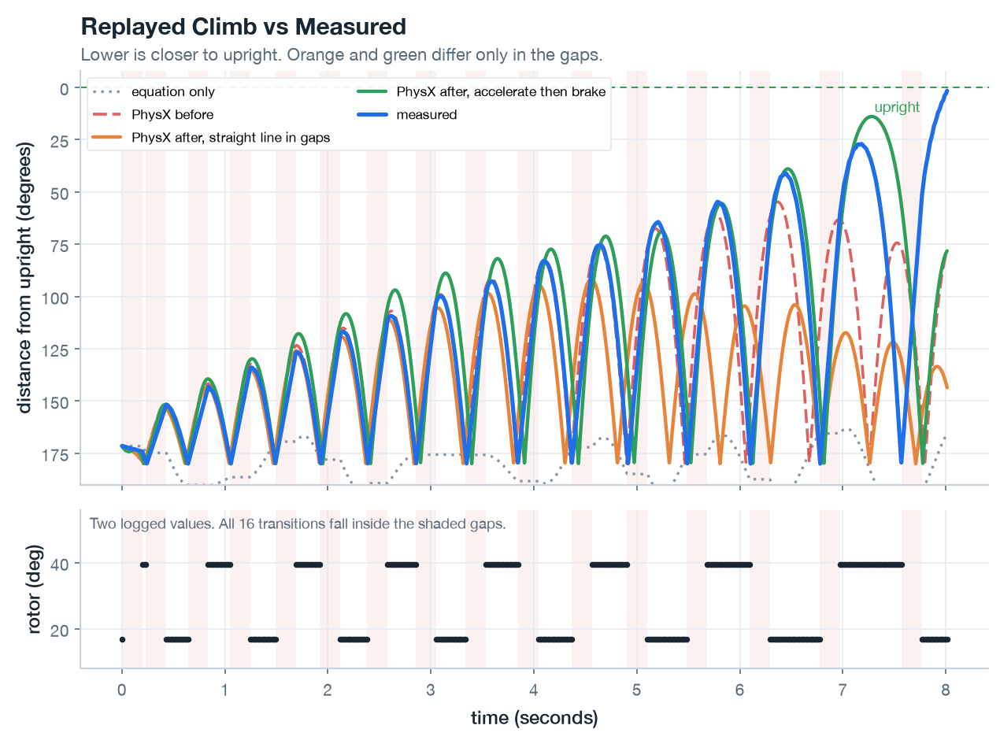
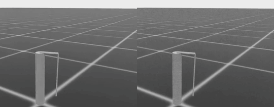

# Experiment 04: Refitting the Simulation

## Goal

[Milestone 04](../../milestones/M4-model-reconciliation.md) calls for bringing the simulated Furuta pendulum into agreement with the physical hardware characterized in [Experiment 03](../03-hardware-bringup/writeup.md).

Prior to this experiment, the simulation environments (both the analytical equations and the Isaac Lab articulation) relied on nominal constants published in the ST / UCLA Edukit Manual. On the bench, however, the physical STEVAL-EDUKIT01 diverged from those specifications in several important ways: the pendulum rod was 2.7% longer, the pivot was mounted 25.5 mm inboard on the arm (reducing drive coupling by a fifth), dry friction and high-speed air drag dominated the ring-down, and the base had a measurable half-degree tilt.

This experiment reconciles the simulation models with those bench measurements so that policies trained in simulation transfer reliably to the physical machine.

## Setup

Validating the system dynamics relies on two complementary simulations:

1. **Analytical Planar Model ([`src/furuta/planar.py`](../../../src/furuta/planar.py)):**
   A single differential equation governing pendulum angle $\theta$. It builds directly on the suspended-mode derivation in the Edukit Manual (Appendix D, page 143), augmented with three physical effects: centrifugal coupling from the arm's rotation, Coulomb (dry) friction, and quadratic velocity drag:

   ```math
   \ddot{\theta} = \underbrace{\omega_g^{2}\sin\theta + \omega_r^{2}\ddot{\phi}\cos\theta - \frac{\omega_g}{Q}\dot{\theta}}_{\text{Edukit Manual App. D}}
   \underbrace{+\,\kappa\dot{\phi}^{2}\sin\theta\cos\theta}_{\text{arm rotation coupling}}
   \underbrace{-\,c_{\mathrm{dry}}\operatorname{sign}(\dot{\theta})-b\,|\dot{\theta}|\,\dot{\theta}}_{\text{reconciled friction}}
   ```

   Angles are referenced from upright: $\theta = 0$ corresponds to inverted balance, while $\theta = \pi$ is hanging at rest.

2. **PhysX Multi-Body Simulation (Isaac Lab on the GPU Host):**
   The full 3D physics environment used for policy training, implemented in reduced coordinates (tracking only joint angles so links cannot artificially separate). Unlike the closed-form ODE, PhysX advances the articulation numerically through discrete time steps. Setup details are in the [training host runbook](../../runbooks/training-host-setup.md).

Both models share the exact same parameter definitions, configured in [`config.yaml`](./config.yaml) and [`config/edukit.yaml`](../../../config/edukit.yaml).

This dual-model setup provides an essential diagnostic lever:
- If PhysX disagrees with the analytical ODE, the issue lies in the numerical solver, substep torque injection, or actuator abstraction inside Isaac Lab.
- If both simulations agree with each other but deviate from the physical Edukit, the discrepancy points to missing or mismeasured physics in the plant model.

## The Work

### Fitting Friction

Bench characterization during hardware bring-up ([Experiment 03](../03-hardware-bringup/writeup.md)) exposed two clear discrepancies between the nominal manual model and the physical unit:

1. **The pendulum comes to a dead stop:** Dry friction takes a fixed bite out of the swing amplitude on every half-cycle, bringing the real pendulum to rest. The nominal manual model only includes linear viscous damping, which decays energy exponentially, meaning the simulated pendulum rings down indefinitely.
2. **High-amplitude drag rolls off quality factor:** Beyond roughly $60^\circ$ of swing amplitude, the measured effective quality factor ($Q_{\text{eff}}$) rolls off sharply. The manual model has no mechanism that can produce this drop.

The key to untangling the friction mechanisms is understanding how each one shapes the effective quality factor, $Q_{\text{eff}}$, across different swing amplitudes:

- **Linear viscous damping** dissipates a fixed percentage of the system's kinetic energy per cycle. Its quality factor is completely flat across all amplitudes.
- **Coulomb (dry) friction** removes a constant slice of amplitude every half-swing. As the swing grows larger, that constant bite represents a smaller fraction of the total swing energy, causing $Q_{\text{eff}}$ to rise linearly with amplitude.
- **Velocity-squared drag** ($-b |\dot{\theta}|\dot{\theta}$) exerts a retarding torque proportional to speed squared. The fraction of energy lost per cycle scales with amplitude, causing $Q_{\text{eff}}$ to peak and then fall away at wide angles.

The bench data from Experiment 03 showed exactly this third signature: $Q_{\text{eff}}$ climbs at small angles, peaks near $48^\circ$, and then steadily degrades.

Fitting the drag coefficient $b$ involved running a simulated ring-down ladder through the analytical equation against the bench $Q_{\text{eff}}$ curve. The linear viscous quality factor was held fixed at $Q = 28.7$, the baseline value measured from gentle free swings, where the velocity-squared loss is small enough to ignore.

Here, $Q_{\text{eff}}$ is defined as $\pi$ divided by the fractional amplitude lost per cycle, measured peak-to-peak on the same side. The diagnostic ladder pumps the simulated pendulum to each of seven target amplitudes and then lets it ring down with the rotor held still. All ring-down traces, whether simulated or captured from hardware, pass through the exact same analysis routine in `furuta.pump.qeff_vs_amplitude`.



*The shaded band is the measured quartile spread on the physical Edukit. Its dashed tail covers bins supported by only two or three swings.*

Once fitted, the reconciled model tracks the hardware dissipation remarkably well, achieving an RMS error in $Q$ of 1.2 across the nine shared amplitude bins. By comparison, the manual's viscous-only model missed by an RMS of 7.0.

The optimization yielded:
- A quadratic drag coefficient $b = 0.006\text{ rad}^{-1}$.
- A Coulomb bite $c_{\mathrm{dry}} = 0.65^\circ$ per half-swing.

That $0.65^\circ$ Coulomb figure is notably smaller than the $1.07^\circ$ reported from the free-swing test in Experiment 03. That difference comes down to model expressiveness. The original free-swing probe in Experiment 03 used a single-parameter friction model with no drag term, which forced its dry-friction parameter to absorb all high-speed air resistance. Even at a moderate $55^\circ$ release, aerodynamic drag already accounts for about two full units of $Q$.

The tight confidence interval reported in Experiment 03 showed how tightly the data pinned that specific single-parameter fit; it did not mean that single parameter was physically pure. `config/edukit.yaml` now uses $0.65^\circ$, retaining the earlier $1.07^\circ$ in the comments for historical context.

### Implementing the Reconciled Terms in PhysX

Bringing these reconciled parameters into Isaac Lab meant working around some built-in actuator limitations. Isaac Lab's standard `ImplicitActuatorCfg` only models linear PD-style damping:

$$\tau = K(q_{\text{target}} - q) - D\dot{q}$$

That interface handles linear viscous damping cleanly, but it provides no mechanism for Coulomb friction or quadratic drag. Both terms have to be calculated explicitly and applied as joint torques directly to the pendulum pivot.

These terms are implemented in `src/furuta/dissipation.py`. The module computes the desired angular accelerations from the equation and multiplies them by the pendulum's moment of inertia about the pivot. In `_apply_action`, the resulting torque is injected at every physics substep. A unit test verifies that the analytical ODE and the PhysX environment produce identical torques from the same configuration values.

With these changes in place, the diagnostic ladder was re-run inside PhysX on the GPU host:

```powershell
python -u scripts\diag_dissipation.py --headless --plant before --out results\qeff_before.csv
python -u scripts\diag_dissipation.py --headless --plant after  --out results\qeff_after.csv
```



*The same hardware and the same equation ladders as the previous figure, with the PhysX pair added. Round markers are the equation, squares PhysX.*

The validation results confirmed the implementation:
- Across the eight shared amplitude bins with hardware, the viscous-only PhysX model had an RMS error of 6.2 in $Q$; the reconciled PhysX environment cut that error down to 1.6.
- After reconciliation, PhysX and the analytical ODE agree within 0.9 in $Q$ across every single amplitude bin (and stayed within 1.6 even before fitting). That close agreement is the check on the substep torque calculation and inertia scaling. An effort target applied on only the first solver iteration, or scaled wrongly by inertia, would push PhysX visibly above or below the ODE behind it.
- In the viscous-only baseline, $Q_{\text{eff}}$ dropped from 28.7 at small swings down to 15.9 at $138^\circ$. Looked at in isolation, that drop might appear to be numerical energy loss inside PhysX's solver. But the solver-free analytical ODE falls the same way, matching PhysX within 1.6, which places the roll-off in the pendulum's large-angle dynamics rather than in an integration bug.

Re-running the ladder at 1 kHz (the target production physics rate) tested whether stepping at 4 kHz yields any accuracy advantage during unforced decay. The answer is essentially nothing: both simulation rates agreed within 0.01 in $Q$ at every amplitude bin.

| Amplitude Bin | Before (4 kHz) | Before (1 kHz) | After (4 kHz) | After (1 kHz) |
|---|---|---|---|---|
| $18^\circ$ | 28.65 | 28.65 | 16.58 | 16.58 |
| $48^\circ$ | 27.09 | 27.09 | 19.98 | 19.98 |
| $78^\circ$ | 23.95 | 23.95 | 18.85 | 18.86 |
| $108^\circ$ | 19.92 | 19.92 | 15.71 | 15.71 |
| $138^\circ$ | 15.94 | 15.93 | | |

Free ring-down does not stress the integrator the way a driven swing-up does. Replaying the trace below at 1 kHz leaves the pendulum $114.8^\circ$ from upright where 4 kHz reaches $91.7^\circ$, a separation of 23 degrees.

### Replaying a Logged Hardware Swing-Up

With dissipation locked down, the next step was testing the reconciled model against a real trajectory. The benchmark dataset is the `probe-trace` capture from [Experiment 03](../03-hardware-bringup/writeup.md), a complete, successful run of the Edukit's stock firmware swinging up from hanging and catching into a stable balance hold. The log records the optical encoder's pendulum angle alongside the rotor angle tracked by the stepper driver's step counts.

An initial attempt to replay the trace by commanding rotor acceleration failed immediately. The stepper motor moves in discrete 1/16 microsteps. Differentiating that quantized position signal twice to reconstruct acceleration introduces high-frequency noise and subtle numerical bias. Integrating that noisy acceleration twice inside the simulation caused the simulated rotor to drift by $640^\circ$ over an episode where the physical arm only swung $22.5^\circ$. To make trace replay viable, a dedicated `position` control mode was added to `FurutaEnvCfg.rotor_command_mode`.

```powershell
python -u scripts\replay_trace.py --headless --plant after --gap-profile linear `
    --trace docs\experiments\03-hardware-bringup\trace.tsv --out results\replay_after.csv
```



*The exact same recorded rotor endpoints drive each simulated trajectory.*

When driven with the measured rotor path, the analytical planar ODE only climbs about $8^\circ$ before stalling out. That is expected: a Furuta pendulum pumps energy into the swing via dynamic coupling with the arm's angular velocity, a three-dimensional gyroscopic and centrifugal coupling that the simplified planar equation does not capture.

The full 3D PhysX articulation, however, climbed aggressively. For the first eight swings, it tracked the physical hardware within about $6^\circ$ at every peak:

- **Simulated peaks:** $151.7^\circ, 143.1^\circ, 134.0^\circ, 126.6^\circ, 116.9^\circ, 109.3^\circ, 99.9^\circ$, and $92.7^\circ$ from upright.
- **Measured peaks:** $153.7^\circ, 142.9^\circ, 135.0^\circ, 126.0^\circ, 119.4^\circ, 111.4^\circ, 105.5^\circ$, and $98.5^\circ$.

Then, right around the horizontal mark, the two paths cleanly parted ways: the physical hardware continued climbing and locked into balance, while the simulation stalled out near $91.7^\circ$.

At first glance, this looked like a failure of the reconciled physics model. But a deeper dive into the raw telemetry file (`trace.tsv`) uncovered the real culprit:

Across all 391 logged rows in the trace, the rotor column records only two unique values: $16.9^\circ$ and $39.4^\circ$. Every single one of the 16 rotor kicks occurred entirely inside ~198 ms logging blackouts where the STM32 firmware recorded no data at all. Those blind spots account for 40% of the entire run's elapsed time, and they contain 100% of the motor's actual motion. The trapezoidal rotor moves shown in diagnostic plots are what an interpolator draws between two endpoints.

Because a pendulum's energy intake depends on the exact shape, peak acceleration, and phase alignment of each kick, missing the entire trajectory of the kick is fatal. To evaluate the impact of this blind spot, the exact same reconciled simulation was replayed under two different assumptions about the rotor's motion inside those 198 ms blackouts:

1. **Linear Interpolation:** The rotor glides smoothly at a constant velocity across the gap.
2. **Bang-Bang Move:** The rotor accelerates at a constant rate to the midpoint and brakes symmetrically to rest at the target.

Both profiles pass through every single logged point in the file. But look at what happens to the pendulum:

```powershell
python -u scripts\replay_trace.py --headless --plant after --gap-profile bangbang `
    --trace docs\experiments\03-hardware-bringup\trace.tsv --out results\replay_after_bangbang.csv
```

| Assumed Rotor Motion in Telemetry Gaps | Closest Approach to Upright |
|---|---|
| Straight line (constant velocity) | $91.7^\circ$ |
| Accelerate, then brake (bang-bang) | $13.9^\circ$ |
| Real hardware run | $1.6^\circ$ |



*The exact same reconciled simulation replayed under two different interpolation assumptions. On the left, the rotor follows a linear interpolation across logging gaps; on the right, it accelerates and brakes. Only the bang-bang profile delivers enough energy to swing the pendulum up.*

Without touching a single physical parameter in the simulation, simply replacing a lazy linear glide with a sharp accelerate-and-brake profile took the simulation from stalling near horizontal to reaching within $14^\circ$ of vertical, matching the physical unit swing for swing.

Neither synthetic trajectory is ground truth. A shorter, sharper jerk profile that finishes early would alter the timing and phase of the kick even more. But this comparison decisively proves that the simulation's failure to complete the swing-up isn't evidence of a broken physics model; it is an artifact of an undersampled hardware trace.

A similar telemetry bottleneck breaks the balance hold. The `probe-trace` firmware restarts its microsecond timer when handing over from swing-up to balance, splitting a single continuous run into two disconnected log files. Stitching them together with `--run all` gives a 4.8-second balance hold across 2,400 control steps. On the bench, the physical controller keeps the pendulum within $8.4^\circ$ of upright. In simulation, the pendulum falls past $20^\circ$ on the very first step under either interpolation profile.

The math explains why open-loop replay is doomed here. The inverted Furuta pendulum has an unstable pole at $\lambda \approx 7.35\text{ rad/s}$, which corresponds to a divergence timescale $\tau = 1/\lambda \approx 136\text{ ms}$. Tilt errors compound exponentially as $e^{\lambda \Delta t}$:

| Operating Mode | Loop Interval ($\Delta t$) | Error Growth Factor ($e^{\lambda \Delta t}$) |
|---|---|---|
| Hardware control loop | 2 ms (500 Hz) | $1.01\times$ |
| Swing-up telemetry rate | 13 ms (~77 Hz) | $1.10\times$ |
| Balance telemetry rate | 200 ms (5 Hz) | $4.35\times$ |

During swing-up, open-loop replay survives the telemetry gaps because energy pumping is resonant and forgiving: if a kick lands a few milliseconds early or late, it still adds energy to the swing. Inverted balance, however, is strictly open-loop unstable. On hardware, the STM32 runs its stabilizing loop at 500 Hz (2 ms), where error only grows by 1% between updates. But to avoid overwhelming the microcontroller during balance, telemetry streaming was throttled to 5 Hz (200 ms). Over a 200 ms gap, any initial tilt error blows up by $4.35\times$! Trying to replay an unstable mode open-loop at 5 Hz simply measures the log rate, not the plant dynamics.

Finally, the trace exposed an intriguing puzzle regarding actuator limits. Moving $22.5^\circ$ ($0.393\text{ rad}$) in 198 ms with a symmetric accelerate-then-brake motion requires an acceleration of:

$$a = \frac{4d}{T^2} = \frac{4(0.393\text{ rad})}{(0.198\text{ s})^2} \approx 40.1\text{ rad/s}^2$$

Yet the simulation configuration caps rotor acceleration at $11.78\text{ rad/s}^2$, based on a conservative interpretation of the manual's `MAX_ACCEL` parameter.

This leaves two possibilities: either the Edukit's stepper motor possesses more than three times the assumed dynamic authority, or the stepper suffered silent step loss under high load (a concern raised during bring-up in Experiment 03). Because the trace replay script commanded rotor position directly, bypassing the environment's acceleration clamp, this limit did not constrain the replay runs. Resolving whether the motor is stronger than expected or losing steps under load will require dedicated bench characterization.

## Takeaway

This experiment reconciles the simulation with bench measurements for dissipation. The apparent failure to reproduce the full swing-up and balance hold is a limitation of the logged data, not the underlying physics.

1. **Friction is Grounded in Reality:** Fitting the full swing arc established a Coulomb friction bite of $0.65^\circ$ per half-swing and a velocity-squared drag coefficient of $0.006\text{ rad}^{-1}$. The earlier $1.07^\circ$ Coulomb figure from Experiment 03 was an artifact of a single-parameter fit that forced dry friction to absorb the velocity-squared loss.
2. **PhysX Matches the Analytical Model:** Inside Isaac Lab, the reconciled multi-body simulation tracks the physical Edukit's dissipation with an RMS error in $Q$ of 1.6 (down from 6.2 in the manual's viscous-only model) and stays within 0.9 of the analytical ODE across all amplitude bins. In free decay, stepping at 1 kHz rather than 4 kHz makes no measurable difference, and on the driven replay the two rates separate by 23 degrees of closest approach.
3. **Trace Replay is Telemetry-Bound:** The simulation's stall during swing-up is directly attributable to 198 ms telemetry blackouts during which 100% of the rotor's movement occurred. Replaying with a bang-bang kick profile carried the pendulum from $91.7^\circ$ to within $13.9^\circ$ of vertical. Similarly, replaying the balance hold open-loop fails because 5 Hz telemetry cannot stabilize an inverted mode with a 136 ms instability time constant.

Closing the loop on model reconciliation doesn't require tweaking the physics model further; it requires flashing firmware that logs the rotor continuously throughout both the kicks and the catch.

## References

- [Milestone 04](../../milestones/M4-model-reconciliation.md): Exit gates and acceptance criteria for model reconciliation.
- [Experiment 03](../03-hardware-bringup/writeup.md): Hardware bring-up, parameter identification, and baseline bench measurements.
- [System Parameters (`config/edukit.yaml`)](../../../config/edukit.yaml): Authoritative system constants, measured values, and calibration notes.
- [Edukit Manual Reference](../../design-inputs/references/edukit-manual.md): Authoritative documentation by STMicroelectronics and Prof. William J. Kaiser (UCLA).
