# Experiment 05: balance policy training and hardware deployment

## Goal

[Milestone 05](../../milestones/M5-balance.md) sets three targets: hold the Furuta pendulum upright for 30 seconds from a near-vertical release in simulation, catch handovers from a swing-up, and deploy the resulting policy zero-shot onto the physical Edukit microcontroller.

Training runs in the Isaac Lab simulation environment built in [Experiment 02](../02-furuta-environment/writeup.md), characterized in [Experiment 03](../03-hardware-bringup/writeup.md), and reconciled against hardware ring-down data in [Experiment 04](../04-model-reconciliation/writeup.md). If the reconciled dynamics model is accurate, policies trained in simulation should transfer directly to physical hardware.

## Setup

Training and evaluation ran on the dedicated GPU host following the [training host runbook](../../runbooks/training-host-setup.md). All figures can be regenerated via `just figures 05` using scripts in [`figures/`](./figures/). Full parameters are specified in [`config.yaml`](./config.yaml).

## The work

### Updating the environment

The training environment was updated to match the physical Edukit's physical limits, sensor quantization, and observation pipeline (documented in detail in [the environment design](../../design/rl-environment.md)):

- **Observation** (5-dim, unscaled, 500 Hz):
  - Pendulum angle: $\cos\theta, \sin\theta$
  - Pendulum velocity: slope fitted over a 16-sample sliding window
  - Rotor position: angle from microstep count
  - Rotor velocity: slope fitted over 16 samples
- **Action** (1-dim): rotor acceleration command in $[-1, 1]$, scaled to the nominal $11.78\text{ rad/s}^2$
- **Termination**: pendulum tilt $> 20^\circ$ from upright, or rotor displacement $> 90^\circ$ from center
- **Reset**:
  - *Balance task*: tilt within $\pm 2^\circ$, angular rate within $\pm 0.25\text{ rad/s}$
  - *Momentum task*: sampled across the analytically recoverable set
- **Reward**:
  - Alive: $+1.0$ per step
  - Upright: up to $+1.0$, falling quadratically with tilt: $1 - (\theta / \theta_{\max})^2$
  - Termination: $-2.0$ on breach
  - Rotor travel: $-0.05/\text{rad}$ outside a $0.35\text{ rad}$ deadband
  - Regularization: $-0.01 a^2$, $-0.01 (\Delta a)^2$, $-0.005 \dot{\theta}^2$
- **Episode length**: 10 s (5,000 steps) for training, 30 s for evaluation

The environment originated as a port of the standard Isaac Lab cartpole baseline. The following sections detail the changes required to adapt that baseline to the rotary pendulum's physical dynamics and hardware constraints, leading to the final design summarized in the preceding specification.

#### Fixing the upright reward
The environment originally inherited an upright reward term from the standard cartpole example: $\cos\theta$. For a cartpole, $\cos\theta$ works well because the pole swings through large angles, and its derivative ($-\sin\theta$) peaks at $90^\circ$ while flattening near upright.

On the Furuta pendulum, balancing takes place entirely within $20^\circ$ of vertical, the flat deadband of the cosine curve. Across that entire $20^\circ$ envelope, $\cos\theta$ drops by only 0.058 (from 1.000 to 0.940). Against a +1.0 alive bonus, a policy leaning $8^\circ$ collected over 99% of the maximum reward, giving the optimizer almost no incentive to center the pole.

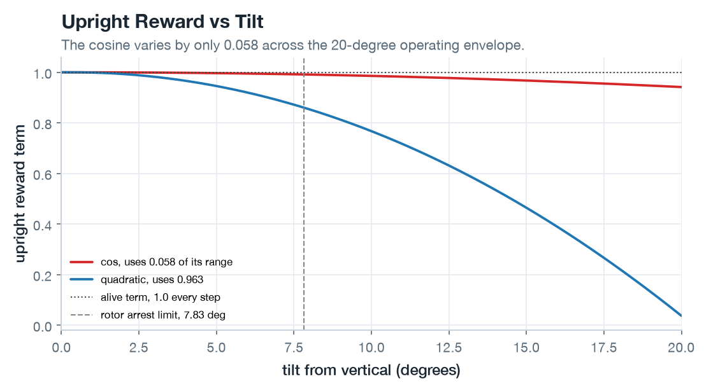

*The two candidate upright terms over the balance envelope. Under the cosine reward, episodes plateaued between 247 and 299 steps (Run 2). Switching to the quadratic penalty reached 413 steps in the same 32 iterations.*

Replacing $\cos\theta$ with a quadratic penalty ($1 - (\theta / \theta_{\max})^2$) created a steep restoring gradient near vertical, immediately driving episode duration past 400 steps.

#### Exploration noise and rail saturation
Learned exploration noise initially looked problematic: with `init_noise_std = 1.0`, the policy's noise standard deviation climbed to 1.23, causing 55% of commanded accelerations to clip against the $\pm 1$ saturation rails.

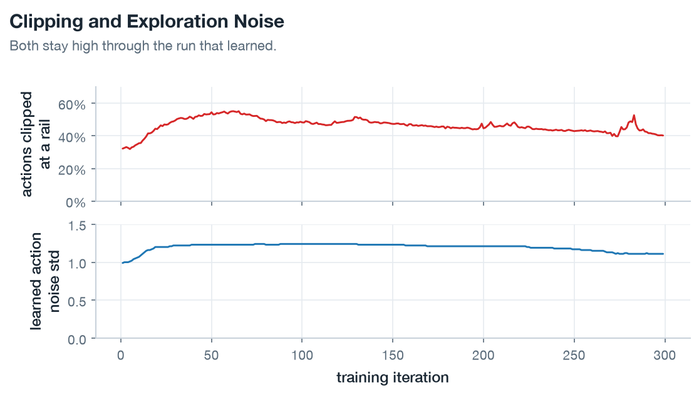

*Upper panel: action clipping fraction. Lower panel: learned noise standard deviation. Between 32% and 55% of actions clip throughout training, yet the policy learns steadily.*

Throttling initial noise to 0.3 brought clipping down to 2%, but crippled learning: episodes stalled at ~260 steps versus 529 with unit noise (Runs 3 and 4 in [logbook.md](./logbook.md)). The clipping was not a configuration error. The rotor can only arrest tilt deviations up to $7.8^\circ$, so the policy needs broad noise to discover recovery trajectories in the first place. Rail clipping is a symptom of exploring that narrow envelope. Between 32% and 55% of actions clip throughout training, and the policy learns anyway.

#### Environment bugs caught during bring-up
Debugging the simulation flushed out two subtle implementation bugs before training:
1. **Actuator integration rate mismatch**: the actuator model double-integrates acceleration commands into rotor position setpoints. Originally, this integration ran inside the physics substep loop using the 2 ms control timestep instead of the 1 ms physics timestep. With decimation set to 2, the actuator advanced 4 ms of motion every 2 ms cycle, doubling motor speed; at decimation 8 (4 kHz physics), the motor accelerated 8× too fast. Moving integration to `_pre_physics_step` ensures the actuator advances exactly 2 ms once per control step.
2. **Spurious reset velocity**: the optical encoder has 2,400 counts/rev ($2.62\text{ mrad/count}$). The environment estimates velocity by differencing encoder positions over the 2 ms control timestep. At episode reset, the filter buffer was originally seeded with the exact continuous ODE angle. The rounding difference between that continuous seed and the first quantized encoder reading created an artificial position step of up to half a count ($1.31\text{ mrad}$), injecting a phantom velocity spike of up to $\frac{1.31\text{ mrad}}{2\text{ ms}} = 0.65\text{ rad/s}$ on step 0, eating 64% of the motor's $1.011\text{ rad/s}$ recovery authority before the policy could act. Pre-quantizing the reset angle before seeding the filter buffer eliminated the spike.

### Training

Algorithm selection and network sizing followed [ADR-0003](../../adrs/0003-training-algorithm.md):

- **Algorithm**: PPO via `rsl_rl` serves as the on-policy optimizer. The primary priority was validating sim-to-real transfer rather than benchmarking RL optimizers. Having a known-good optimizer that already solved cartpole ([Experiment 01](../01-cartpole-bringup/writeup.md)) was crucial: when task variants failed to learn, issues could be isolated to physics or reward shaping rather than optimizer instability. With 1,024 parallel GPU environments generating ~60,000 steps per second, sample efficiency was not a constraint.
- **Network sizing**: both actor and critic are two-layer MLPs with hidden dimensions `[32, 32]` and ELU activations. This small size was non-negotiable for hardware: system identification in [Experiment 03](../03-hardware-bringup/writeup.md) clocked serial round-trip latency at 86 ms, making off-board control impossible. The policy had to run on-chip on an 84 MHz STM32F401 (ARM Cortex-M4F) inside a 2 ms (500 Hz) interrupt budget. A `[32, 32]` network requires only 1,216 multiply accumulate operations and executes in well under 0.3 ms, leaving ample headroom for encoder filtering and stepper timing.
- **Scaling and hyperparameters**: scaling to 4,096 environments stalled during USD scene graph creation outside Fabric (remaining stuck after 17 minutes). Scaling back to 1,024 environments initialized in one minute, completing a 300-iteration run in 11 minutes on an RTX 5080. Hyperparameters adapted for 500 Hz included discount factor $\gamma = 0.999$, GAE $\lambda = 0.99$, and 128 rollout steps per environment (`src/furuta/agents/rsl_rl_ppo_cfg.py`).

Five random seeds trained for 300 iterations. Seed 1 reached 9.84 s mean episode duration by iteration 177 and capped the 10-second limit by iteration 257.

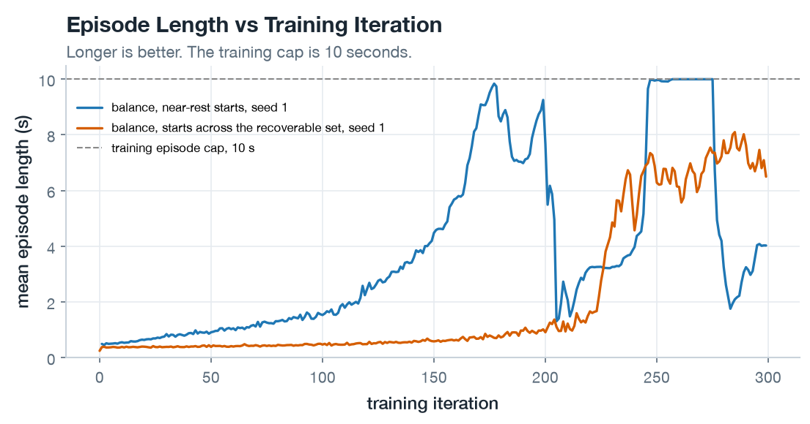

*Mean episode duration per iteration. Seed 1 (blue) stabilizes balance by iteration 257. The follow-on momentum task (orange) levels near 7 seconds under broader resets.*

The Seed 1 checkpoint (`checkpoints/balance_seed1_model_299.pt`) served as the baseline policy for subsequent evaluations.

| Untrained | Trained |
|---|---|
| 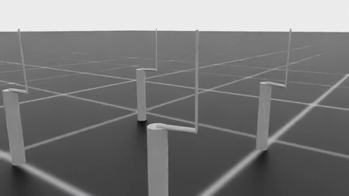 |  |

*Seed 1 policy before and after training (2.4 s real time at 25 fps). The untrained policy drops the pendulum immediately; the trained policy holds balance.*

### Scoring the gate

Gate evaluation tested the deterministic policy across 256 episodes per seed over 30-second runs. Success requires keeping tilt within $3^\circ$ of vertical (matching the factory firmware's balance engagement threshold, Edukit Manual Section 1).

Disturbance testing evaluates rejection by injecting an instantaneous angular velocity kick ($\Delta \dot{\theta}$ with random sign) at a random step during the hold. An episode counts as recovered if the pendulum returns inside $3^\circ$ within 1.0 second and remains balanced for the rest of the 30 seconds.

| Seed | 30 s Hold Rate | Peak Tilt | Worst Rotor Travel |
|:---:|:---:|:---:|:---:|
| 1 | 256 / 256 (100%) | 1.47° | 51° |
| 2 | 0 / 256 (0%) | 2.37° | 90° (travel stop) |
| 3 | 254 / 256 (99.2%) | 1.60° | 57° |
| 4 | 256 / 256 (100%) | 1.54° | 54° |
| 5 | 256 / 256 (100%) | 1.47° | 49° |

Three seeds held 100% of episodes, and Seed 3 held 254 of 256 (experiencing two brief excursions past $3^\circ$ that recovered without falling).

Seed 2 exposed an instructive failure mode: it balanced tightly (peak tilt only $2.37^\circ$), but the arm slowly and steadily drifted until hitting the $90^\circ$ travel limit in every single episode. Because the reward function included a $0.35\text{ rad}$ ($20^\circ$) travel deadband, small drift was free, and the +1.0 alive bonus easily outweighed the $-0.05/\text{rad}$ travel penalty once outside the deadband.

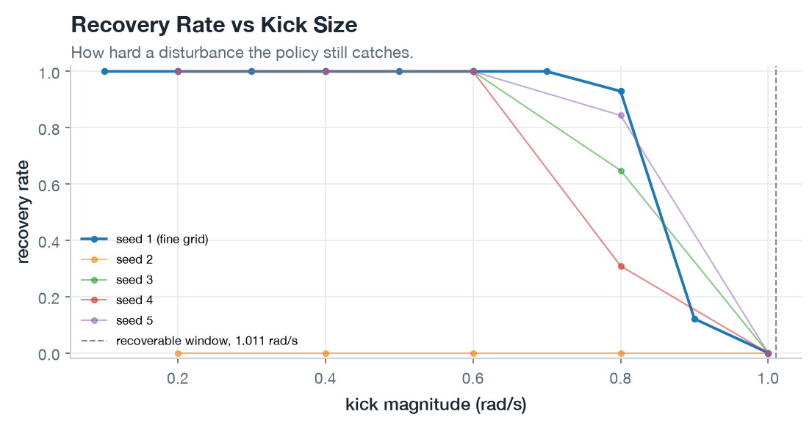

*Recovery rate versus disturbance kick magnitude for all five seeds. The dashed line marks the analytical $1.011\text{ rad/s}$ recovery limit of the $11.78\text{ rad/s}^2$ motor. Seed 2 fails due to arm travel drift.*

Holding seeds absorbed kicks up to 0.6 to 0.7 rad/s with high reliability, falling off sharply at 0.8 rad/s and dropping to zero at 1.0 rad/s. This matches physical limits: at vertical balance, the motor's nominal $11.78\text{ rad/s}^2$ acceleration can analytically arrest at most $1.011\text{ rad/s}$ of angular rate. Beyond 0.8 rad/s, almost all failures occurred because the arm ran out of room ($90^\circ$ limit) while arresting the bob, not because the pole fell over (`recovery.csv`).

### Catching a swing-up

Before attempting an end-to-end swing-up policy, the balance policy needed to prove it could catch a pendulum arriving from a swing-up.

The initial attempt used a standard energy pump, $u = a_{\max} \operatorname{sign}(\dot{\theta} \cos\theta)$, with a braking governor when predicted arm travel exceeded 2.0 rad. At the nominal $11.78\text{ rad/s}^2$ acceleration limit, however, the pump could not invert the pendulum in 3D simulation. It stalled $64^\circ$ short of vertical, reaching only 12.4 rad/s through bottom dead center versus the 14.7 rad/s needed to reach upright. Simulated aerodynamic drag and dry friction absorbed energy as fast as the arm injected it. (In the planar model from [Experiment 04](../04-model-reconciliation/writeup.md), which lacks 3D centrifugal coupling and discrete actuator dynamics, the pump barely squeaked through after 14.8 seconds).

To force handovers and evaluate the catch controller, raising `--accel-bound` tested higher pump acceleration limits. At $15\text{ rad/s}^2$, 236 of 256 episodes reached the $20^\circ$ handover gate. Pumping harder (20 or $30\text{ rad/s}^2$) actually degraded handover success: each half-swing injected too much energy, blowing past the narrow capture window.

```bash
python -u scripts/scripted_swingup.py --headless --num-envs 256 --seed 1 --duration-s 30 --physics-hz 4000 --accel-bound 15 --checkpoint logs/rsl_rl/furuta_balance/seed1/model_299.pt --out results/handover.csv --episodes-out results/handover_episodes.csv
```

| Pump Bound | Handovers Reached | Baseline Policy Holds | LQR Holds |
|:---:|:---:|:---:|:---:|
| 11.78 rad/s² | 0 of 256 | | |
| 15 rad/s² | 236 | 16 (6.8%) | 168 (71.2%) |
| 20 rad/s² | 109 | 14 (12.8%) | |
| 30 rad/s² | 65 | 7 (10.8%) | |

Out of 236 handovers at $15\text{ rad/s}^2$, the baseline policy caught only 16.

To determine whether this was a motor authority limit, a benchmark against a classical Linear Quadratic Regulator (LQR) clamped to the same $11.78\text{ rad/s}^2$ limit on the identical 236 states caught 168 arrivals. Actuator authority was clearly sufficient.

The failure was pure distribution shift:
- Baseline training initialized episodes within $2^\circ$ of vertical with the arm stationary near center.
- Handovers arrived at the $20^\circ$ gate with the arm displaced by a median of 1.09 rad and moving at speed.
- In 218 of the 220 failed policy attempts, the pendulum did not fall. The rotor arm slammed into the $90^\circ$ travel limit. The policy had never learned to recover while conserving arm travel.

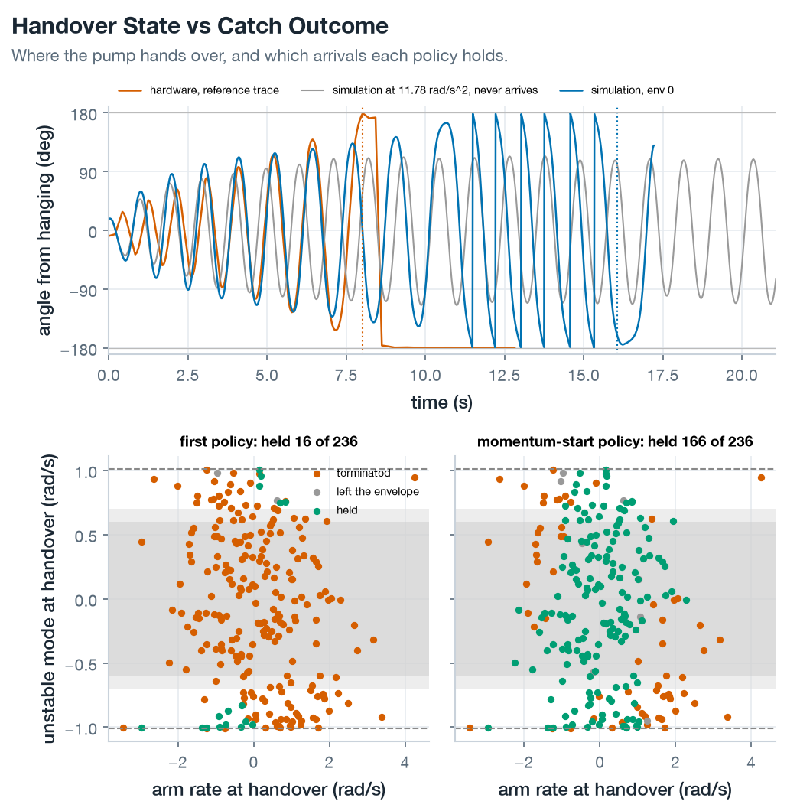

*Top: pendulum swing-up angle over time (hardware trace in orange vs. nominal simulated pump in grey). Bottom: handover states in modal velocity vs. rotor speed for the baseline policy (left) and momentum-start policy (right).*

#### Retraining with momentum resets
Addressing this required expanding the reset distribution into `Furuta-Balance-Momentum-Direct-v0`. Rather than uniform random resets (which create unrecoverable states and teach the agent to quit), initial states sample from the analytically recoverable set:
- Tilt within $\pm 0.3\text{ rad}$ ($\pm 17^\circ$), with coupled modal velocity within $\pm 0.9\text{ rad/s}$ so every initial state is recoverable by construction.
- Arm position sampled across $\pm 2.0\text{ rad}$ at velocities up to $\pm 6.0\text{ rad/s}$.

Retrained on this distribution, the momentum policy (`checkpoints/momentum_seed1_model_299.pt`) caught 166 of the 236 handovers, matching the LQR (168) and holding every handover the baseline policy had caught.

| First policy | Momentum-start policy |
|:---:|:---:|
| 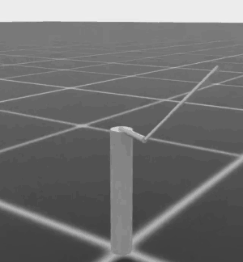 | 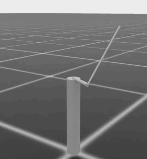 |

*Comparison catching the same simulated swing-up at 17.5 s. The baseline policy runs out of arm travel and drops; the momentum policy stabilizes and centers.*

### Running the firmware's own swing-up

Analyzing the Edukit firmware source code ([ADR-0004](../../adrs/0004-two-actuator-paths.md)) revealed a fundamental surprise: the factory swing-up is not an energy pump at all. It is an open-loop pulse schedule.

At each pendulum zero-crossing, the firmware commands a blocking 200-microstep jump opposing pendulum motion using the L6474 stepper driver's internal ramp generator ($11.78\text{ rad/s}^2$ acceleration for 185 ms), completely suspending the 500 Hz control loop during each pulse. Once swings exceed $150^\circ$, pulse amplitude drops to 160 microsteps. Handover occurs when tilt enters $1.0^\circ$ of vertical, regardless of velocity.

This revealed a critical misconception: **$11.78\text{ rad/s}^2$ was never the motor's acceleration limit.** It was merely the ramp rate parameter inside the swing-up generator. In balance mode, the firmware writes directly to the acceleration register with a software clamp of 131,071 microsteps/s² ($257.4\text{ rad/s}^2$). Bench telemetry showed the stock balance PID routinely commanding 43 to $58\text{ rad/s}^2$ during initial catches.

Module `src/furuta/kick.py` models this pulse routine, switching from position stepping during swing-up to acceleration integration at handover:

```bash
python -u scripts/scripted_swingup.py --headless --pump firmware --physics-hz 4000 --num-envs 256 --seed 1 --duration-s 30 --start-at-rest --out results/handover_firmware.csv --episodes-out results/kick_episodes_lqr_rest.csv --trace results/kick_trace_lqr_rest.csv --kicks-out results/kick_kicks_lqr_rest.csv
```

Simulated pulse timing matched bench hardware within 30 ms over the first eight kicks (2.87 s vs 2.86 s). Hardware inverted in 16 kicks (8.0 s), while simulation required 20 kicks (11.6 s) due to higher simulated dissipation at wide angles.

At handover, the simulated pulse delivered:
- Tilt: $0.9^\circ$
- Pendulum velocity: $1.19\text{ rad/s}$
- Unstable modal velocity: $1.07\text{ rad/s}$

That $1.07\text{ rad/s}$ arrival velocity strictly exceeds the $1.011\text{ rad/s}$ physical recovery limit of an $11.78\text{ rad/s}^2$ actuator. Clamped to 11.78, LQR caught 0 of 256 arrivals. The $11.78\text{ rad/s}^2$ momentum policy caught only 115 of 256 handovers, catching arrivals below 0.9 rad/s, but failing on almost everything exceeding 1.011 rad/s (`kick_episodes_momentum.csv`).

No controller limited to $11.78\text{ rad/s}^2$ could ever reliably catch factory handovers.

#### Expanding action authority to 40 rad/s²
Retraining the momentum policy with `--accel-bound 40` scaled the recoverable reset set accordingly, safely inside the $58\text{ rad/s}^2$ observed on hardware.

| The firmware's swing-up, then the 40 rad/s^2 policy |
|:---:|
| 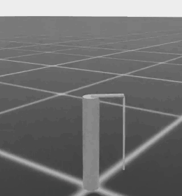 |

*The firmware pulse routine caught and stabilized by the 40 rad/s² policy (real time, 7.5 to 19.5 s; handover at 11.6 s inside a 1.0° window). The command peaks at 40 rad/s² during the catch and settles to 8.5 rad/s² RMS.*

With $40\text{ rad/s}^2$ authority, the policy caught **256 of 256** simulated handovers from rest (and 256/256 from spread starts) with zero failures (`handover_firmware.csv`, `kick_episodes_a40.csv`).

The checkpoint (`checkpoints/momentum_a40_seed1_model_299.pt`) was exported to `board/policy_weights.h` and compiled into firmware mode `b`.

### On the machine

The policy's 1,281 floating-point weights were compiled into microcontroller flash memory as constant arrays. In firmware mode `b`, the STM32F401 evaluates the neural network inside its 500 Hz timer interrupt without host computer involvement, using the serial port only for post-run telemetry ([firmware runbook](../../runbooks/edukit-firmware.md)).

Initial bench testing exposed three real-world defects that simulation never modeled:

1. **Velocity estimator blindness**: the 16-sample least-squares velocity filter was originally reset at handover, blinding the policy for the first 32 ms while the pendulum swept through upright at $>2\text{ rad/s}$. Running the estimator during swing-up also failed because the swing-up loop polled at 3.25 ms instead of 2.0 ms, distorting calculated velocities by $1.6\times$ (reporting 3.62 rad/s for a 2.2 rad/s arrival). Pre-seeding the filter from the last eight swing-up samples using actual timestamps via `observer_seed` resolved the distortion.
2. **Blocking serial prints tripping the watchdog**: the factory firmware printed a 40-byte ASCII telemetry line on every 2 ms cycle. At 230,400 baud, that write blocked for 1.7 ms. Simple PID arithmetic fit into the remaining 0.3 ms margin, but neural network inference overran the window. The loop fell behind by ~0.5 ms per cycle until the hardware watchdog triggered after 19 cycles (38 ms), killing the motor. Muting per-cycle serial prints and buffering telemetry into RAM for a post-run dump eliminated the timing overrun.
3. **Artificial travel stop in test harness**: the host harness code originally stopped runs if the arm moved more than $\pi$ radians from handover (a simulation termination rule). The first real catch hit this threshold at 1.5 seconds while holding tilt within $3^\circ$ with the arm already decelerating. Because the physical encoder cable safely accommodates complete rotations, removing this check allowed catches to complete.

With these fixes in place, the policy stabilized physical swing-up handovers on hardware.

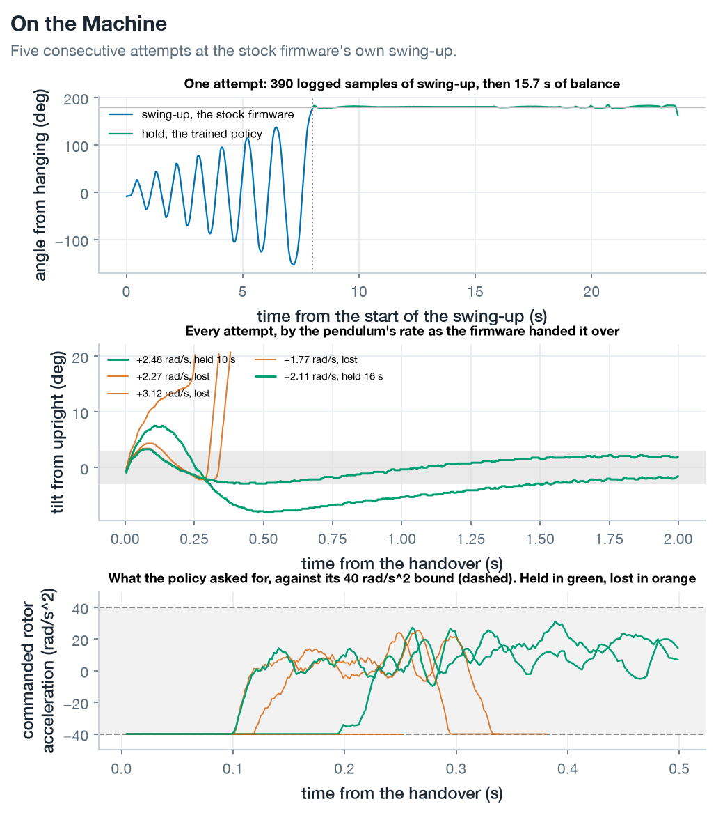

*Five consecutive bench attempts from on-chip telemetry. Top: full run (16 swing-up pulses over 8.0 s, followed by 15.7 s of policy hold). Middle: first 2 seconds post-handover against the 3.0° band. Bottom: command saturation at 40 rad/s².*

Two of five attempts held balance for 9.7 s and 15.7 s, holding tilt within $3^\circ$ for 97% of the duration (RMS tilt $1.83^\circ$). Three attempts failed early because the initial catch saturated against the negative acceleration rail for 100 to 200 ms.

Increasing action authority to $60\text{ rad/s}^2$ caught 5 of 7 attempts for the full 30 seconds. However, the arm drifted through 10.2 radians (1.16 revolutions), tangling the encoder cable (`hardware_rl_balance_a60.tsv`).

#### Penalizing rotor drift
The arm wandered because the initial 60 rad/s² training run had omitted rotor travel penalties, treating arm movement as free. On hardware, bench arrivals were much faster than in simulation (median 2.33 rad/s vs 1.12 rad/s), demanding substantial arm displacement.

Evaluating three reward variants across 256 simulated momentum resets matching bench arrival speeds shows the impact of travel penalties:

| Charged For | Checkpoint | Hold Rate | Travel Terminations | Peak Tilt |
|---|---|:---:|:---:|:---:|
| Neither | `momentum_a60_seed1` | 23.4% | 66.4% | 14.10° |
| Arm position | `momentum_a60b_seed1` | 52.0% | 48.0% | 13.16° |
| Position and velocity | `momentum_a60c_seed1` | **56.3%** | **43.8%** | 13.23° |

Penalizing arm position and velocity more than doubled hold success by eliminating slow drift outside the deadband (`recovery_reward_sweep.csv`).

### Holding upright and regularizing high-frequency chatter

Flashing the position-and-velocity penalized policy (`momentum_a60c`) caught **three out of three consecutive bench attempts**, holding each for the full 30-second window:

| Attempt | Arrival Velocity | Tilt RMS | Inside 3° | Arm Span |
|:---:|:---:|:---:|:---:|:---:|
| 1 | 1.37 rad/s | 1.47° | 90% | 57° |
| 2 | 2.96 rad/s | 2.81° | 78% | 105° |
| 3 | 2.83 rad/s | 4.11° | 65% | 172° |

Once settled (after ~5 seconds), steady-state tilt RMS was exceptional: $0.36^\circ$ to $0.38^\circ$ across all three runs (`hardware_rl_balance_a60c.tsv`).

#### Violent mechanical chatter
While the pendulum balanced upright, the control command chattered violently, visibly shaking the rod.

During steady-state hold, commands reversed direction 12 to 30 times per second at $44\text{ rad/s}^2$ RMS, slamming into the $\pm 60\text{ rad/s}^2$ rails for 30% of samples. Simulation reproduced the same switching pattern (36 reversals/s at $11.2\text{ rad/s}^2$ RMS), confirming this was learned policy behavior. Hardware then amplified the command magnitude fourfold into hard rail saturation.

The root cause was reward under-penalization. The inherited action-rate weight was only $-0.01$ on squared normalized action differences:
$$\Delta a_{\text{norm}} \approx \frac{2.99\text{ rad/s}^2}{60\text{ rad/s}^2} = 0.05 \implies (\Delta a_{\text{norm}})^2 = 0.0025$$
This yielded a microscopic penalty of $-2.5 \times 10^{-5}$ per step against a +1.0 alive bonus. Rapid chatter was effectively free.

#### Action-rate penalty sweep
Sweeping action-rate weights across 256 simulated firmware swing-up handovers reveals the trade-off between smoothness and catch authority:

| Action-Rate Weight | Catches | Reversals / s | Command RMS | Peak Command | Tilt RMS |
|:---:|:---:|:---:|:---:|:---:|:---:|
| 0.01 (deployed) | 256 / 256 | 36 | 11.24 rad/s² | 17.4 rad/s² | 0.36° |
| 0.5 | 256 / 256 | 11 | 1.85 rad/s² | 7.1 rad/s² | 0.46° |
| 3.0 | 29 / 256 | 14 | 0.47 rad/s² | 2.3 rad/s² | 0.61° |
| 15.0 | 0 / 256 | | | | Falls |

A weight of 0.5 dropped command RMS by a factor of six and cut reversals by two-thirds while maintaining a 100% catch rate. Weights of 3.0 or higher degraded catches because the penalty fought the sharp initial acceleration spike needed to arrest the swinging pendulum (`chatter_sweep.csv`).

The regularized model (`momentum_a60d`) was exported to C and flashed to hardware.

### Eliminating mechanical vibration

The regularized policy (action-rate weight 0.5) stabilized two consecutive bench handovers for the full 30 seconds while eliminating all mechanical chatter.

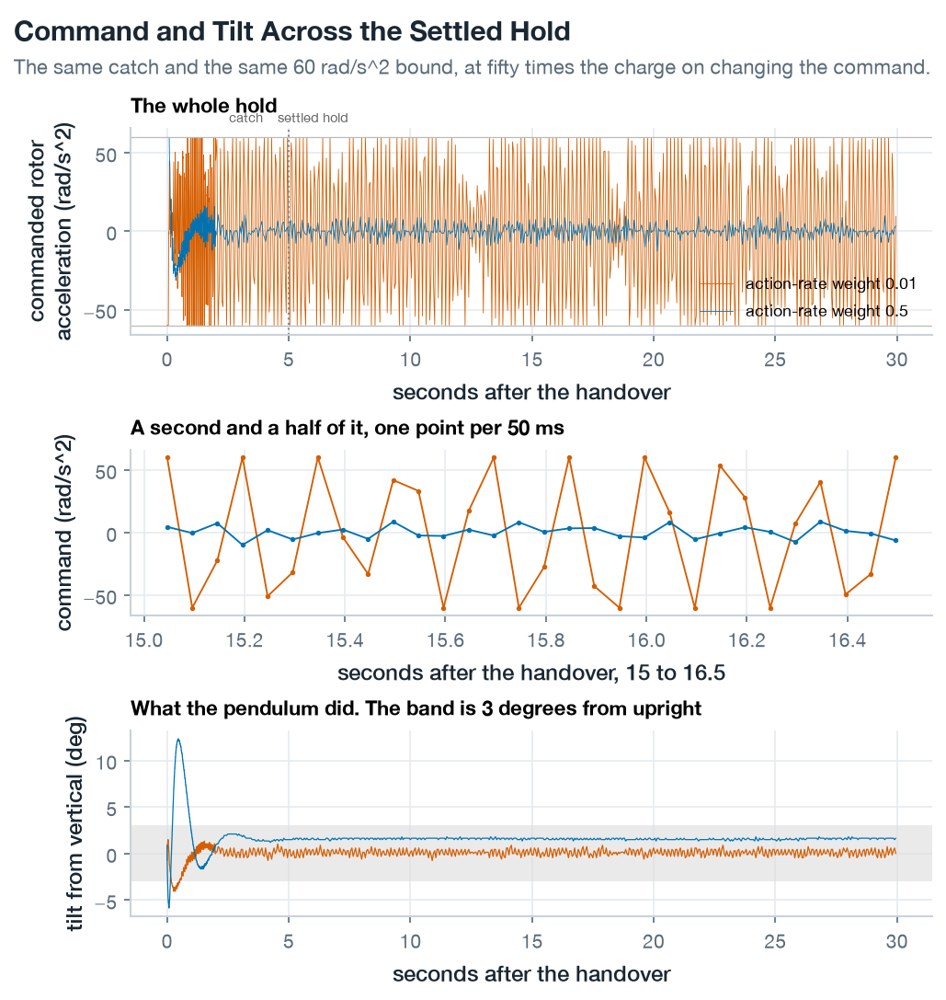

*Hardware command and tilt at action-rate weight 0.01 vs 0.5 over 30-second holds. Top: full run. Middle: 1.5 s of settled hold at 20 Hz. Bottom: tilt against the 3.0° band.*

| | Simulated RMS | Bench RMS | Bench Peak | Time on Rail |
|---|:---:|:---:|:---:|:---:|
| **Weight 0.01** | 11.24 rad/s² | 43.80 rad/s² | 60.0 rad/s² (bound) | 30% |
| **Weight 0.5** | 1.85 rad/s² | 4.28 rad/s² | 12.7 rad/s² | **0%** |

On hardware, commanded acceleration dropped tenfold from 43.8 to $4.28\text{ rad/s}^2$ RMS, peaking at $12.7\text{ rad/s}^2$ with **zero rail saturation**. Hardware command amplification dropped from $3.9\times$ to $2.3\times$, showing that mechanical non-linearities (drivetrain backlash, rotor compliance, and microstep slip) scale non-linearly with command amplitude.

The trade-off was a small steady-state tilt offset of $\sim 1.6^\circ$ ($1.58^\circ$ RMS) compared to $0.36^\circ$ under the noisy policy, remaining comfortably inside the $3.0^\circ$ gate. Baseplate inclination measured in [Experiment 03](../03-hardware-bringup/writeup.md) accounts for up to $0.51^\circ$ of this offset, with the rest coming from regularized policy gradients.

The second run held for the complete 30 seconds. On the first run, the policy held steady until a manual push disturbance at 9.9 seconds; the controller commanded a $29^\circ$ arm correction, returned to vertical within 600 ms, and held until a second push ended the test (`hardware_rl_balance_a60d.tsv`).

| Before, weight 0.01 | After, weight 0.5 |
|:---:|:---:|
| 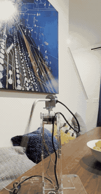 | 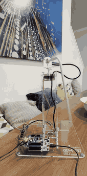 |

*Action-rate weight 0.01 vs 0.5 on hardware. Left: the baseline policy holds upright while violently shaking the rod. Right: the regularized policy holds still and quiet.*

## Takeaways

1. **Simulation balance and kick limits**: policies trained in the reconciled Isaac Lab environment held balance for 30 seconds across 4 of 5 seeds. Holding seeds absorbed disturbance kicks up to 0.7 rad/s, closely matching the theoretical $1.011\text{ rad/s}$ motor torque authority limit.
2. **The swing-up handover gap**: baseline balance policies failed 93% of swing-up handovers because narrow resets left them unprepared for high-velocity arrivals, causing the arm to run into travel limits. Sampling resets across the analytically recoverable set (`Furuta-Balance-Momentum-Direct-v0`) lifted catches to match an optimal LQR.
3. **Actuator limits vs. profile limits**: the nominal $11.78\text{ rad/s}^2$ acceleration limit was an artifact of the firmware's swing-up ramp profile, not motor torque capacity. Real handovers delivered $1.07\text{ rad/s}$ modal velocity, physically exceeding an 11.78 limit. Expanding action authority to 40 to $60\text{ rad/s}^2$ matched real motor capability and enabled 100% simulated catches.
4. **Embedded sim-to-real hurdles**: successful on-chip deployment on the STM32F401 required solving three physical issues: pre-seeding the 16-sample velocity estimator from true swing-up timestamps, muting blocking UART output to prevent watchdog timeouts, and removing artificial harness travel limits.
5. **Action-rate regularization**: negligible action-rate penalties allowed policies to develop high-frequency chatter that saturated hardware actuators and shook the rig. Increasing the penalty weight from 0.01 to 0.5 dropped hardware command RMS tenfold (43.8 to $4.28\text{ rad/s}^2$) and eliminated rail hits, producing smooth, silent balance without sacrificing catch performance.

### Unmeasured physical quantities
- **Arrival velocity distribution**: bench swing-ups handed over at a median velocity of 2.33 rad/s (up to 3.12 rad/s) versus 1.12 rad/s in simulation, indicating higher kinetic energy at arrival on hardware.
- **Drivetrain non-linearities**: hardware amplified commands by $3.9\times$ when noisy and $2.3\times$ when smooth, reflecting unmodeled backlash, arm flexure, and stepper slip under dynamic load.
- **Standing tilt offset**: the regularized policy balances with a $\sim 1.6^\circ$ steady-state tilt offset, exceeding the $0.51^\circ$ measured baseplate lean.
- **Dynamic torque limits**: the 60 rad/s² action bound was empirically validated against factory PID logs; true motor pull-out torque and dynamic step loss remain uncharacterized.

## References

- [Milestone 05](../../milestones/M5-balance.md): exit gates and deliverables for the balance stage.
- [Environment design](../../design/rl-environment.md): state space, action space, and reward formulation.
- [ADR-0003](../../adrs/0003-training-algorithm.md): learning algorithm and network sizing.
- [ADR-0004](../../adrs/0004-two-actuator-paths.md): dual actuator paths and the origins of the 11.78 rad/s² ramp limit.
- [Model conversion runbook](../../runbooks/model-conversion.md): exporting checkpoints to C and equivalence testing.
- [Firmware runbook](../../runbooks/edukit-firmware.md): mode `b` operation and bench testing procedures.
- [Experiment 03](../03-hardware-bringup/writeup.md): parameter identification and reference hardware traces.
- [Experiment 04](../04-model-reconciliation/writeup.md): reconciled simulation and loss models.
- [Checkpoints registry](./checkpoints/README.md): checkpoint lineage and run metadata.
- [Logbook](./logbook.md): chronological log of all training configurations and failed runs.
- Edukit Manual Section 1: 3.0-degree balance engagement envelope.
