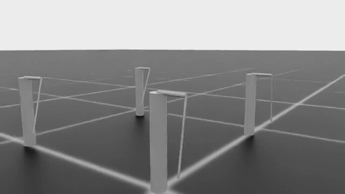
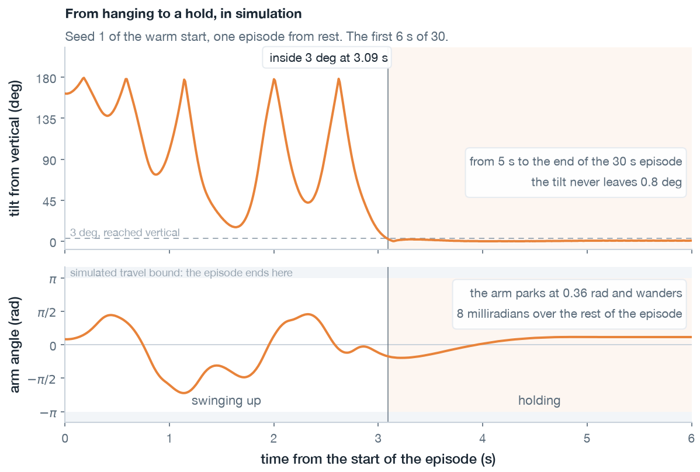
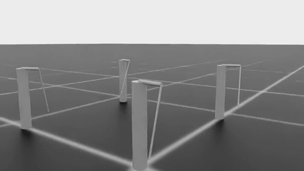
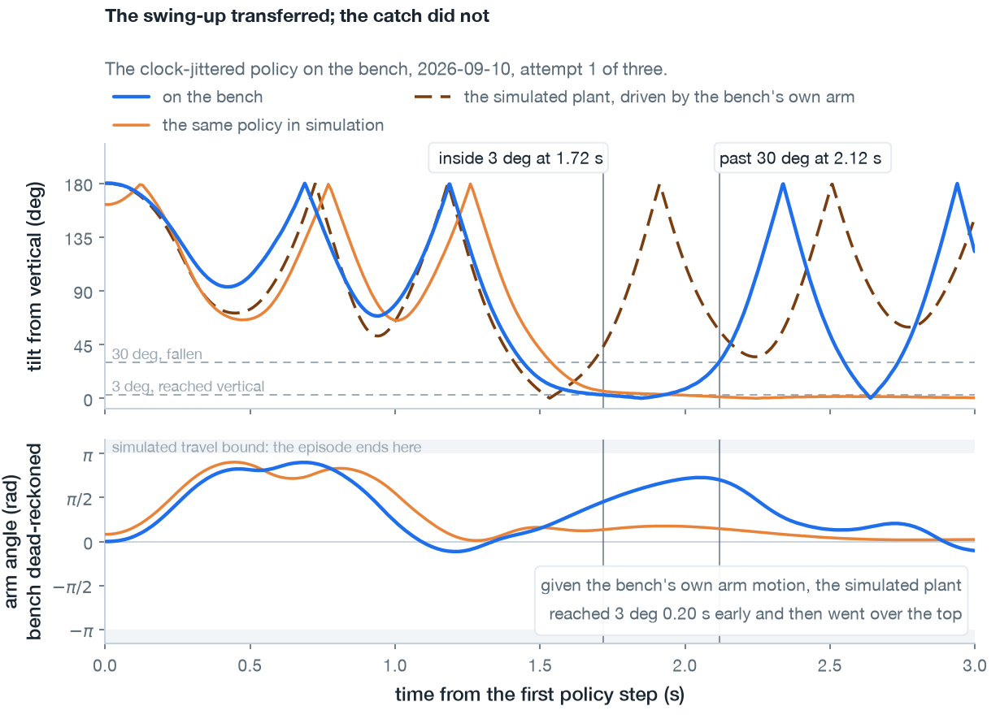
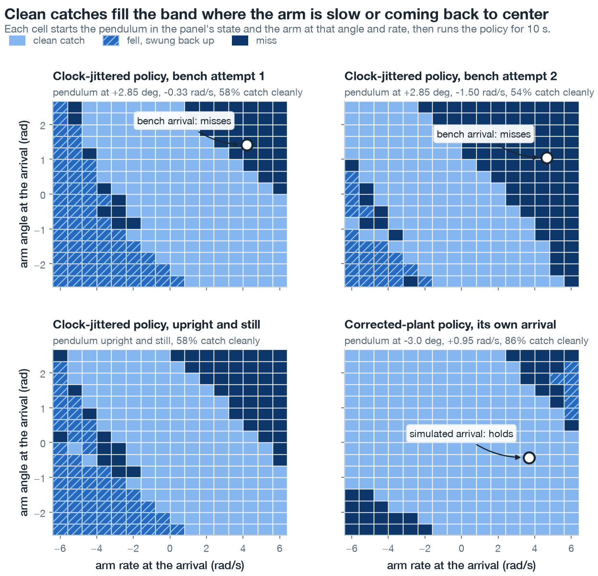
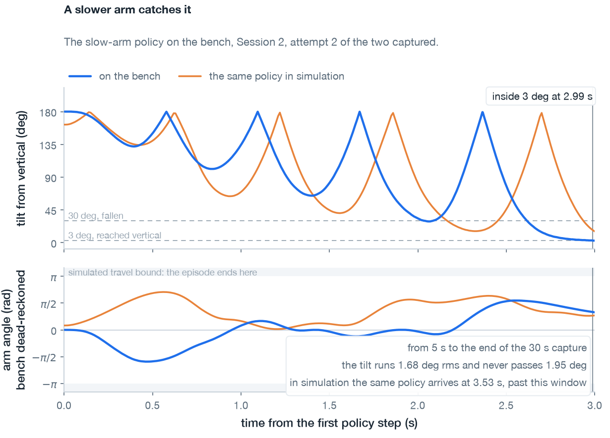
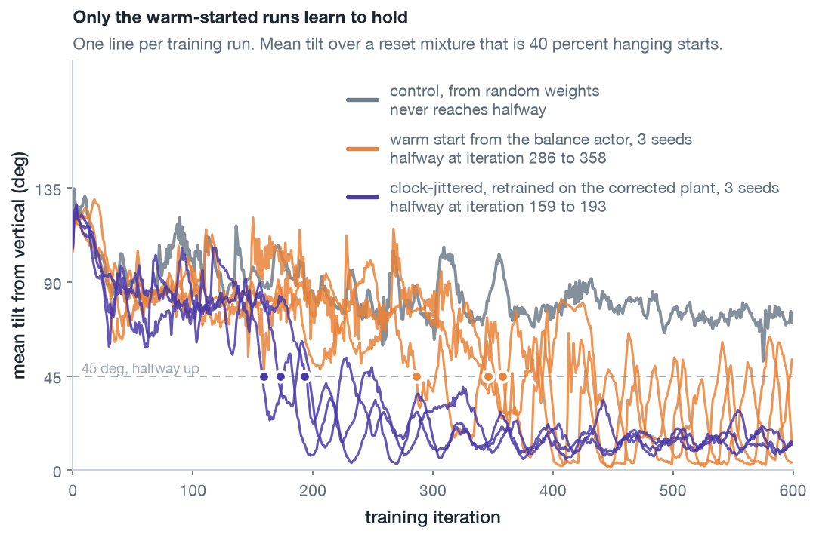
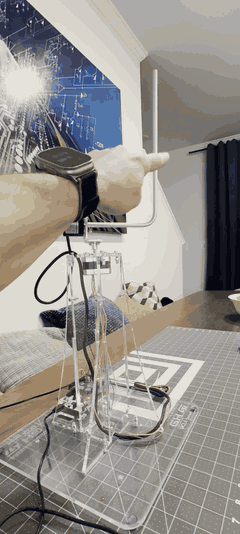

# Experiment 06: swing-up

## Goal

[Milestone 06](../../milestones/M6-swing-up.md) targets autonomous swing-up and balance on the rotary inverted (Furuta) pendulum: a single neural network policy that swings the rod up from hanging rest and stabilizes it upright, with no manual assistance and no heuristic switching between separate pumping and holding controllers.

Success requires reaching vertical and holding within $3^\circ$ of upright for the final 5 seconds of a 30-second episode across a fixed evaluation seed set. On hardware, the policy must swing up and hold on the board, or the transfer gap must be characterized.

Building on the balance policy developed in [Experiment 05](../05-balance/writeup.md), this task requires the network to bridge two fundamentally different dynamical regimes: nonlinear, large-angle energy pumping to raise the rod, followed by rapid capture into high-precision balance.

## Setup

The hardware, the firmware interface, and the training host are [Experiment 05](../05-balance/writeup.md)'s. Training keeps that experiment's $60\text{ rad/s}^2$ acceleration bound, a working hypothesis under [ADR-0004](../../adrs/0004-two-actuator-paths.md) until a bench step-loss ladder measures the motor. The Isaac Lab simulation carries [Experiment 04](../04-model-reconciliation/writeup.md)'s reconciled pivot friction and tilts gravity by the $0.51^\circ$ bench incline measured in [Experiment 03](../03-hardware-bringup/writeup.md).

### Conventions and key concepts

- **Tilt ($\theta$), unstable mode ($\eta = \dot{\theta} + \omega_g \theta$) and recoverable set**: as the [environment design](../../design/rl-environment.md#where-the-limits-come-from) defines them, with $\omega_g = 7.351\text{ rad/s}$. At $60\text{ rad/s}^2$ the recoverable set is $|\eta| \le 5.15\text{ rad/s}$.
- **Separatrix energy ($E_{\mathrm{up}}$)**: the potential energy required to reach vertical upright with zero angular velocity ($2 m g l$, with $m$ the rod's mass and $l$ the distance from the pivot to its center of mass). Measured relative to hanging rest ($E = 0$), mechanical energy is expressed as a normalized ratio $E / E_{\mathrm{up}}$. With the arm at rest, an energy below 1.0 means the rod cannot reach vertical and an energy exceeding 1.0 carries it over the top; a moving arm adds or removes energy on the way.
- **Evaluation protocol**: [Experiment 05](../05-balance/writeup.md)'s gate of 256 deterministic 30-second episodes starting within 0.4 rad and 1 rad/s of hanging rest. An episode counts as reaching vertical once tilt enters within $3^\circ$, and succeeds if it stays inside that $3^\circ$ window for the final 5 seconds without exceeding the $\pm \pi$ rotor travel limit.

`just figures 06` redraws the plots from [`figures/`](./figures/); the three GIFs are recordings, the bench one from a phone.

## The work

### Updating the environment

The observation space is [Experiment 05](../05-balance/writeup.md)'s ([ADR-0005](../../adrs/0005-observation-space.md)). Expanding the task from local balance to full swing-up requires several structural changes:

- **Continuous action squashing**: acceleration commands are squashed through $\tanh$ to $[-60, 60]\text{ rad/s}^2$. Under hard clipping, a policy mean far past the rail commands the same as one at the rail, so nothing pulls a drifting mean back. $\tanh$ has no such flat region.
- **Full rotation and cable limits**: removing the $20^\circ$ tilt termination permits full $360^\circ$ swings. Rotor travel termination tightens from the $4\pi$ used during Experiment 05 balance training to $|\phi| > \pi$, matching the evaluation protocol's limit (the encoder cable binds once rotated past a full turn from center).
- **Multi-modal reset mixture**: training exclusively from hanging rest leaves the top unvisited, and a policy cannot learn to hold a state it has never entered. The reset mixture comprises:
  - 40% from hanging rest ($|\theta - \pi| \le 0.4\text{ rad}$, $|\dot{\theta}| \le 1.0\text{ rad/s}$),
  - 25% near upright inside the recoverable set ($|\theta| \le 0.3\text{ rad}$, $|\eta| \le 4.58\text{ rad/s}$, with arm speeds up to $6.0\text{ rad/s}$), ensuring the policy retains balancing competence, and
  - 35% uniformly distributed across the full circle with velocities up to $\pm 10\text{ rad/s}$.
- **Composite reward shaping**: to guide the policy from hanging rest to upright stabilization, the reward blends several complementary terms:
  1. *Separatrix energy shaping*: $+2.0(1 - |E - E_{\mathrm{up}}| / E_{\mathrm{up}})$, rewarding the agent for pumping total mechanical energy toward the separatrix.
  2. *Quadratic capture well*: $+2.0(1 - (\theta / 20^\circ)^2)$ active within $20^\circ$ of vertical, providing a steep restoring gradient toward zero tilt.
  3. *Upright bonus*: $+1.0\cos\theta$ to encourage spending time near the top.
  4. *Regularization*: an alive bonus of $+1.0/\text{step}$, penalized by rotor velocity ($-0.01\dot{\phi}^2$), rotor excursion past a $0.5\text{ rad}$ deadband ($-0.5(|\phi| - 0.5)$), command magnitude ($-0.01a^2$) and rate of change ($-0.5(\Delta a)^2$), both on the normalized action $a \in [-1, 1]$, and pendulum angular velocity within the capture well ($-0.0096\dot{\theta}^2$). A travel termination costs $-2.0$.
- **Physics timestep**: physics simulation runs at 4 kHz (8 substeps per 2 ms control cycle), up from the 1 kHz used in [Experiment 05](../05-balance/writeup.md). [Experiment 04](../04-model-reconciliation/writeup.md)'s replay of a logged hardware swing-up climbed $23^\circ$ higher at 4 kHz than at 1 kHz, though free decay showed no difference between the rates. That replay ran on the stepped rotor target, whose driven results change with the physics rate ([ADR-0006](../../adrs/0006-walked-rotor-target.md)). Every policy here trained and was scored at 4 kHz, and whether 1 kHz would serve on the corrected plant is untested.

### Pre-training diagnostics and modeling corrections

Before training, several issues in the simulation and training loop needed fixing:

1. **Episode clock desynchronization**: initially, all parallel environments reset simultaneously (`init_at_random_ep_len=False`). Because the task rarely terminates, the clocks stayed in step, and every 128-step rollout (0.25 s) sampled the exact same slice of every episode. Enabling randomized initial episode lengths desynchronizes the batch at the start of training, though terminations can pull the clocks back into step.
2. **PPO value clipping**: standard PPO clips value function updates to $\pm 0.2$ in return units. Swing-up returns move by thousands of points as the agent discovers pumping, and under the clip the critic can close on them by at most 0.2 per update. Nothing measured whether that would have stalled training. Disabling value clipping (`--no-value-clip`) allows the critic to adapt quickly to regime changes.
3. **Velocity estimator buffer seeding**: the 16-sample slope-fit buffers previously initialized with flat values at reset. A pendulum starting at $4\text{ rad/s}$ would erroneously report velocity ramping up from zero over its first 32 ms. Seeding the filter buffer with the true initial rate resolves this startup transient.
4. **Centrifugal coupling**: in a rotary pendulum, horizontal arm rotation flings the pendulum outward with a centrifugal torque proportional to $\kappa \dot{\phi}^2 \sin\theta \cos\theta$ (where $\kappa = 0.974$ is the ratio of rod inertia to total pivot inertia). At an arm speed of $7.45\text{ rad/s}$, this centrifugal term cancels gravity's restoring pull on small swings about hanging. Past that speed, the hanging rod lifts on its own. While Isaac Lab's articulated multibody model includes this effect natively, the standalone planar reference model (`planar.py`) applies it only when a caller passes the arm speed, and [Experiment 04](../04-model-reconciliation/writeup.md)'s replay did not. Passing it gives the reference model the same coupling the full 3D simulation already carries.

### Scripted baselines: proving feasibility

Comparing three classical pumping controllers answered a basic feasibility question (the bang-bang and energy pumps before starting RL, the kick pump after the control and warm-started runs): can any controller pump the rod into a state that the balance policy can actually catch within the $60\text{ rad/s}^2$ acceleration limit?

Each controller pumps from 256 hanging starts until the rod enters the recoverable set within $0.35\text{ rad}$ ($20^\circ$) of upright, at which point control hands over to the [Experiment 05](../05-balance/writeup.md) balance policy:

1. **Bang-bang pump** (the sign law [Experiment 05](../05-balance/writeup.md) calls a standard energy pump): applies maximum acceleration switching on $\operatorname{sign}(\dot{\theta}\cos\theta)$, braking instead whenever the arm's stopping distance would carry it past a 2 rad travel allowance (the energy pump runs behind the same governor). It reaches vertical quickly, but hands the rod over with the arm still turning fast.
2. **Energy-regulated pump**: implements Åström and Furuta's saturated energy-feedback law (their Eq. 8, pumping side only) at gain 8, scaling down acceleration as the system approaches separatrix energy.
3. **Discrete kick pump**: emulates the firmware's 200-microstep kick by delivering a fixed $0.384\text{ rad}$ pulse (its $0.393\text{ rad}$ rounded to whole control steps) each time the rod passes bottom dead center.

| Controller | Handed over | Reached vertical | Held | Travel terminations | Handover time | Unstable mode at handover | Arm speed at handover |
|---|---|---|---|---|---|---|---|
| Bang-bang | 165 | 242 | 19 | 146 | 0.91 s | 3.1 rad/s | 6.9 rad/s |
| Energy-regulated (gain 8) | 254 | 238 | 53 | 201 | 2.17 s | 1.7 rad/s | 1.7 rad/s |
| Kick pump (0.384 rad) | 67 | 65 | 37 | 187 | 6.5 s, after 11 kicks | 2.0 rad/s RMS | 0.23 rad/s RMS |

*Performance of scripted pumps across 256 episodes from hanging rest handing over to the balance policy. Values at handover are medians unless indicated as RMS.*

The comparison highlighted what matters most for a catch:
- **Arrival velocity matters**: under the energy-regulated pump, the balance policy catches 29 of 32 handovers arriving with $|\eta| < 1.0\text{ rad/s}$, but 0 of 79 arriving with $|\eta| > 3.0\text{ rad/s}$.
- **Rotor state at handover is decisive**: bang-bang hands over in 165 episodes but holds only 19. It delivers the rod with the arm flying outward at a median $6.9\text{ rad/s}$, leaving the rotor about 1.4 rad of travel to stop in and then catch the rod, and the balance policy spends it before the arm strikes the $\pi$ travel limit.
- **The catch requirement**: a successful swing-up must bring the rod to vertical with a small unstable mode *while simultaneously braking the rotor to near rest*.

### Training and the rotation trap

Policies trained with PPO across 1,024 parallel environments for 600 iterations (about an hour on an RTX 5080). To see whether the balance half was the missing piece, training compared two starting points:
1. **Control (random weights)**: actor and critic initialized from scratch.
2. **Warm-started**: actor initialized from the Experiment 05 balance policy; critic initialized randomly.

```powershell
$env:PYTHONPATH = "src"
& $env:USERPROFILE\Code\isaac\.venv\Scripts\python.exe -u scripts\train.py --headless --task Furuta-SwingUp-Direct-v0 --num-envs 1024 --physics-hz 4000 --seed 1 --max-iterations 600 --accel-bound 60 --max-rotor-rad 3.1416 --rotor-travel-deadband 0.5 --travel-weight -0.5 --rotor-rate-weight -0.01 --action-rate-weight -0.5 --pendulum-rate-weight -0.0096 --gamma 0.999 --episode-length-s 10 --no-value-clip --stepped-rotor --init-from-actor docs\experiments\05-balance\checkpoints\momentum_a60d_seed1_model_299.pt --run-name r1-warm
```

The randomly initialized control quickly ran into a local optimum: it learned to pump energy, but never learned to stop. By iteration 230, every hanging start swung past vertical at 2.1 times separatrix energy, and the final policy kept spinning continuously over the top like a propeller at 1.24 times.

Because the separatrix energy reward $+2.0(1 - |E - E_{\mathrm{up}}| / E_{\mathrm{up}})$ is symmetric, continuous rotation still collects decent reward: roughly 2.7 points per step (out of 6.0 for a steady hold). Transitioning from full rotation to a balanced hold requires a sharp, counter-intuitive braking move that no reward term pays for until the rod is caught upright. The policy never discovered the braking stroke, and by iteration 340 its action noise had decayed from $\sigma = 1.0$ to 0.27. On evaluation, it reached vertical in 236 of 256 episodes, but held none.



*The randomly initialized control policy spinning continuously in the rotation trap.*

The warm-started run also slipped into this rotation trap around iteration 220. But it discovered the braking stroke between iterations 333 and 443. The log shows two differences from the control but not which one mattered: its actor already had functional balance weights, so the capture reward was never zero, and its exploration noise was wider at iteration 333 ($\sigma = 0.48$ versus 0.27).

On evaluation, the warm-started policy reached vertical in 255 of 256 episodes and successfully held 254 of them.



*Single episode trajectory of the warm-started policy from a hanging start 18° off rest at 0.28 rad/s (`simulation/trace_r1_warm_seed1.csv`).*

In this trace, the policy's first stroke takes the arm to $1.4\text{ rad}$ and its second sweeps it to $2.3\text{ rad}$ at a peak speed of $10.6\text{ rad/s}$, lifting the rod past horizontal by 0.8 s. The rod falls back just short of separatrix energy at 1.6 s, and the next stroke carries it to 1.2 times separatrix energy at 1.9 s. The policy then bleeds off excess kinetic energy over two more half-swings, re-entering the $20^\circ$ capture well at 2.95 s with small unstable mode ($|\eta| = 1.40\text{ rad/s}$) and rotor speed ($2.7\text{ rad/s}$). It locks into upright balance at 3.09 s, holding with root-mean-square command chatter of $3.7\text{ rad/s}^2$.

### Multi-seed evaluation and opening stroke dynamics

Evaluating the warm-started configuration across two additional random seeds gives:

| Seed | Reached vertical | Held | Travel terminations | Termination time (median) | Swing-up time (median) | Peak arm speed (max of 256) |
|---|---|---|---|---|---|---|
| 1 | 255 of 256 | 254 | 1 | 0.72 s | 5.11 s | 11.2 rad/s |
| 2 | 141 of 256 | 141 | 115 | 0.45 s | 2.93 s | 10.6 rad/s |
| 3 | 256 of 256 | 255 | 1 | 2.15 s | 1.96 s | 11.2 rad/s |

*Warm-started evaluation across seeds on the stepped plant, which holds one rotor target across all 8 physics substeps of each control period ([ADR-0006](../../adrs/0006-walked-rotor-target.md)). Mean hold rate is 84.6%.*

Seed 1 (99.2%) and Seed 3 (99.6%) held reliably, but Seed 2 dropped to 55.1%. The failures all occurred on the very first stroke: in 115 episodes, the deterministic evaluation policy swung the arm past the travel limit in under half a second, before the rod even lifted. Training exploration noise had softened those opening moves, but the mean action proved too aggressive on certain reset states.

Introducing **episode length jitter** (varying durations uniformly between 8 and 10 seconds) resolved another training quirk: bursts of early terminations had pulled much of the batch back into step, and once the policy held, few terminations were left to spread it again, causing a 39-iteration cyclic ripple in training metrics. Jittering desynchronized the clocks, lowered the mean tilt's autocorrelation at that lag from $+0.84$ to $+0.50$, and gave a run that held 256 of 256 episodes on Seed 1 with a median swing-up time of 2.10 seconds. Seed 1 held 254 without jitter, and one seed cannot separate the jitter's effect from seed variance. This checkpoint goes to hardware first.



*Clock-jittered policy swinging up and holding across parallel environments.*

### Hardware session 1: the transfer gap

Following the [model conversion runbook](../../runbooks/model-conversion.md), exporting the clock-jittered policy to C enables flashing to the STM32F401 microcontroller in firmware mode `r` (RL swing-up from rest). Telemetry records every 2 ms control cycle for the first 3 seconds of an attempt and every 50 ms after that ([`hardware/rl_swingup_20260910.tsv`](./hardware/rl_swingup_20260910.tsv)).

On the bench, the swing-up transferred cleanly, but the catch failed on all three attempts:



*Hardware attempt 1 against simulation (`simulation/trace_r3_clock_seed1.csv`). The dashed line shows the simulator replaying the bench's logged arm trajectory (`simulation/replay_run0.csv`).*

The physical swing-up looked promising at first: two crisp strokes brought the rod within $3^\circ$ of vertical in 1.7 seconds (even faster than the 1.9 s of the same policy's simulated episode), with bottom-pass speeds of $10.2$ and $13.1\text{ rad/s}$ ($10.3$ and $11.9\text{ rad/s}$ in simulation).

The breakdown happened right at vertical arrival:
- **Outward-moving arm**: in simulation, the policy arrived at upright with the rotor virtually stopped at $0.55\text{ rad}$ and returning inward. On hardware, the rod reached vertical while the rotor sat at $1.42\text{ rad}$ and still moved outward at $4.21\text{ rad/s}$.
- **Late arrest and spin**: the controller commanded only $-4$ to $-9\text{ rad/s}^2$ as tilt crossed vertical, ramping up braking only after 240 ms. That was too late to arrest the fall within the $60\text{ rad/s}^2$ bound. The rod sailed over the top and spun continuously, for 7 s on attempt 1 and 11 s on attempt 2.

### Diagnosing the sim-to-real gap

Tracing the cause ruled out the board's observer and policy code first: replaying recorded hardware observations through the compiled C code reproduced microcontroller commands within $0.003\text{ rad/s}^2$. The board executes the policy as trained.

Telemetry pointed directly to the arrival state: the real rod arrived at vertical with the rotor displaced to $1.42\text{ rad}$ and still moving outward at $4.21\text{ rad/s}$.

Mapping the catch envelope across rotor positions and velocities (`scripts/evaluate_catch_map.py`) explained why this mattered. A cell counts as a clean catch when the rod stays inside $3^\circ$ for the last 5 s of its 10 s run and never passes $30^\circ$:



*Catch success mapped over rotor position and velocity (`scripts/evaluate_catch_map.py`). Clean catches concentrate where the arm is slow or moving inward.*

The resulting catch map revealed a clear boundary:
- When the arm is displaced (more than $0.5\text{ rad}$ from center) but **returning inward** (faster than $2\text{ rad/s}$), the policy catches cleanly in 77% to 83% of states.
- When the arm is displaced and **moving outward** ($>+2\text{ rad/s}$), catch success collapses to 3% to 15%.
- The physical hardware arrival ($+1.42\text{ rad}$, $+4.21\text{ rad/s}$) sat squarely inside this uncatchable dead zone. Even in simulation, starting from that exact hardware arrival dropped the rod in 0.34 seconds.

Driving the simulator with the logged hardware rotor trajectory exposed the root difference: in simulation, the rod passed bottom dead center at $13.0\text{ rad/s}$ after the first stroke, compared to $10.3\text{ rad/s}$ on the bench as the replay reads it ($10.2$ read directly). On that first stroke, the simulated rod carried 1.6 times the kinetic energy of the real one. Because the real machine gave the rod less energy for the same arm motion than the stepped plant, the arm was still running outward when the rod reached vertical.

### Uncovering the plant artifact: stepped versus walked targets

What made the simulator pump excess energy? Checking three candidate explanations isolated the problem:

- **Stepper motor step loss**: replaying logged commands through the independent planar dynamic model (`planar.py`) reproduced the physical hardware trajectory within $6.3^\circ$ RMS. Artificially injecting a 10% step loss into the model tripled the error to $19.7^\circ$. Any step loss was at most a few percent.
- **Physics timestep divergence**: replaying the hardware trace across different physics integration rates showed that bottom-pass velocity grew with simulation frequency:
  - 2 kHz: $6.4\text{ rad/s}$
  - 4 kHz: $13.0\text{ rad/s}$
  - 8 kHz: $14.0\text{ rad/s}$
  - Hardware: $10.3\text{ rad/s}$
  An error in the inertia model, such as the centrifugal coupling term, would converge to a single number as timesteps shrank. Diverging with frequency indicated a numerical artifact in the joint drive.
- **The root cause: stepped position targets**: the control loop updates every 2 ms (500 Hz), whereas the physics simulation integrates at 4 kHz (8 substeps per control cycle). In the original environment, the actuator integrated acceleration into a position target once per 2 ms, and PhysX held that target fixed across all 8 substeps. Stiff position gains made the simulated arm jump to the target in the first 1 to 2 substeps and stay parked for the rest of the period ("jump-and-hold").

A real stepper spreads its microsteps evenly across the 2 ms window. Because centrifugal coupling between the arm and rod scales with the square of rotor speed ($\kappa \dot{\phi}^2 \sin\theta \cos\theta$), concentrating motion into a fraction $f$ of the control period multiplies mean-squared speed by $1/f$. At 4 kHz, these sudden velocity jumps pumped massive unphysical energy into the rod. Because shorter substeps sharpen the velocity spike, the surplus grew with the physics rate from 4 kHz up. Why the stepped plant falls short of the bench at 2 kHz is not established.

Following [ADR-0006](../../adrs/0006-walked-rotor-target.md), linearly interpolating ("walking") the position target across substeps and feeding forward commanded velocity eliminated the artifact. Replaying the bench capture on the walked plant matched hardware bottom passes at $9.6$ and $13.4\text{ rad/s}$ ($10.3$ and $13.3$ on the bench as the replay reads it, $10.2$ and $13.1$ read directly), cutting the mean tilt difference over the first 1.5 s from $12.6^\circ$ (stepped target, 4 kHz) to $4.3^\circ$, with the same answer at 2, 4, and 16 kHz.

### Hardware session 2: the slow-arm interim policy

While diagnosing the stepped-target artifact, an interim experiment tested whether slowing the arm down could achieve transfer, because the centrifugal discrepancy only became severe exceeding $7\text{ rad/s}$.

Scaling the rotor velocity penalty tenfold (from $-0.01\dot{\phi}^2$ to $-0.1\dot{\phi}^2$) yielded a policy with a slower, three-stroke swing-up peaking at $8.4\text{ rad/s}$ (versus $11.0\text{ rad/s}$ for the clock-jittered policy). In simulation, it achieved a median swing-up of 3.48 s and held 249 of 256 episodes.

Deployed to hardware in Session 2 ([`hardware/rl_swingup_20260910_session2.tsv`](./hardware/rl_swingup_20260910_session2.tsv)), this slow-arm policy **successfully caught all four attempts on hardware**. The first two came before the capture started, and it records the other two, numbered attempts 1 and 2 below:



*Hardware Session 2 against simulation over the first 3 seconds. The physical arm arrives moving inward toward center.*

The slower strokes ensured the arm was already returning inward toward center ($1.6\text{ rad/s}$) when the pendulum reached vertical at 2.99 s. The policy caught cleanly on every run:
- Attempt 1 held upright for 7.8 seconds before falling when the arm walked out to $2.84\text{ rad}$.
- Attempt 2 held upright for the **full 30-second duration**.

During these holds, the arm exhibited a slow outward drift of $\sim 0.3\text{ rad/s}$. In the 30-second hold it settled at $2.26\text{ rad}$ by 9 seconds with a standing tilt of $1.7^\circ$. One candidate is the $0.51^\circ$ baseplate incline measured in [Experiment 03](../03-hardware-bringup/writeup.md): on an inclined base, the optical encoder's zero position deviates from true gravitational vertical as a function of arm angle. That account does not explain why the arm then parked, or how $0.51^\circ$ of incline becomes $1.7^\circ$ of standing tilt, and the cause is not established.

### Retraining and session 4: full validation on the corrected plant

With the walked-target actuator model implemented ([ADR-0006](../../adrs/0006-walked-rotor-target.md)), retraining the clock-jittered configuration with the original, balanced rotor velocity penalty ($-0.01$) converged faster: the 15-iteration rolling mean of the mean tilt fell below $45^\circ$ within 159 to 193 iterations (compared to 525 for the same configuration on the stepped plant, and 286 to 358 for the unjittered warm starts).

| Seed | Reached vertical | Held | Travel terminations | Termination time (median) | Swing-up time (median) | Peak arm speed (max of 256) |
|---|---|---|---|---|---|---|
| 1 | 252 of 256 | 252 | 4 | 0.48 s | 1.25 s | 11.6 rad/s |
| 2 | 256 of 256 | 256 | 0 | none | 2.12 s | 11.0 rad/s |
| 3 | 250 of 256 | 248 | 8 | 0.42 s | 1.51 s | 15.1 rad/s |

*Evaluation across seeds on the corrected (walked-target) plant. Mean hold rate reaches 98.4%.*

Seed 2 achieved a 100% hold rate (256/256) with zero terminations and a median swing-up time of 2.12 s. On seed 1's catch map, clean catches expanded from 58% to 84% of cells with the pendulum upright and still, and to 86% at that policy's own simulated arrival, and catches from outward-moving arm states expanded from between 3% and 15% to 43%.



*Learning curves across runs: the randomly initialized control (stuck in rotation), warm starts on the stepped plant, and retraining on the corrected plant (`simulation/results.csv`).*

Before the final hardware session, Session 3 identified and resolved three firmware scaffolding bugs in mode `r` ([`hardware/rl_swingup_20260911_control.tsv`](./hardware/rl_swingup_20260911_control.tsv)):
1. The return-to-center routine waited indefinitely for stepper completion, hanging the board after an attempt that held its full 30 seconds.
2. The fall stop triggered instantaneously if tilt exceeded $30^\circ$, cutting off legitimate catches; adding a 3 s persistence window (`RL_FALL_PERSIST_CYCLES`) allows the policy to recover from a fall and swing back up.
3. An `else-if` logic structure accidentally bypassed the travel stop and the 30-second limit from the catch onward.

In Session 4, Seed 2 of the corrected plant deployed to hardware ([`hardware/rl_swingup_20260911_session4.tsv`](./hardware/rl_swingup_20260911_session4.tsv)). It executed swing-up in two crisp strokes ($2.25\text{ s}$) and held upright for the entire 30 seconds:

| Metric on bench | Session 2 (stepped plant, slow-arm policy) | Session 4 (corrected plant, final policy) |
|---|---|---|
| Time to reach 3° | 2.99 s | 2.25 s |
| Peak arm speed | 7.7 to 7.9 rad/s | 10.2 rad/s |
| Hold tilt RMS (after 5 s) | 1.68° (mean +1.65°) | 0.32° (mean -0.29°) |
| Arm after 5 s | Walked out to 2.26 rad by 9 s, then parked | Parked at 1.14 rad (-0.001 rad/s drift) |
| Command RMS during hold | 1.7 rad/s² | 3.9 rad/s² |

*Comparison of hardware balance performance between Session 2 and Session 4.*

The final policy produces an exceptionally clean hold: root-mean-square tilt drops to $0.32^\circ$ (more than five times tighter than Session 2), command chatter rises to $3.9\text{ rad/s}^2$ from Session 2's $1.7\text{ rad/s}^2$, and arm drift disappears ($-0.001\text{ rad/s}$ drift, remaining parked at $1.14\text{ rad}$).

After the 30-second capture concluded, a phone video recorded the same policy recovering from a manual strike on hardware:



*Hardware disturbance recovery: an external manual strike knocks the rod downward; the policy recovers and restores vertical balance in approximately one second.*

## Takeaways

1. **Unified end-to-end control**: a single compact neural network (two hidden layers of 32 units, 1,216 multiply accumulate operations) learns both nonlinear swing-up and balance, running zero-shot on an ARM Cortex-M4F microcontroller at 500 Hz.
2. **Escaping the rotation trap**: warm-starting from a balance policy gives the actor a working hold to steer toward, and the warm run's exploration noise, reset to 1.0 like the control's, was wider at iteration 333 ($\sigma = 0.48$ against 0.27). With the control on one seed, the log shows both differences but not which one mattered. The warm-started runs bridged the gap between pumping energy and stabilizing upright on all three seeds, climbing out of the local optimum where the randomly initialized control spins endlessly.
3. **Substep interpolation in multi-rate simulation ([ADR-0006](../../adrs/0006-walked-rotor-target.md))**: holding one position setpoint across every physics substep under stiff drive gains (here, 500 Hz control inside 4 kHz PhysX) caused artificial velocity spikes that distort nonlinear terms like centrifugal coupling ($\propto \dot{\phi}^2$). Walking setpoints across physics substeps, with the commanded velocity fed forward, brought the Session 1 replay to a mean tilt difference of $4.3^\circ$ over its first 1.5 s, with the same answer at 2, 4, and 16 kHz, and the Session 2 replay to $5.2^\circ$ over 3 s.
4. **Zero-shot sim-to-real fidelity**: trained on the corrected plant, the final policy transferred without domain randomization, achieving rapid swing-up (2.25 s), tight balance ($0.32^\circ$ RMS tilt), zero drift, and recovery from one manual strike.

### Unmeasured physical boundaries

- **Stepper pull-out torque**: simulations assume an acceleration ceiling of $60\text{ rad/s}^2$. Because the physical arm carries no encoder, telemetry tracks commanded step pulses rather than true rotor position. Replaying Session 1's first attempt through the planar model limits step loss there to a few percent ([ADR-0006](../../adrs/0006-walked-rotor-target.md)), but the true high-speed pull-out torque boundary remains unmeasured on hardware. [ADR-0004](../../adrs/0004-two-actuator-paths.md) requires a bench step-loss ladder before a policy trained past $11.78\text{ rad/s}^2$ runs on hardware, and this experiment deployed at $60\text{ rad/s}^2$ without one.
- **Baseplate tilt azimuth**: the $0.51^\circ$ baseplate tilt introduces a rotor-angle-dependent offset between encoder zero and gravitational vertical. Because firmware zero-references the arm wherever it sits at the start of each attempt, where the tilt direction falls in the arm's frame is unknown in these sessions, whereas simulation assumes a fixed incline axis.

## References

- [Milestone 06](../../milestones/M6-swing-up.md): milestone definition and acceptance criteria.
- [ADR-0004](../../adrs/0004-two-actuator-paths.md): dual actuator paths and provisional acceleration limits.
- [ADR-0006](../../adrs/0006-walked-rotor-target.md): substep rotor target interpolation.
- [Experiment 04](../04-model-reconciliation/writeup.md): model reconciliation and dissipation parameters.
- [Experiment 05](../05-balance/writeup.md): pre-trained balance policy and recoverable set.
- Åström, K. J. and Furuta, K., "Swinging up a pendulum by energy control," *Automatica* 36 (2000).
- [Checkpoints registry](./checkpoints/README.md): trained policies and evaluation commands.
- [Logbook](./logbook.md): detailed chronological log of experimental runs.
