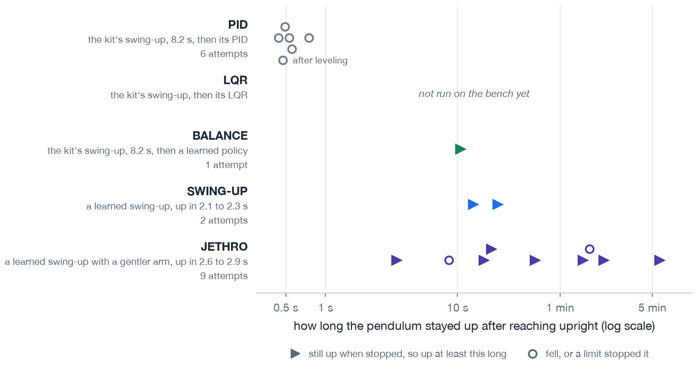

# Showcase training and bench notes

Log of the tame ladder behind Jethro and of the carousel's bench session. The [write-up](./writeup.md) describes the carousel.

## The tame ladder

Each rung fine-tunes a policy with heavier penalties on arm travel and arm speed than [Experiment 06](../06-swing-up/writeup.md). Every run uses Experiment 06's swing-up configuration except where its row says otherwise, and [`config.yaml`](./config.yaml) lists that experiment's penalty weights and the benchmark targets. The Start column names the checkpoint a rung begins from. a60d is the actor of [Experiment 05](../05-balance/writeup.md)'s a60d balance policy, r7-smooth is Experiment 06's full checkpoint of the same seed, with its critic and optimizer state, and tame-f is the rung below.

| Rung | Start | Iterations | Settings | Seeds | Success | Peak arm travel | Peak arm speed |
|---|---|---|---|---|---|---|---|
| tame-a | a60d | 600 | travel -2.0 past 0.25 rad, arm speed -0.05 | 1, 2, 3 | 1.000, 0.594, 1.000 | 2.17, 3.14, 3.04 rad | 11.15, 13.01, 9.58 rad/s |
| tame-b | a60d | 600 | travel -5.0 past 0.15 rad, arm speed -0.1, command change -1.0 | 1 | 0.004 | 0.84 rad | 6.00 rad/s |
| tame-c | a60d | 600 | tame-a's, travel termination 1.6 rad in training and evaluation | 1 | 0.516 | 1.60 rad | 15.48 rad/s |
| tame-d | a60d | 600 | tame-b's, command change -0.5 | 1 | 0.000 | 0.99 rad | 5.86 rad/s |
| tame-e | a60d | 600 | tame-b's, deadband 0.5 rad | 1, 2, 3 | 1.000, 0.000, 0.000 | 1.17 rad on seed 1 | 6.40 rad/s on seed 1 |
| tame-f | r7-smooth | 400 | tame-e's | 3, 2, 1 | 1.000 on all three | 2.04, 1.86, 1.84 rad | 10.36, 8.74, 10.22 rad/s |
| tame-g | r7-smooth | 150, then 250 | travel -1.6, arm speed -0.032, command change -0.7, then tame-e's | 3 | 1.000 | 2.25 rad | 10.99 rad/s |
| tame-h | tame-f | 200 | tame-e's | 3 | 1.000 | 1.47 rad | 10.74 rad/s |
| tame-i | tame-f | 300 | tame-e's, arm speed -0.4, travel termination 1.5 rad | 3 | 1.000 | 1.15 rad | 8.17 rad/s |
| tame-j | tame-f | 300 | tame-e's, arm speed -0.4, travel -10.0 | 3 | 1.000 | 1.52 rad | 6.34 rad/s |
| tame-k | tame-f | 300 | tame-e's, arm speed -0.4, travel -10.0, travel termination 1.5 rad | 3, 2, 1 | 1.000 on all three | 1.62, 1.13, 1.88 rad | 6.52, 5.26, 7.09 rad/s |

Success is the fraction of 256 benchmark episodes that end inside 3 degrees of upright for their last 5 s with no travel termination. Each peak is the maximum over those episodes. tame-b reaches vertical from all 256 starts but holds from only 1. tame-d never reaches vertical. On tame-e, seed 2 never reaches vertical, and seed 3 reaches it from every start but never holds.

Every result is a row of [`simulation/benchmark.csv`](./simulation/benchmark.csv). The seed 1 rows of tame-a to tame-e are added to it on 2026-09-26, copied from the training host's result files. The same day, `scripts/host/drive_tame07r9.ps1` scores tame-f's seeds 1 and 2, which trained as tame-k's first stage.

tame-e on seed 1 and tame-k on seed 2 clear every benchmark target. Neither recipe does on its other seeds. Jethro is tame-i on seed 3, which misses the 8.0 rad/s arm speed target by 0.17 rad/s and is the policy bench session 1 runs.

The header of each rung's driver script, `scripts/host/drive_tame07r1.ps1` to `drive_tame07r9.ps1`, records why that rung was run. From the training host's project directory, the commands below train tame-f and tame-k on seed 1 and benchmark tame-k. Seeds 2 and 3 use the same commands with the seed number changed.

```powershell
$env:PYTHONPATH = "src"
& $env:USERPROFILE\Code\isaac\.venv\Scripts\python.exe -u scripts\train.py --headless --task Furuta-SwingUp-Direct-v0 --num-envs 1024 --physics-hz 4000 --accel-bound 60 --rotor-travel-deadband 0.5 --pendulum-rate-weight -0.0096 --gamma 0.999 --episode-length-s 10 --episode-jitter 0.2 --no-value-clip --max-rotor-rad 3.1416 --travel-weight -5.0 --rotor-rate-weight -0.1 --action-rate-weight -1.0 --max-iterations 400 --seed 1 --init-from docs\experiments\06-swing-up\checkpoints\swingup_r7_smooth_seed1_model_599.pt --run-name tame-f-seed1
& $env:USERPROFILE\Code\isaac\.venv\Scripts\python.exe -u scripts\train.py --headless --task Furuta-SwingUp-Direct-v0 --num-envs 1024 --physics-hz 4000 --accel-bound 60 --rotor-travel-deadband 0.5 --pendulum-rate-weight -0.0096 --gamma 0.999 --episode-length-s 10 --episode-jitter 0.2 --no-value-clip --max-rotor-rad 1.5 --travel-weight -10.0 --rotor-rate-weight -0.4 --action-rate-weight -1.0 --max-iterations 300 --seed 1 --init-from logs\rsl_rl\furuta_swingup\tame-f-seed1\model_399.pt --run-name tame-k-seed1
& $env:USERPROFILE\Code\isaac\.venv\Scripts\python.exe -u scripts\evaluate_swingup.py --headless --physics-hz 4000 --accel-bound 60 --num-envs 256 --seed 1 --checkpoint logs\rsl_rl\furuta_swingup\tame-k-seed1\model_299.pt --out results\tame07r_tame-k-seed1.csv
```

## Bench session 1, 2026-09-13

The board runs the 13-entry image recorded in [`config.yaml`](./config.yaml). Every number is a single sample from one unit. The display comes up at every boot.

JETHRO swings up in 2.6 to 2.9 s on all nine attempts that print a result line. Seven end at the button, after holds of 336, 127, 88, 38, 18, 16, and 3.4 s (`hardware/showcase_20260913_pid_diagnosis.tsv:199`, `hardware/showcase_20260913.tsv:7491`, `hardware/showcase_20260913.tsv:7653`, `hardware/showcase_20260913_level_base.tsv:1882`, `hardware/showcase_20260913.tsv:6`, `hardware/showcase_20260913.tsv:2196`, `hardware/showcase_20260913.tsv:108`). Two end on the fall stop: one after a 99 s hold with three passes over the top (`hardware/showcase_20260913.tsv:78`), and one after 8.6 s, probably knocked during leveling (`hardware/showcase_20260913_level_base.tsv:33`). SWING-UP holds 20 s and 13 s before the button (`hardware/showcase_20260913.tsv:147`, `hardware/showcase_20260913.tsv:5166`), and BALANCE holds 10.4 s after catching the firmware's swing-up (`hardware/showcase_20260913.tsv:3393`). NEAR MISS hits the fall stop 3.05 s in (`hardware/showcase_20260913.tsv:5187`). The other learned entries, and STOCK (since removed), have no attempt on record.

PID falls within a second of the handover on all six attempts. Four end on the firmware's pendulum limit (`hardware/showcase_20260913.tsv:7507`, `hardware/showcase_20260913_pid_diagnosis.tsv:2491`, `hardware/showcase_20260913_pid_diagnosis.tsv:2901`, `hardware/showcase_20260913_level_base.tsv:4188`) and two on its arm limit (`hardware/showcase_20260913.tsv:26`, `hardware/showcase_20260913.tsv:9721`). The base stand is found tilted and leveled mid-session, and the one PID attempt after leveling still falls, 475 ms after the handover (`hardware/showcase_20260913_level_base.tsv:4190`). An attempt on the image that recorded [Experiment 03](../03-hardware-bringup/writeup.md)'s golden trace also ends on the pendulum limit, about 1.1 s after the handover (`hardware/showcase_20260913_sept4_image.tsv:950`). The cause is open.



*One marker per attempt, all from one evening on one unit, each a single sample. A filled triangle was still up when the attempt was stopped. A hollow circle fell or hit a limit. A PID attempt's time is how long the firmware's loop ran before one of its limits stopped it.*

In the three PID attempts that log the firmware's per-cycle report, every control period is within 7 microseconds of 2.000 ms. The exception is the last ten cycles of one attempt, which run 32 to 86 microseconds late with the pendulum past 90 degrees (`hardware/showcase_20260913_pid_diagnosis.tsv:2891` to `:2900`).

Early in the session, each attempt printed its RAM log before its result and the return move, and the board looked hung for several seconds after every stop (`hardware/showcase_20260913.tsv:212` to `:2196`). The fall stop also ended attempts whenever the pendulum passed over the top, which cut NEAR MISS short. Mid-session, the log moves to after the return move (`hardware/showcase_20260913.tsv:7646` to `:7653`), and passes over the top no longer end a swing-up entry. The `RL STOP` line reports 32158 ms for the 339 s attempt with the 336 s hold, because its cycle counter wraps every 51 s (`hardware/showcase_20260913_pid_diagnosis.tsv:192`).
