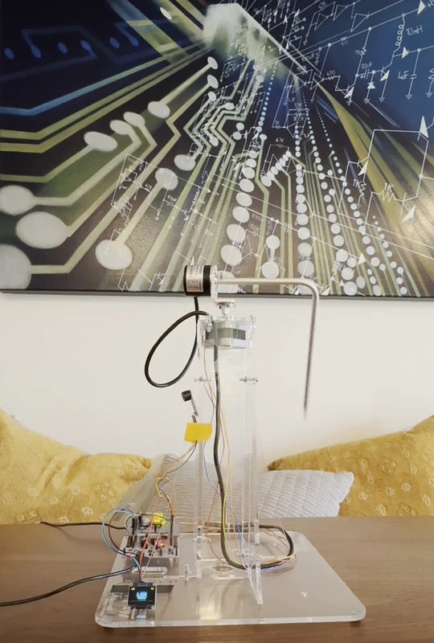
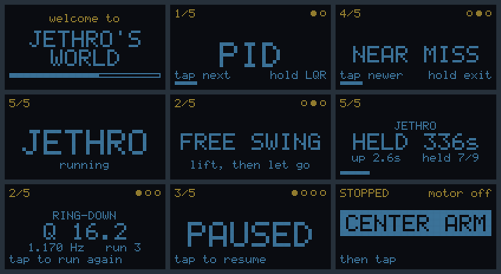

# Experiment 07: the showcase carousel

## Goal

[Milestone 07](../../milestones/M7-wrap-up.md) asks for an LQR mode and some personality. This experiment adds a display and a buzzer to the board, and a firmware carousel of the project's controllers that the Nucleo's blue button cycles through. It also names the unit Jethro, inspired by a late coworker.

## Setup

The unit and firmware interface are unchanged from [Experiment 06](../06-swing-up/writeup.md). The showcase runs as firmware mode `x`, described in the [firmware runbook](../../runbooks/edukit-firmware.md#mode-x-the-showcase-carousel), and plays the entries listed in [`config/showcase.yaml`](../../../config/showcase.yaml). [`config.yaml`](./config.yaml) records the build.

## The work

### Display and buzzer

The display, an SSD1306 128×64 OLED, and a passive buzzer plug into the IHM01A1 driver shield's stacking sockets, as the [assembly runbook](../../runbooks/edukit-assembly.md#showcase-display-and-buzzer) lists. The carousel runs without either. The display shows the selected entry and each attempt's result, and the buzzer sounds on selections, catches, and falls.

| Right header | Left header |
|---|---|
|  |  |

### The carousel

A tap moves to the next primary mode, and a one-second hold opens its submodes.

| # | Primary mode | Submodes | Experiment |
|---|---|---|---|
| 1 | PID | LQR | [Experiment 03](../03-hardware-bringup/writeup.md) |
| 2 | RING-DOWN | FREE SWING, TILT SWEEP | [Experiment 04](../04-model-reconciliation/writeup.md) |
| 3 | BALANCE | 1ST CATCH, WANDERING, SHAKY HOLD | [Experiment 05](../05-balance/writeup.md) |
| 4 | SWING-UP | NEAR MISS, FIRST HOLD | [Experiment 06](../06-swing-up/writeup.md) |
| 5 | JETHRO | none | [Experiment 07](#jethro) |

LQR, a linear quadratic regulator, was added as a submode of PID. It runs after the same swing-up. PID corrects the pendulum and arm angles in separate loops, while LQR reads both angles and their rates together and corrects all four through one set of gains. Both controllers ship in the Edukit firmware, and LQR's gains come unchanged from the Edukit Manual (Section 14, page 84). [PID and LQR on the rotary inverted pendulum](../../design/pid-and-lqr.md) explains both.

*LQR on the bench: the end of the swing-up, the catch, and the hold.*

The following are the display's screens for the above modes:

*Carousel screens across the modes.*

### Jethro

The goal for Jethro is a tame swing-up. [Experiment 06](../06-swing-up/writeup.md)'s swing-up works, but it swings the arm hard to get the pendulum balanced as fast as possible, up to 15.1 rad/s in simulation. That is too rough to leave running unattended. This experiment fine-tunes it with heavier penalties on how far and fast the arm moves.

#### Reward updates

Each penalty is subtracted from the reward every step, so a larger weight makes that motion more costly to the learned policy:

| Reward term | Experiment 06 | Jethro |
|---|---|---|
| Arm travel past 0.5 rad from center | -0.5 | -5.0 |
| Arm speed, squared | -0.01 | -0.4 |
| Change in command between steps | -0.5 | -1.0 |

#### Termination updates

An episode ends when the arm swings past 1.5 rad from center, down from pi rad in [Experiment 06](../06-swing-up/writeup.md).

#### Results

Jethro is fine-tuned from [Experiment 06](../06-swing-up/writeup.md)'s policy in two steps. The first raises the penalties, with arm speed at -0.1. That policy still swings up every time but stays too fast, peaking at 10.4 rad/s. The swing-up lasts only a second or two of each 10 s episode, so a per-step penalty on its strokes barely registers in the total. The second step makes those strokes costlier: it raises the arm speed penalty to -0.4 and adds the 1.5 rad termination.

The result is a gentler swing-up. In simulation it succeeds from all 256 hanging starts, but the arm now stays within 1.15 rad of center and tops out at 8.17 rad/s, about half the old 15.1 rad/s. The smaller, slower strokes add 1.5 s to the swing-up, which now takes a median of 2.97 s.

<table>
  <tr>
    <th width="50%">Experiment 06's final swing-up</th>
    <th width="50%">Jethro</th>
  </tr>
  <tr>
    <td></td>
    <td></td>
  </tr>
</table>

*Both on the bench, swinging up from rest.*

## Takeaway

The main takeaway is how easily a trained policy can be fine-tuned for whatever it needs to optimize. Change the reward, fine-tune for a few hundred iterations, and it picks up the new behavior while keeping what it already knew. Jethro kept [Experiment 06](../06-swing-up/writeup.md)'s reliable swing-up but learned to move the arm at half the speed, for 1.5 s more swing-up time. The same approach could aim for a faster swing-up instead, or anything else the reward can describe. That flexibility is one of the strengths of a learned controller.

## References

- [Milestone 07](../../milestones/M7-wrap-up.md): milestone definition.
- [Experiment 03](../03-hardware-bringup/writeup.md): PID.
- [Experiment 04](../04-model-reconciliation/writeup.md): the ring-down test.
- [Experiment 05](../05-balance/writeup.md): the balance policies.
- [Experiment 06](../06-swing-up/writeup.md): the swing-up policies, and Jethro's starting point.
- [PID and LQR on the rotary inverted pendulum](../../design/pid-and-lqr.md): the classical controllers.
- [Assembly runbook](../../runbooks/edukit-assembly.md#showcase-display-and-buzzer): display and buzzer wiring.
- [Firmware runbook](../../runbooks/edukit-firmware.md#mode-x-the-showcase-carousel): running the carousel.
- [Checkpoints](./checkpoints/README.md): the Jethro checkpoint.
- [Logbook](./logbook.md): the tame ladder and the bench session.
- Edukit manual, `docs/reference/Edukit_Manual.pdf` via `scripts/fetch_reference_docs.sh`: Section 14, page 84, for the LQR gains.
