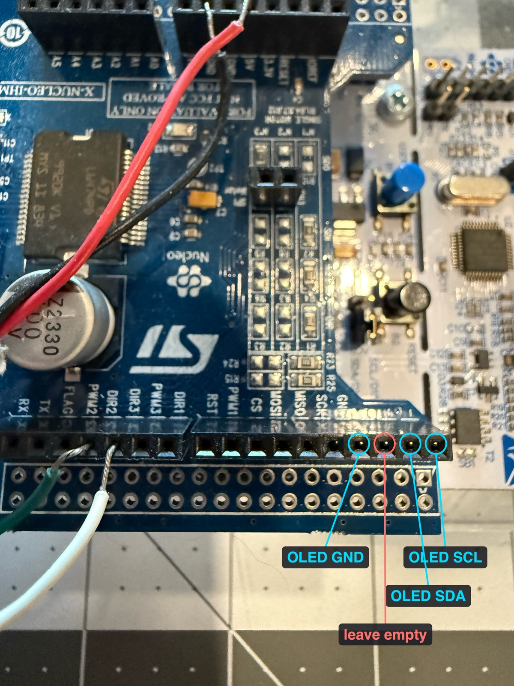
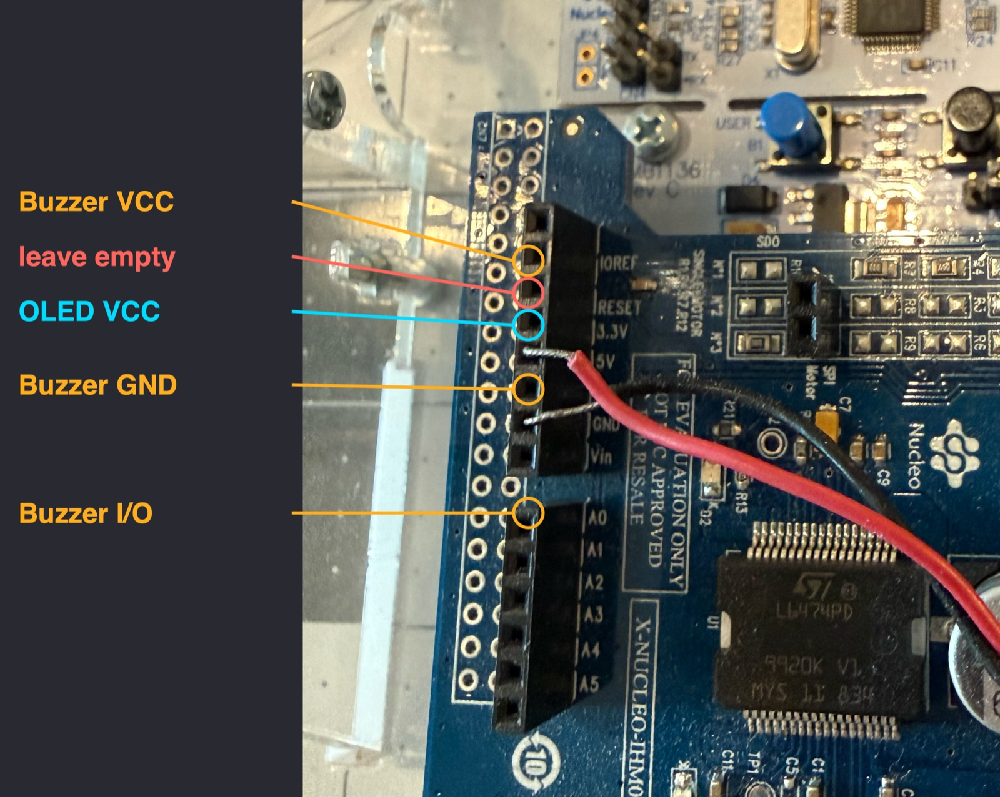

# Edukit assembly

The kit provides no printed documentation, relying entirely on video walkthroughs cataloged in Manual Section 1. The videos serve as the sole source for encoder wiring specifications, as reference pack schematics omit lead pinouts. The documented assembly sequence details the solderless build configuration utilized for the project, linking each stage to the corresponding video source. Video references verified 2026-08-23.

Consult [edukit-firmware.md](edukit-firmware.md) for firmware flashing and runtime procedures.

## Frame and encoder, steps 1 to 10

Unpack and inventory components in steps [1](https://youtu.be/0meOVIx7N1M) and [2](https://youtu.be/gUSe4PwD93I), verifying fastener counts against [the bill of materials](../design-inputs/bom.md) in step [3](https://youtu.be/Mix6ypv3_9k).

| Fastener | Qty | Use |
|---|---|---|
| M3 x 16 mm pan head, with M3 hex nut | 19 each | General frame assembly |
| M3 x 10 mm pan head | 4 | Motor support |
| M3 x 8 mm pan head | 3 | Rotary encoder |
| M2.5 x 6 mm pan head | 4 | L-bracket |
| M3 x 6 mm set screw | 2 | Shaft couplings |

Parts correspond to ST BOM v2 line items 6 to 9 and 20 to 22, along with three standoffs, and four rubber grommets.

Assemble the support tower from four vertical struts in step [4](https://youtu.be/MxSs33k4FxM). Fasten the Nucleo platform to the baseplate in step [5](https://youtu.be/FV42xqJDJCU), and mount the stepper motor bracket to the tower in step [6](https://youtu.be/Xr47u1rKld8).

**Measure the rotor arm prior to step 7.** Rigid-body equations of motion require the sweep radius of the pendulum pivot rather than overall arm casting length. Manual Table 2 quotes 0.14 m for the complete physical part. The pivot axis sits 25.5 mm inboard, establishing a true moment arm of **0.1145 m**. Enclosing the assembly inside the encoder housing obscures the measurement datum, causing subsequent caliper checks to under-read by approximately 3.5 mm. [Experiment 03](../experiments/03-hardware-bringup/writeup.md) details the physical measurement protocol, while `config/edukit.yaml` stores the validated parameter.

Mount the encoder bracket to the shaft coupling in step [7](https://youtu.be/wRVLRFOLsKk), install the optical encoder onto the bracket in step [8](https://youtu.be/tDe5ZhxdriQ), seat the assembled bracket on the motor shaft in step [9](https://youtu.be/zsis9pTEHMA), and join the tower structure to the baseplate in step [10](https://youtu.be/dyKNGgI_p1A).

## Electronics and wiring

Solderless assembly routes motor leads, power supply connections, and signal channels through a four-station screw terminal block using male-to-male jumper leads.

Step [11](https://youtu.be/bhhw-CBYqBQ) covers shield stack placement and cable routing. Motor driver connections follow in video step [12](https://youtu.be/SVQJFX1-22g).

Prepare the motor leads as demonstrated in video step [15](https://youtu.be/VLsVsyIXWbE), titled step 16 in the YouTube video stream. Route power, motor, and signal lines directly into the terminal block.

### Encoder leads

The encoder cable bundles four color-coded conductors and a braided ground shield. Color coding maps as follows:

| Lead | Connects to |
|---|---|
| Red | 5 V |
| Black | GND |
| White | DIR3 |
| Green | DIR2 |
| Braid | shield, not connected |

Seat white and green conductors on the inner header rail, placing white first, followed immediately by green.

The step 17 YouTube title displays `DIR2 DIR2` due to an authoring typo. Reference narration confirms white connects to Direction 3 and green connects to Direction 2.

**DIR2 and DIR3 carry no native encoder designations.** The IHM01A1 shield supports three stacked motor controller boards. Board headers allocate direction lines and step clocks per motor slot: `DIR1/PWM1`, `DIR2/PWM2`, and `DIR3/PWM3`. The Edukit drives a single motor marked `SINGLE MOTOR`. Firmware repurposes the two spare driver slots as quadrature encoder inputs under legacy board labels.

### Showcase display and buzzer

Firmware [mode `x`](edukit-firmware.md#mode-x-the-showcase-carousel) uses an SSD1306 128x64 I2C display at address 0x3C (0x78 in 8-bit form) and a passive buzzer module. Both are optional. The firmware probes no other address, and a display strapped to 0x3D boots as `SHOWCASE oled absent`. Check the display's address jumper.

The IHM01A1 covers the Nucleo's own headers, and both modules plug into the shield's female stacking sockets with male-to-female jumper leads. Near the row ends, the socket labels sit behind the tall header and read one socket off. Count sockets from the end of the row instead, and check the count against the encoder leads in `DIR2` and `DIR3`.

| Module pin | Shield socket | Signal |
|---|---|---|
| Display VCC | `3.3V`, fourth socket from the top of the power header, the end away from the analog header | 3V3 |
| Display GND | `GND` on the SCK/MISO header, fourth socket from its Nucleo end, after the empty AREF | GND |
| Display SCL | last socket at the Nucleo end of that header | PB8 (D15), I2C1 |
| Display SDA | second from that end. The third, AREF, stays empty | PB9 (D14), I2C1 |
| Buzzer I/O | `A0`, first socket of the analog header, next to the power header | PA0 (A0), TIM5 |
| Buzzer GND | the free `GND` between the kit's red and black leads | GND |
| Buzzer VCC | `IOREF`, second socket from the top of the power header, 3.3 V on this Nucleo. The third, RESET, stays empty | 3V3 |

Keep the buzzer on 3.3 V. The module's driver type is unknown, and a PNP driver powered from 5 V never turns fully off from a 3.3 V pin. The supplied firmware and the IHM01A1 use none of these pins. `board/showcase_port.h` lists the same pins.

| Right header | Left header |
|---|---|
|  |  |

## Final assembly, steps 19 to 23

Stack the IHM01A1 driver shield onto the Nucleo baseboard in step [19](https://youtu.be/hYXkdnByJaE), dress header cables in step [20](https://youtu.be/GMteZB7qzlY), and attach the programming USB cable in step [21](https://youtu.be/VgMReqATafk).

**Record masses for pendulum components before step 22.** The carbon tube and brass counterweight, ST BOM v2 items 19 and 23, detach only prior to final installation. Subsequent disassembly requires pulling the pivot bearing. Configuration file `config/edukit.yaml` records component masses measured during unit construction. Logging distinct component masses bounds dynamic divergence from the uniform-rod approximation in the manual.

Fasten the pendulum to the encoder hub in step [22](https://youtu.be/nXJLYx9tR4M) and install rubber mounting feet on the baseplate in step [23](https://youtu.be/DJ2Se6L7miM).

## Verification checks after assembly

**Encoder rotation direction.** Observing raw pulse counts alone proves insufficient, as a single functional channel still increments the counter without verifying phase. Direction verification requires validating signed angular deflection. Flash firmware mode `t` to verify quadrature phase through guided clockwise and counter-clockwise rotations.

**Baseplate leveling.** The frame rests on compliant rubber grommets. Mechanical tilt shifts the gravitational vertical datum across rotor positions. Full-circle calibration sweeps reveal **0.51 degrees** of structural inclination, exceeding acceptable assumptions of level geometry while remaining compensable in firmware. Earlier half-turn calibration passes showed 0.98 degrees. [Experiment 03](../experiments/03-hardware-bringup/writeup.md) documents both measurement series. Firmware mode `y` sweeps rotor positions and logs settling angles automatically.

**Physical geometry verification.** Physical rotor radius and pendulum length on the assembled hardware diverge from idealized manual specifications and resist direct measurement once assembled. Parameter definitions in `config/edukit.yaml` reflect direct pre-assembly measurements obtained via the procedures in [Experiment 03](../experiments/03-hardware-bringup/writeup.md).
